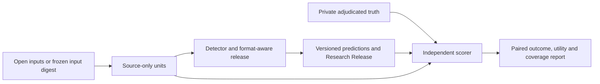
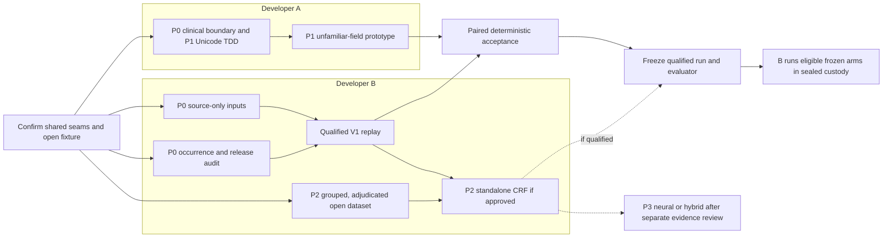

# Secret Wards generalization engineering specification

**First slices authorized.** Broader detector adoption, model work and performance thresholds remain subject to their evidence gates. This is the team addendum to the [organizer submission contract](SPEC.md). It updates the evaluation, deterministic detection and data sections of the [development plan](development-plan.md). The organizer interface, release policy decisions outside this scope and historical benchmark evidence retain their existing authority. The supporting research remains in the [generalization investigation](research/generalization-and-regularization.md) and [solution plan](research/generalization-solution-plan.md).

## Problem statement

Developer A needs to improve privacy on unfamiliar fields and layouts without damaging adjacent clinical content. Developer B needs to produce evidence the team can use to select changes and compare detectors. The current evaluation can feed annotation-derived roles to the detector, miscount repeated occurrences, and credit preservation of the wrong occurrence. High scores on familiar synthetic records cannot resolve those problems.

## Solution

Qualify independent evaluation first and compare a pinned baseline against small deterministic changes. Agree on one source-only input and finding contract so evaluation, detector work and dataset review can proceed independently. Use existing output formats and the existing export policy. Introduce a small learned comparator only after evaluation and training data are ready.

### Decisions and uncertainties

| Status | Decision or risk |
| --- | --- |
| Set by the current request | Evaluation integrity gates end-to-end performance claims and tuning. Developer A can fix confirmed defects and run component tests while Developer B builds that evidence. Preserve the organizer contract, V1, historical results and the 600-record sealed set. |
| Set by the current request | The first learned baseline is an independent L2-regularized CRF. Readiness must be demonstrated before training. Neural dropout and hybrid work are conditional. |
| Proposed for approval | Exercise two public seams. The source-input-to-prediction-and-score workflow verifies truth separation, counters and role-aware alignment. The existing input-directory-to-Research Release CLI verifies real edits, file accounting and utility. Use the detector callable for focused original-offset assertions within the same finding contract. |
| Proposed for approval | Qualify role-aware release scoring with independently parsed, context-anchored outcomes. Report ambiguous repeated occurrences as unresolved. Consider a verified private edit mapping if representative open fixtures show that alignment limits meaningful coverage. |
| Decision after evidence | The benefit of column-neighborhood evidence, section inference and label-independent candidates is unmeasured. Test each against misleading headings and protected clinical controls before widening production behavior. |
| Delivery risk | V1 does not emit the newer role-aware prediction fields. Replay its original release through the corrected audit. Where the historical detector has observable findings, map them through a versioned adapter. Publish unavailable spans or roles explicitly. Adjudication capacity and access to pinned offline FHIR tooling may limit qualification. |

## User stories

1. As an evaluator, I want detector inputs to be invariant to truth changes, so that results reflect what the detector can infer at runtime.
2. As an annotator, I want repeated surfaces to have distinct occurrence IDs, roles and original locations, so that removing one occurrence does not earn credit for editing another.
3. As a developer, I want exact typed spans and one-to-one partial diagnostics, so that missed entities and bad boundaries remain visible.
4. As an evaluator, I want unreviewed predictions and incomplete scans to be recorded, so that missing evidence does not become a false positive or a true negative.
5. As a clinician reviewing the release, I want names removed without changing doses, units or follow-up intervals, so that the records remain useful.
6. As a reviewer, I want file, record and occurrence denominators alongside rejection reasons, so that dropping difficult cases cannot improve the reported result.
7. As Developer A, I want a stable finding contract and open fixtures, so that I can fix verified defects while the evaluator is being repaired.
8. As Developer B, I want to replay the historical versions independently, so that score changes can be attributed to the evaluator or the detector.
9. As a dataset steward, I want grouped, reproducible splits and separate identity novelty measures, so that name, layout and script transfer can be distinguished.
10. As the sealed-set owner, I want access limited to an independent frozen runner, so that candidate selection cannot consume the test.
11. As a model developer, I want an independent CRF that can emit spans outside the rule candidate set, so that its recall is measured fairly.
12. As a maintainer, I want separate qualified standalone outcomes, so that hybrid complexity is justified by measurable complementary errors.

## Implementation decisions

### Contracts and module boundaries

- **Source Unit.** Include an opaque stable input identity and unit locator, record locator or file-level channel, source format, parse status, immutable original decoded text or typed scalar, and observable input context. Distinguish physical input files that share a hash. Use whole-value targets for typed scalars and half-open Unicode code-point ranges for text. Paths, column labels, neighboring fields and resource types may be derived from input. Role annotations, expected edits and the set of scored occurrences stay in evaluator custody.
- **Detection snapshot.** Bind the input inventory and variant/configuration digest to findings. Each finding carries unit identity, original target, category, role when supported, disposition and controlled reason or score where available. Complete, empty and incomplete units have distinct outcomes. Keep raw values and truth out of the snapshot. Pin any coordinates for decoded attachments and validate their representation.
- **Release and truth.** Keep the current CLI and organizer artifacts. The independent auditor verifies serialized output, its ledger and mapped record/source locations. It owns occurrence annotations and protection facts. It checks file reuse, orphan files, invalid dispositions, path containment, mapped output locators and metadata-only index behavior. Exact index coverage and organizer longest-locator linkage are separate measures. Share neutral types and existing format utilities where practical. The evaluator does not import recognizers or consult their decisions to grade release success.

### Evaluator and pinned replay

- Enumerate supported units from inputs before opening truth. Run the predictor with truth absent. Renaming, mutating or replacing annotations must leave the same byte-for-byte source inventory and prediction digest for a deterministic run.
- Exact matches require source location, boundaries, category and role for the role-aware metric. Score partial matches one-to-one by typed overlap. A wide prediction can cover at most one gold occurrence in the partial count. Validate ranges and track overlong findings and protected overlap independently. Use exhaustively adjudicated scope or individually reviewed predictions for precision. Use an explicitly defined exhaustive negative universe for false-positive rate. Report unsupported roles, partial annotation and incomplete units separately.
- Count fully transformed, partly visible, visible, unresolved and unexported occurrences using mapped output context. Preserve repeated identical occurrences as distinct facts. Audit exact clinical values and task facts, such as dose plus unit and frequency. Report input and released denominators for files, records, Scoring Units, identifier labels and protected facts. Quarantined or suppressed content receives no successful-release or clinical-preservation credit. Retain linkage, date and age checks where fixture truth supports them.
- Replay `095c854` on frozen open inputs and score the outputs with the corrected evaluator. Retain the original literal reports and publish a reconciliation of changes in support, alignment, outcomes and treatment of incomplete units. Replay `d8973ab` separately when assessing the current runtime because it contains an additional FHIR date guard. Compare future candidates on the identical input, truth, release policy and scorer. Publish digests, scope and resource conditions. Corrected counts can differ from historical counts without a runtime behavior change.

### Deterministic changes

- **Direct TDD fixes.** Reproduce the non-breaking-space miss for a known note label. Normalize a comparison view, map the result back to original coordinates and keep the emitted clinical text outside accepted ranges byte-for-byte at the decoded value level. Reproduce the name-and-dose over-redaction and stop the candidate at the independently expected name boundary. Confirm no unwanted deletion in the corresponding clinician/relative, medication and punctuation controls. These two confirmed bugs use component-level red–green tests and a CLI regression each.
- **Isolated prototypes.** Run one unfamiliar-field comparison with typed FHIR paths, neighboring fields and value shape as corroborating evidence. Include unknown, misleading and protected clinical controls. Test optional context or dictionary cues one at a time and keep field aliases as a small evidence source. Test conflict and overlap policy only where examples expose an ambiguity beyond the confirmed boundary bug. Keep original spans and trace reasons within the finding seam. Trial broad compatibility normalization, cross-field role inference or schema-independent detection only on reviewed positives and hard negatives before adopting the technique.
- **Shared controls.** Keep format-specific parsing and validation in the adapters. Do not widen transformations to new structured fields without covered output validation. Preserve a complete Research Release or explicitly account for quarantine and suppression under the existing policy.

### Dataset and learned baseline

- B versions open fixtures independently of runtime, preserving the current corpus and separate sealed custody. Balance independently authored layouts, scripts, entity categories, protected hard negatives and same-surface role flips. Separate exact name, surname or initials novelty from layout novelty and report compositional slices. Keep connected patients, institutions, template/file families and near-duplicate ancestry within one split. Derive and verify manifests from reproducible seeds and authoring provenance. Do not open or modify the sealed 600. The sealed owner runs a single frozen comparison and shares aggregates only.
- Start with one matched-count, matched-review-budget comparison of familiar versus independent layouts and identity pools. Add protected negatives and extra diversity arms only where they answer a measured failure. Adjudicators review complete Scoring Units in the target subset, including unrecognized sensitive spans and ordinary negative controls. Version ambiguous cases and their decision history. Reserve validation for threshold selection. Record any validation unit used to refine rules as development material.
- After readiness, train a CPU-only linear-chain CRF on versioned adjudicated development sequences. Use BIO labels and a stable Unicode tokenizer with reversible original offsets. Define flat-span training policy before fitting and retain ambiguous or nested gold for separate reporting. Use character n-grams and affixes, token shape, script, capitalization, digits and punctuation, contextual windows, output-independent structural cues, and scoped clinical or identifier-shape signals. Exclude truth-derived roles and trace artifacts. Keep L1 disabled in the initial L2 comparison. The proposed CRFsuite grid uses a weak control of `c2=0.0001` and candidates `0.01, 0.1, 1, 10`. Pin the coefficient grid and feature limits before the comparison, then select on grouped development folds. Separately ablate lexical, structural and clinical feature groups. Report seen/unseen vocabulary, exact and partial spans, role support, release utility, p50/p95 CPU latency, throughput, resident memory and model size. Freeze the selected candidate before any sealed run.
- A future hybrid can compare a simple category-level gate after the standalone release results. Calibration is separate for each compatible score and fitted on grouped validation support. A deterministic Detection Score has no probability semantics by default.

## Testing decisions and acceptance

Use fixtures through the proposed two public seams and reuse existing CLI and scoring tests. Use the detector callable for original-range assertions that the CLI alone cannot expose.

| Regression or gate | Required observable result |
| --- | --- |
| Truth supplied, mutated or absent | Identical source-only input inventory, serialization and digests. No annotation roles, protected labels or truth-selected unit omissions. |
| Same name in protected and sensitive roles | Removing the protected occurrence while leaving the identifier reports one lost protected fact and one residual. Unalignable duplicates remain unresolved and in the denominator. |
| Partial, repeated and nested occurrences | A broad span earns at most one partial match. Report a partly retained identifying span separately from complete removal. Escaped pointers, decoded payloads and output locator shifts remain attributable or explicitly unresolved. |
| Unreviewed or incomplete unit | No false-positive or true-negative credit from missing adjudication or incomplete scans. Report both scored support and unscored coverage. |
| Corrupt, skipped, reused or quarantined artifact | Every input has one consistent disposition. No raw fallback, orphan artifact, inflated preservation or metadata-only Patient Record entry. Protect the organizer's valid format requirements and side channels. |
| Deterministic fixes and supported cases | The NBSP and adjacent-dose fixtures pass through the detector and release. There are zero newly failed paired clinical facts, silent skips, format failures, seeded Canary escapes or False Merges on the approved regression set. No supported coverage regression on the same target fixtures. |
| Comparison and resource gate | Reproduce V1 under the corrected methodology before a gain claim. Require targeted exact typed improvement on independently authored open cases with counts and grouped uncertainty. Agree the minimum worthwhile margin before any tuning. The earlier 10 percentage point figure remains provisional. Enforce the organizer's two CPU, 4,096 MB RSS and 900 second budget. |

## Out of scope

Production changes during spec approval, access to sealed inputs or annotations, changing the organizer's artifact contract, retuning the historical baselines, learned training before evidence readiness, and neural or hybrid implementation as part of the first delivery.

## Further notes and execution roadmap

The evaluator qualification and baseline replay gate candidate acceptance. They do not block A's confirmed component fixes once the public seams are approved. A owns the runtime and CLI tests. B owns evaluation, dataset fixtures, adjudication and sealed custody. Both review one shared fixture and finding example. The scope of the first independent comparison is an open change in field label or layout plus the verified Unicode and clinical-boundary regressions. Keep the release and linkage gates visible without bundling a general linkage rewrite into this iteration.

### Draft work packets for breakdown review

These are planning references. Existing implementation issues retain their GitHub IDs and owners. Runtime and evaluator slices can be agent-ready after the applicable contract is approved. Humans own adjudication, sealed custody and candidate acceptance. Publish new slices or wire dependencies after this specification and the ticket breakdown are approved.

| Priority and owner | End-to-end deliverable | Starts when | Acceptance and required verification | Initial effort |
| --- | --- | --- | --- | --- |
| P0 B · [Neutral source inventory](https://github.com/baymax-afk/scaler_hackthon/issues/21) | Generate a source-only snapshot consumable by either detector. Own benchmark source enumeration and snapshot tests. | Agreed fixture and digest seam. | CLI truth removal/mutation regression and checked file-level/record channel inventory. | 1–2 h |
| P0 B · [Occurrence scoring](https://github.com/baymax-afk/scaler_hackthon/issues/22) and [Artifact reconciliation](https://github.com/baymax-afk/scaler_hackthon/issues/23) | Report role-specific clinical damage and visible identifiers, plus verifiable file and record outcomes. Own scoring and release audit tests. | Start synthetic fixtures immediately. Integration uses neutral snapshots. | Same-surface, overlap, missing output and incomplete scan probes pass. Reuse [existing linkage locator work](https://github.com/baymax-afk/scaler_hackthon/issues/24) where needed. | 2–4 h initial |
| P0 A · Clinical boundary | Release one name-plus-dose document with only the name transformed. Own deterministic candidate and runtime tests. | Agreed release fixture. Does not wait for B's evaluator. | Red–green original-range test, CLI fact preservation and clinician/relative controls. | 1–2 h |
| P1 A · Unicode offsets | Fix the known NBSP cue without modifying neighboring text. Own comparison-view mapping and source-offset tests. | Agreed original-coordinate contract and open fixture. Does not wait for B's evaluator. | Original range and release checks pass. Equivalent formatting and protected neighbors remain intact. | 1–2 h |
| P1 A · Unfamiliar field roles | Demonstrate one unknown structured-field vertical slice through the CLI. Own the format-derived evidence and runtime test. | Open unseen-label fixtures and shared finding contract. Directional experiments can start alongside B. | Unknown and misleading label controls pass. Accept wider behavior only after the qualified paired release comparison. | 1–2 h initial |
| P0 joint, lead B · Pinned replay | Produce a corrected and reproducible V1/current comparison with explicit support. | Neutral snapshot and role/artifact audit qualify. | Same frozen inputs and caps, report/replay reconciled, original evidence retained. | 1–2 h |
| P2 B · Open diversity and labels | Deliver adjudicated open groups ready for independent training. Own corpus manifest, annotation and split QA. | Authoring starts from the shared fixture. Scoring requires qualified evaluator. | Compare matched efforts and publish overlap and slice support. Reuse [scenario QA](https://github.com/baymax-afk/scaler_hackthon/issues/26) and [near-duplicate QA](https://github.com/baymax-afk/scaler_hackthon/issues/27). Private sealed custody and independent adjudication require human ownership. | 3–6 h initial plus review |
| P2 B with A review · CRF | Compare an independently decoded learned detector through the common release and scoring seams. | Corrected evaluator, adjudicated labels and separate training approval. | Grouped validation, feature ablation, standalone outcomes and organizer CPU/RSS preflight. | 4–8 h plus labeling |
| P3 conditional · neural and hybrid | Compare only if a strong remaining error pattern or complementary errors justify it. | Qualified standalone results and human selection. | Separate comparison with unchanged release gates. No implementation issue is needed to decide today. | Re-estimate if selected |

The narrow delivery is the source-only path, occurrence and artifact qualification, the pinned replay and the two confirmed runtime fixes. If time permits, add the unfamiliar-field comparison before deciding whether more labels or another detector are justified.
