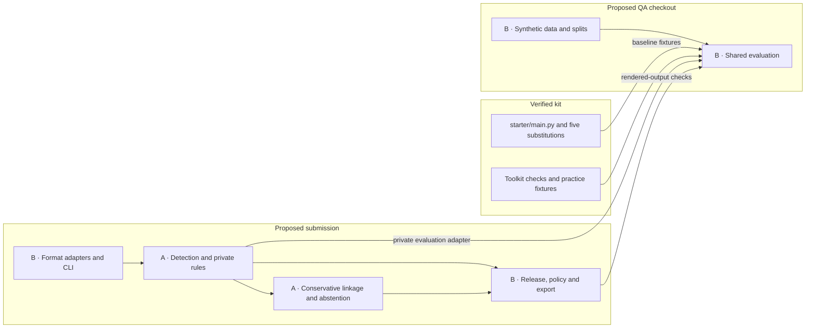
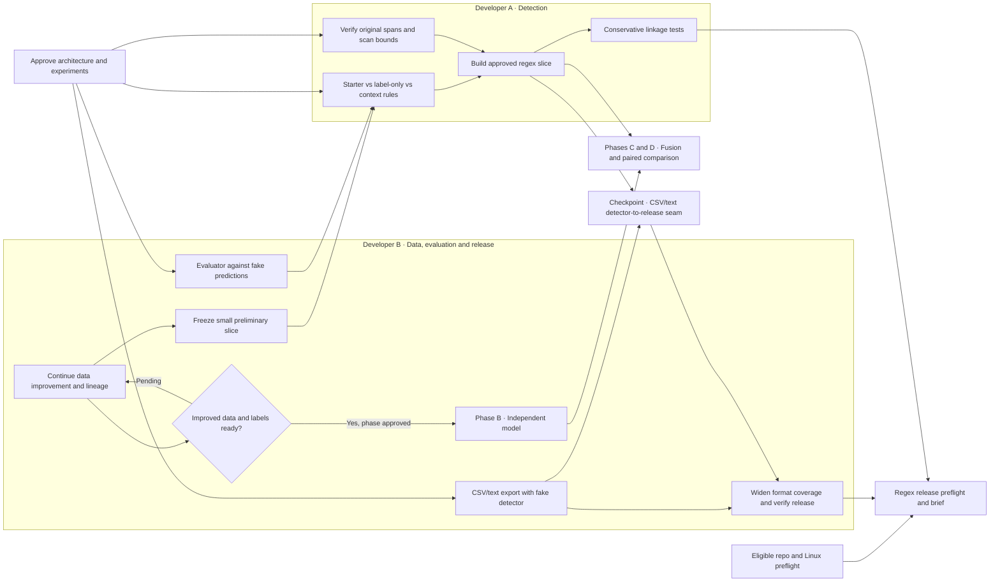
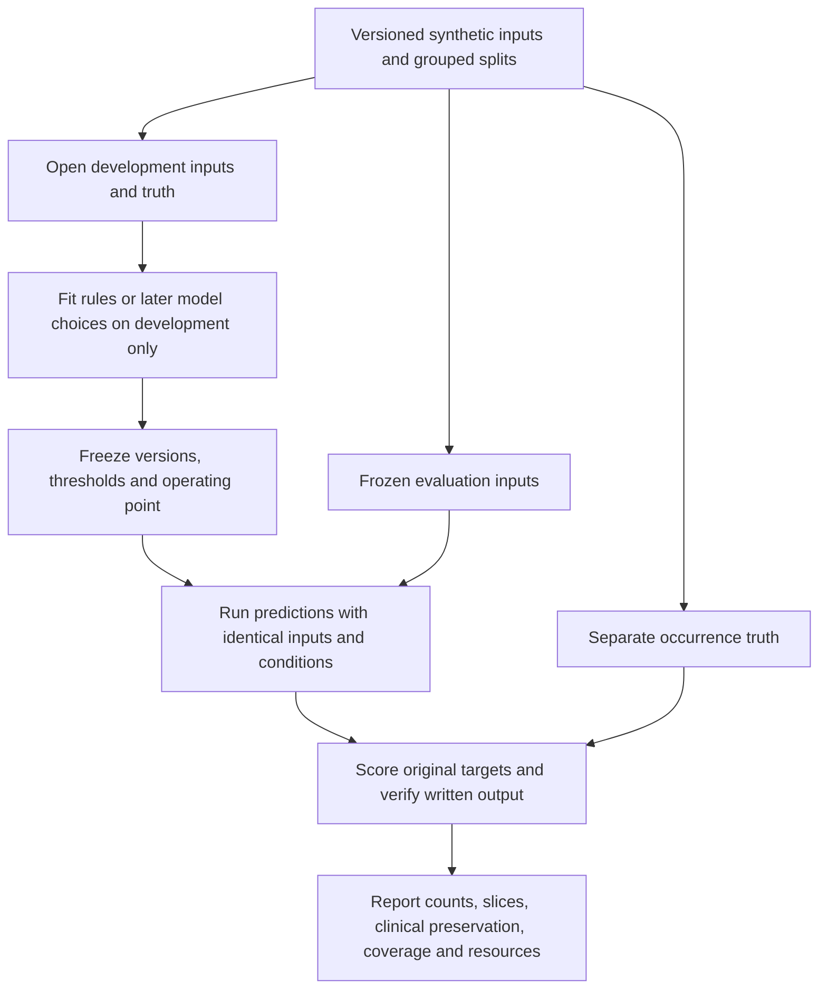
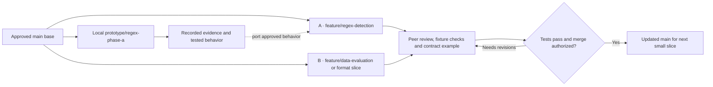
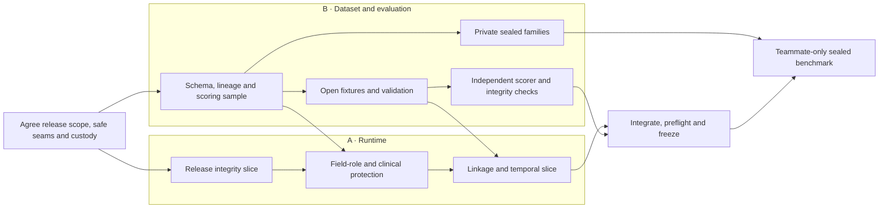

# Secret Wards development plan

**Draft for team approval.** Phase A develops the format-aware regex detector with existing synthetic inputs. Phase B evaluates an independent model after the improved dataset passes its readiness checks. Phase C tests score integration, and Phase D compares the three configurations. Phase A and the regex release path can reach completion during dataset improvement. The prior 24-person-hour budget and six-hour integration allowance are working assumptions. Confirm the remaining availability before committing scope. [Candidate pipelines](research/candidate-pipelines.md) · [Wayfinder](wayfinder.md)

## Existing code and proposed repository structure

The kit has a Python CLI at `starter/main.py`. Five regexes replace text in order. The CSV handler does not pass column context, and the JSON handler skips numeric scalars and treats FHIR like generic JSON. Linkage always abstains. The public checker measures surviving substrings over files, so it cannot establish occurrence-level precision or distinguish all patient and clinician uses of the same name. Preserve the public kit as the baseline harness. Both developers work on separate branches in this team repository. Keep submission code together so the team can put it at the root of the eligible repository once the destination is approved. [Starter](../starter/main.py) · [Toolkit overview](research/codebase-overview.md) · [Submission contract](SPEC.md) · [Repository eligibility decision](https://github.com/baymax-afk/scaler_hackthon/issues/14)

```text
Team repository/
  submission/                  proposed package staged for the judged repo root
    main.py, raksha.toml, config/
    rakshak/
      detection.py, rules.py    A, detector and private rules
      linkage.py                A, conservative linkage
      formats/, release.py      B, format handling and release
    tests/detection/            A, detector tests
    tests/release/              B, adapter and release tests
  dev/ and docs/datasets/       existing inputs and truth
  data/ and tests/data/         B, dataset preparation
  evaluation/                  B, shared evaluator and toolkit adapter
  tests/evaluation/             B, metric and split tests
  experiments/regex/           A, isolated prototype branch only
  models/                       B, Phase B when authorized
  docs/                         plan, handoff and evidence
```

`submission/` and `rakshak/` are proposed paths. A owns the detector and private rules. B is the proposed steward of format adapters, release integration, dataset preparation and evaluator. The production CLI and policy configuration have one editor at a time, initially B. A supplies conservative linkage or explicit abstention and linkage tests once the detector baseline is in hand. A and B review the source-coordinate examples together. The evaluator calls the detector from this checkout and joins predictions to QA truth offline. Package only runtime code, configuration and approved artifacts for the judged run, with `raksha.toml` at the destination root.



## Proposed interfaces

The detector exposes `detect(unit) -> DetectionResult`. Compile trusted rules once per run. Matching, normalization, context, local scoring and overlap handling stay inside the detection module. The runtime caller constructs a source unit and gets an ordered result suitable for planning edits. The evaluator can use the same callable or a neutral predictions adapter.

| Contract | Required meaning |
| --- | --- |
| Source unit | One original decoded note, structured scalar, header, key, metadata value or path component. Include a stable private unit ID, channel, format, original text where applicable and format-derived context such as a column label, JSON path, FHIR resource type, value kind, or nearby field labels. Keep IDs and exact file/record locators in the private adapter. Unit IDs distinguish physical inputs even when their SHA-256 hashes match. Adapters provide neutral structure and source context without supplying inferred detector labels. |
| Target | Text uses a nonempty half-open range of Unicode code points in the unit's original decoded text. Structured scalar findings may target the whole value and preserve its type tag. A numeric scalar may carry a comparison rendering for detection, but its identity and reconstruction belong to the format adapter. Neither range accesses bytes, JSON escape offsets, or offsets in a normalized string. Define one code-point coordinate system for annotation, the HTML demonstrator and Python. Browser indexing uses UTF-16 code units internally and needs an explicit conversion in the demo. |
| Finding | Unit ID, target, entity type, role where meaningful, disposition (`detect` or `review`), optional Detection Score and stable reason IDs. Scores are finite numbers in [0, 1]. In Phase A they rank evidence for an entity and role within the configured ruleset. They carry no probability interpretation. Scores may be absent for an independently supplied hard decision. Rule IDs, context reasons and counters are enough to diagnose failures without a copied match value. `review` flags unresolved concern. It never authorizes a release or edit. |
| Detection result | `complete` means the configured scan completed, including a valid empty result when no finding was emitted. `incomplete` carries a limited code such as `input_limit` or `unsafe_span_mapping`. A caller must treat every incomplete result as unresolved. Accepted findings are stable, exact duplicates are deduplicated, and accepted text ranges for edits cannot overlap. Retain ambiguous conflicts as review findings. Define a deterministic tie-break using evidence specificity, length only among comparable targets, then stable rule ID. Keep pre-resolution candidate counts or optional diagnostics private to the evaluator. |
| Prediction and truth join | The evaluator projects predictions to a versioned schema using the same source unit/target/type/role. The truth side adds positive, protected negative, other adjudicated negative, ambiguous and unannotated status as applicable, plus group/slice metadata in the manifest. Truth opens in evaluation only. Protected labels come from independent annotation and never become detector features. Held-out prediction snapshots, when needed, use opaque IDs and omit raw text and paths. Version the format once two real consumers need it. |
| Configuration and errors | Pin Python, rule revision and validated limits/thresholds in the run manifest. Keep rule tuning in detection and age/date policy in release configuration. A bad ruleset or invalid runtime configuration fails at startup. The adapter surfaces bad encoding, unsupported or malformed files and unsafe output rewrites via controlled reasons. Release handles per-file quarantine and incomplete publication or fatal I/O explicitly. Keep raw paths, text, secrets and arbitrary exception messages out of diagnostics and benchmark artifacts. |

The format adapter owns source enumeration, encodings, bounds and original locations. Release owns editing, collision checks, FHIR references, Patient Pseudonyms, quasi-identifier policy, output validation and the file ledger. Use the existing CLI shape and three artifacts. Test both roles through public interfaces on in-memory fixtures. Future model-only inference can consume the same neutral source units and emit findings without rule scores or rule proposals. Fusion can consume either arm's findings when the comparison is approved. See the comparator diagrams and operating points in the [candidate pipelines](research/candidate-pipelines.md#paired-comparative-evaluation).

For example, in the synthetic text `Dr. Mira spoke. S/o Mira`, the protected clinician occurrence is `[4, 8)` and the relative finding is `[20, 24)`. In a JSON number under a recognized local patient ID path, the target is the whole scalar, and the release module must preserve the JSON value type even when the comparison rendering looks like a string. These are draft interface examples for both workstreams.

## Workstreams and estimates

The tasks below are reviewable slices, with estimates in person-hours. A works on regex behavior while B owns dataset lineage and the evaluation harness through the full comparison. For the hackathon B also owns the first format and release slices. If B's dataset work uses all available time, A takes first release integration after the prototype or the team defers the less critical dataset tooling. Both developers can inspect and inventory existing assets now. Implementation tasks in the table start after approval, except B's already delegated dataset improvement.

| Task and owner | Owns and prerequisites | Deliverable, tests and acceptance | Effort and handoff |
| --- | --- | --- | --- |
| A1. Compare regex strategies and original spans | A, `experiments/regex/`. Approval. B's new dataset is independent. Use public practice plus small labeled tuning and reserved fixtures. | Throwaway browser walkthrough for scope, protection and overlaps. One Python CLI for the real engine comparison. Run the three ablations and the span and bounds probes. Record counts with denominators. | 2–3 h. Independent with synthetic examples. Consume B's frozen preliminary slice when available. |
| A2. Ship the qualified rule slice | A, detector, rules and detection tests. A1 verdict and shared-interface review. | Accept or review typed findings with deterministic positions. Test Hindi/Hinglish labels, clinician and relative collisions, protected clinical values, number formats, overlapping rules, blocked scans and repeated runs. | 3–4 h. Independent against approved fixture examples, then integrate with B's adapters. |
| A3. Preserve defensible identity continuity | A, linkage and its tests. Can develop in parallel on fixture findings after interface review. Needs export support to emit a pseudonym. | Issuer-scoped strong evidence, conflict tests, safe abstention and a repeatable linkage result. Report False Merges and Missed Links. A mismatched or unresolved record abstains. | 1–2 h for a narrow baseline; broader linkage depends on observed results. B integrates pseudonym placement where safe. |
| B1. Version synthetic data and isolate groups | B, `data/`, `tests/data/` and existing dataset docs. Start independently on the delegated dataset. | Version input/manifest hashes, schema and annotation guide. Group patients, physical duplicates and variants with original template/schema families. Split reproducibly and test that patient/template/file lineage does not cross the final holdout. Audit labels and positive/negative support. | 2–3 h for inspection, initial split and small preliminary slice. Improved corpus creation and full labels to estimate separately. A receives tuning cases and frozen inputs through the evaluator. |
| B2. Establish shared evaluation | B, `evaluation/` and `tests/evaluation/`. Can start independently from approved fixture examples using fake predictions. Needs B1 for the preliminary readout. | One runner with inputs, predictions and separate truth. Hand-check metric cases, duplicate/repeated occurrence joins, incomplete scans, slice counts and undefined denominators. Capture runtime configuration and provenance. | 1–2 h. A supplies one sample result and runs its own engine sample through the runner. |
| B3. Connect one format slice and establish preflight | B, adapters, CLI, release and release tests. Start from starter + fake detector after approval. Confirm eligible submission checkout and Linux runner separately. | CSV and text slice with an honest ledger. Check Unicode and delimiters, colliding filenames, fault accounting, clean clinical content, and byte-repeatable artifacts under the toolkit smoke check. Then add TSV, JSON and FHIR support and verify numeric precision and reference targets. | 3–5 h for starter reuse, the first slice and narrow format coverage. A2 connects at the first integration checkpoint. Remaining contract gaps determine final effort. |
| Joint release preflight and brief | A and B. Requires A2, B3, submission eligibility and a judge-like runner. Extend linkage and policy only within release gates. | Build from a clean checkout. Run format, leakage, retention, same-secret and secret-change checks. Record Linux resource measurements and known limitations. Prepare the two-page brief with measured evidence. | Reserve 6 h total. A verifies detection/preservation and reports results. B owns runner, artifacts and packaging. |
| B4. Independent model, later | B, `models/` and model tests. Improved versioned corpus, enough independent occurrence labels, grouped development support, extra time and Phase B go-ahead. | Frozen offline artifact and model-only predictions. Mock feature/label interfaces before dataset readiness if time remains. Validate grouped training, reproducibility, artifact metadata and representative latency on development. | Estimate after label audit. No training prerequisite for Phase A. |
| A4/B5. Fusion and paired comparison, later | A integrates behind the approved finding seam, B runs evaluation. Needs qualified Phase B predictions and split. | Compare simple gating or blend on grouped development, freeze decisions, then run the three arms once on the common holdout. Test rule silence, model silence, span conflicts and deterministic output. Adopt a change only if it beats the stronger standalone on agreed measures and clears clinical, privacy, linkage and resource gates. | Scope after the two standalone error analyses. Preserve the prior 90-person-minute optional follow-up limit until the team revisits it. |

The estimated regex, data/evaluation, release and preflight slices total 18–25 person-hours, excluding open-ended dataset improvement, optional follow-ups and later model work. Treat the top end as a scope signal. The critical detector path runs through approval, a frozen preliminary slice, A1, the A2/B3 interface checkpoint and preflight. The critical submission path also needs the eligible repository and Linux runner. If time is short, keep deterministic context rules with exact original spans and a basic reproducible evaluation. For the submission, focus on supported formats, safe accounting, exact clinical facts, and conservative linkage or abstention. Defer extra rule engines, gazetteers, anchor hints, attachment expansion and ML. A detector demonstration does not establish release readiness.



## Evaluation and checkpoints

1. **Agree on two source-unit examples and freeze a small preliminary slice.** Cover one structured value and one note with a repeated surface in two roles. Use the organizer practice material for open regressions. Surface labels and generated record truth can seed an annotation pass. Ambiguous occurrences require a location and role from review. A genuinely untouched independent slice needs novel patients and independently authored templates with lineage separated from tuning. B may create a small reserved slice from the current synthetic sources and independently authored edge cases while the improved corpus is pending. If only public or reviewed examples are ready, call the first run exploratory. Reserve the eventual improved holdout for the frozen A/B/C comparison.
2. **Run the same spot checks independently.** Given arbitrary short fixture predictions, compare exact typed-span/whole-field TP, FP, FN, precision, recall and F1. On a predeclared universe of fully adjudicated fields or tokens, compare TP, FP, TN, FN, accuracy, FPR and FNR with explicit denominators. Label boundary and role errors, candidate misses, context vetoes, overlaps and unsupported units. Note the incidence of rule families among errors including multi-rule attribution. Show results by entity type, role, script, channel, format and template familiarity when supported. Include aggregate Canary escapes, exact protected probes and coverage over all input. Keep unknown and incomplete units visible. Mark empty-denominator metrics as undefined.
3. **Run one joined CSV/text check.** A tests original locations, clinical negatives, typed findings and repeated decisions. B tests CSV quoting and schema, filename collisions, encoded or unsupported input handling and quarantine accounting. Follow with tests for structured numeric values, malformed/deep JSON, duplicate hashes, FHIR references and exact clinical numerics. Add an integration assertion against an unchanged clean slice. Compare the starter's end-to-end output with the candidates using the toolkit. Use an explicit, instrumented match-only adapter for the starter where its sequential edits cannot support exact-span comparisons; report its omissions and retain its unmodified output results separately.
4. **Freeze the run protocol.** Record input hashes, annotation/split schema, fixture lineage and support, code/rule/config revision, Python/environment, CPU limits, test seed and run command. Keep predict and score steps separate. On fixed input run cold-start and repeat measurements, median and tail detector latency with file counts, wall/CPU time, peak process-tree RSS and candidate counts. Use an external time budget for stress cases. The official cap is 2 CPUs, 4,096 MB and 900 s. The standard scoring reference is 60 s and 512 MB. A detector run does not predict the full runner score. [Runner contract](SPEC.md#2-execution-environment) · [Scoring](SCORING.md#6-cpu-efficiency--reliability-10)
5. **Integrate and qualify the regex release.** Run the toolkit checks from a clean checkout, confirm required facts on written output, and record output/coverage and repeatability. Include distinct secret outputs where the pipeline claims keyed linkage/date behavior, and scan side channels using synthetic Canaries. Agree on the release gates before claiming readiness. For eventual A/B/C, freeze each arm on development and apply identical adjudicated held-out input, neutral parsing, output safety checks, evaluator and resource conditions. Compare overlap and paired disagreements with raw counts and group support. [Toolkit checks](research/codebase-overview.md#setup-and-execution) · [Open release gates](https://github.com/baymax-afk/scaler_hackthon/issues/11)



## Git collaboration

Use each developer's own clone or sibling worktree. Start production branches from an agreed current base and keep increments small enough for the other developer to review quickly. Prototype work uses `prototype/regex-phase-a` in a separate worktree and leaves a verified commit reference in the evidence notes. Port the approved behavior in fresh production changes. Keep a single open contract change at a time, with both developers reviewing an updated sample prediction before dependent changes. B edits `main.py`, format and release configuration. A edits detection rules and detector configuration. Avoid simultaneous formatting, dependency changes or edits to README/CI. Share an existing handoff or one focused PR description if the environments differ.

Synchronize via a fetch and a fast-forward-only update of an unmodified local `main` when authorized. Start the next small branch from the updated base. On a shared feature branch, coordinate explicit synchronization with its reviewer. Local merge or rebase is a deliberate team choice. The PR author runs the affected fixture suite and kit smoke check where applicable, then the reviewer verifies interface changes, provenance and exact clinical preservation. Require end-to-end offline preflight for the combined release. Remote branch changes, merges, pushes and destructive operations require explicit authorization. [Developer B handoff](developer-b-handoff.md)



## Version 2 planning and handoff
[Developer B handoff](developer-b-v2-handoff.md)

The baseline and Phase A decisions above remain historical. The [Version 2 proposal](research/version-2-improvement-plan.md) records reusable seams and short experiments. The [requirements and failure audit](research/generalization-analysis.md) establishes the order of work. Developer A owns production code and B owns the independently scored corpus. This avoids two developers changing format traversal and the same release module simultaneously. Ownership and estimates remain provisional pending developer capacity and collaboration constraints.

| Priority and owner | Directory | Deliverable and effort | Prerequisite and integration | Acceptance and test |
| --- | --- | --- | --- | --- |
| P0 A, run the safety slice | `submission/rakshak/`, `submission/tests/` | Isolated replay/probe for encoding, FHIR and ledger. 1–2 h. | Starts after design approval with public synthetic cases. Share a neutral disposition/locator sample with B. | Reproduce all known boundary cases and show safely handled controls through CLI and output. |
| P0 B, freeze dataset contracts | `docs/datasets/`, `evaluation/` | Version and annotation schema, quotas, lineage policy, separate custody. 1–2 h. | Independent design with one sample source unit, expected edit and locator reviewed jointly. | Two parties independently join and score shared examples. Demonstrate no lineage crossing and no inputs exposing truth. |
| P0 B, deliver the corpus and scorer increments | Same open paths, private sealed storage | Open corpus families, partial then independently reviewed annotations, QA and card. 8–14 h estimate, more if independent review is slow. | Start on approved families before detector prototypes finish. Sealed authorship/storage stays with B. Audit tooling can land separately after shared schema agrees. | Exactly 2,000 valid records, 1,000/400/600 splits, counts by format and family, reproducing scripts, separate invalid suite and no private content in shared Git. |
| P1 A, candidate coverage and protected facts | Detector and adapter tests | Field role and scoped-context vertical slice, compared with V1. 2–4 h implementation after probe. | B can provide a small open subset or A can use finite synthetic fixtures. Needs harness sample and baseline release tests. | Improve targeted exact-span recall without damaging approved clinical negatives, references or disposition. |
| P1 A, deterministic linkage and temporal policy | Runtime and fixture tests | Small issuer-scoped evidence and privacy slice, with truthful and structure-safe dates/age policy. 3–6 h after probe. | Requires approved patient and privacy policy, output schema decisions and B's first adjudicated linkage fixtures. B owns ground truth and metrics. | Positive eligible-pair recovery, zero false merges on negative/conflict fixtures, keyed output consistency, valid references and exact intervals. |
| P1 B, independent bench and preflight | `evaluation/`, dataset docs | V1/V2 harness, neutral per-arm snapshots, validation and sealed runner procedure. 2–4 h separate from authoring. | Starts with small public fixtures. Score a frozen pipeline after integration and accept no private tunings. | Report correct namespaces, denominators and undefined scores, platform/limits, hashes, seed and timed reproducibility. |
| P2 both, handoff | Integration branch and brief | Approve one narrow follow-up, freeze V2, preflight and prepare deliverables. Reserve 4–6 h. | Requires eligible target and runner, same evaluator and release status, reviewed fixes and baseline evidence. | Public regressions and B-only sealed report, release gates and brief verified. |



The full cycle exceeds the historical 24-person-hour budget at the high end before external reviews. If that budget still binds, prioritize release correctness, one candidate-coverage slice, an evidence-gated exact linkage slice and valid patient-level date handling. Reserve separate effort for completing and independently reviewing the full 2,000 records. Report limited evidence while the corpus is incomplete and reserve the sealed comparison until QA passes. Schedule packaging and runner checks in parallel with the first slices.

Use a separate local feature branch or sibling worktree per owner. Keep prototypes on isolated branches. Both developers review one small interface change and frozen sample before consumer branches rely on it. Merge small independently verified PRs after agreed authorization. Keep evaluation, generated input and private seed assets in distinct locations. Sync from the approved main revision and agree which person resolves any shared contract conflict. Adopt a named immutable V1 Git reference once authorized, using the existing SHA in the meantime. See the [dataset custody protocol](research/dataset-v2-design.md#leakage-and-sealed-ownership) and the [Git collaboration workflow](#git-collaboration).
