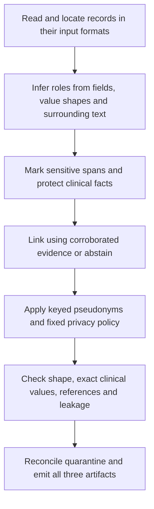
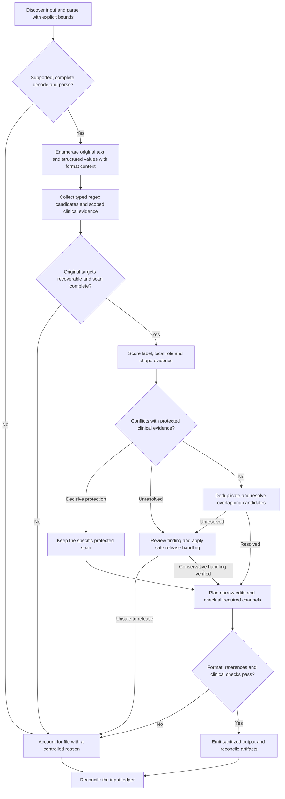
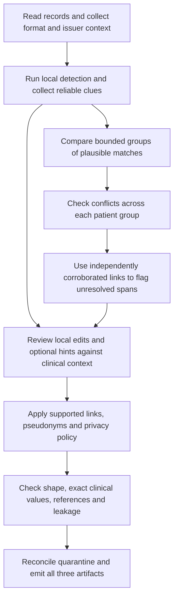
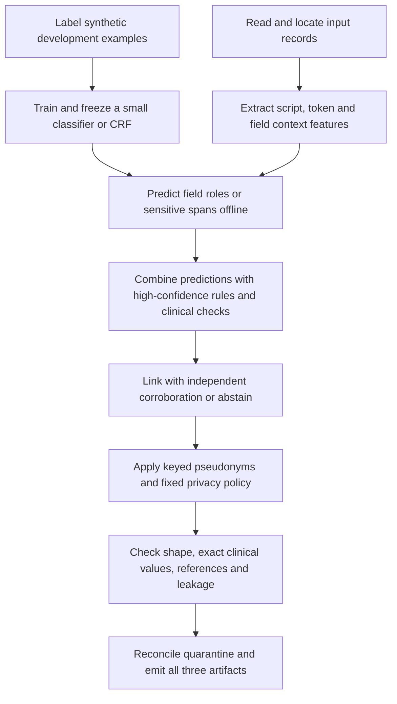
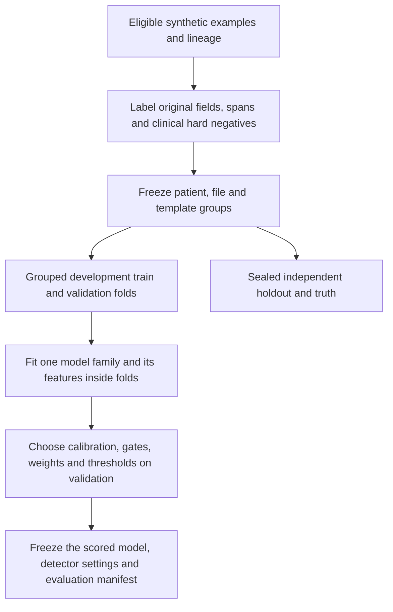
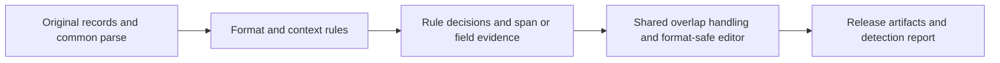
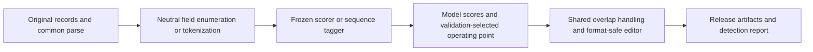
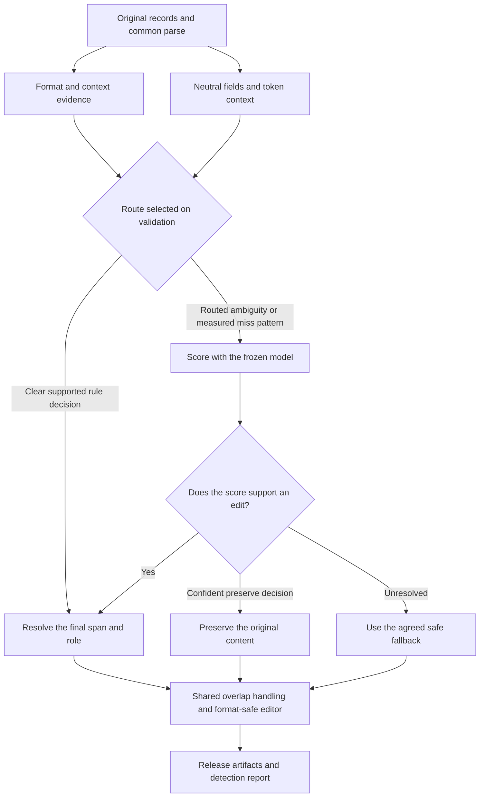
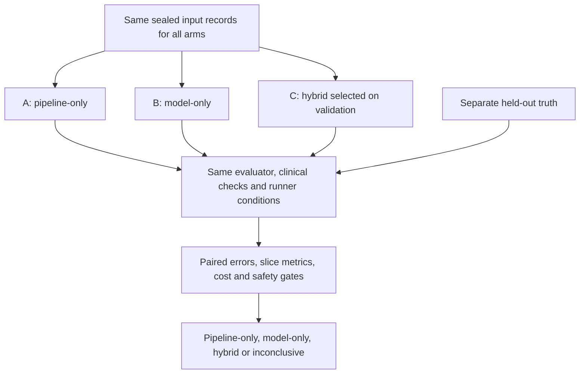

# Secret Wards candidate pipelines

**Provisional recommendation.** Start with **format-aware context rules and clinical checks**. It is the strongest route under the 24-person-hour budget because it keeps format-specific edits, clinical preservation and evidence collection independently testable. Run the agreed unfamiliar-field comparison first. Switch to an anchor-led or learned approach only if the held-out errors show that its extra complexity will solve a material problem. [Secret Wards hackathon decision map](https://github.com/baymax-afk/scaler_hackthon/issues/1) · [Compare multilingual detection on unfamiliar field roles](https://github.com/baymax-afk/scaler_hackthon/issues/6)

The team has selected Candidate A for Phase A. Begin with rules and current synthetic inputs while Developer B improves the dataset. Phase B requires improved, independently labeled data and evaluates a model on its own. Phase C integrates scores only after Phase B. Phase D compares the three configurations under the same protocol. The approved phase order gives the regex release its own path to completion. The architecture, workstream division and experiment designs below are proposals for review. [Development plan](../development-plan.md)

## Design constraints and evidence

Secret Wards produces a record-level **Research Release** from synthetic English, Hindi and Hinglish hospital exports. Every candidate must preserve CSV, TSV, JSON, FHIR R4 and text structure according to the contract, release the three required artifacts, account for every input, and keep raw evidence out of logs, reports and temporary files. It must run deterministically on Linux with 2 CPUs, 4 GB process-tree RSS, 900 seconds and no runtime network, hosted inference or generative model. The judging weights are privacy 25%, detection 20%, clinical utility 20%, linkage 15%, integrity 10% and reliability 10%, with additional penalties for critical failures. The public event-created submission repo and two-page brief are part of the delivery constraint. [Problem statement](../PROBLEM_STATEMENT.md) · [Contract](../SPEC.md) · [Scoring](../SCORING.md) · [Organizer rules research](https://github.com/baymax-afk/scaler_hackthon/blob/research/organizer-contract/docs/research/organizer-contract.md)

- **Measured locally.** The starter passed the format checker while 84.1% of annotated PII mentions remained visible in the practice self-check. All four planted Canary identities were found and the starter linked zero records. The self-check is a local comparison aid with limited format and privacy coverage. [Toolkit baseline](codebase-overview.md#baseline-measured-in-this-checkout)
- **Published by the organizers.** Their reference scored 84.84 on standard normal inputs and 50.33 on standard unfamiliar-format inputs. The blanket-redaction reference scored roughly 22/100. These results justify a separate unfamiliar-input evaluation and protection of utility. The three candidates below have yet to be benchmarked. [Calibration](../SCORING.md#calibration)
- **Agreed by the team.** Two people share 24 total person-hours. The ingestion, FHIR and Linux packaging work can proceed alongside multilingual detection and linkage evaluation. Use the same synthetic holdout, run the field-role comparison first and allow up to 90 person-minutes for one evidence-selected follow-up. The six-hour allowance for integration, preflight and the brief is a planning estimate. An optional change is ineligible if it introduces any new **False Merge** or alters any protected clinical fact on the targeted holdout. This is a comparative team gate on that slice. The formal release acceptance ticket remains open. [Wayfinder notes](../wayfinder.md) · [Set MVP privacy, utility and linkage acceptance gates](https://github.com/baymax-afk/scaler_hackthon/issues/11)

## Consolidation of the previous proposals

| Earlier approach | Disposition and reason |
| --- | --- |
| Context-first editing and context rules with a preservation check | Combine into **A**. Exact clinical preservation belongs in every release. A second checker on ambiguous edits needs a measured gain before it becomes a runtime step. |
| Patient-first evidence and context rules with anchor hints | Combine into **B**. Both use independently corroborated patient evidence to recover misses. Keep local detection for isolated records and use a bounded, one-way hint pass. |
| Model-first recognition | Keep as **C**, a local classical learner with deterministic guardrails. A full training cycle is unlikely to fit the optional follow-up unless the synthetic labels and features already exist. |
| Release-risk-first and selective generalization | Keep as a policy comparison shared by A, B and C. It depends on identifier handling and trustworthy patient grouping. As a standalone workflow it leaves those tasks unsolved. Start from a fixed policy and test selective recoding only where it plausibly improves coverage-adjusted privacy. |
| Deterministic versus probabilistic linkage, rereading versus keeping evidence in memory, and specialized validation | Retain as component decisions. Compare matching methods on the same candidate pairs and compare processing shapes on the same workload. Changing both at once makes it hard to attribute a gain. |
| Hosted inference, generative or disallowed models, aggregate-only output, a query enclave, wholesale output conversion and blanket redaction | Exclude from the shortlist on contract or published scoring evidence. Keep internal normalization and a limited clinical preservation check as candidate techniques. |

Off-the-shelf OCR for unusual attachments stays a conditional extension. Its value depends on observed coverage, safe handling of unreadable content and headroom on the offline runner. A focused check of known attachments or honest quarantine addresses the immediate release boundary. [Prior feasibility estimates](feasibility-analysis.md) · [Existing implementations](existing-solutions.md) · [Problem statement](../PROBLEM_STATEMENT.md#7-ground-rules)

## Shared end-to-end contract

Each route starts from read-only input and ends with verified UTF-8 sanitized files, `records.jsonl` and `report.json`. Keep normalized evidence private and map each suggested edit back to the original field, text span or FHIR resource. Use **Linkage Abstention** where evidence is inadequate. Keep a keyed **Patient Pseudonym** consistent within the release when a link is justified, and use a separately derived patient date shift when precision and format permit. Use controlled error codes and reconcile quarantine as part of the input ledger. A persistently stored identifier-bearing intermediate would need explicit protection and a reason to exist. [Glossary](../../GLOSSARY.md) · [Record and report contract](../SPEC.md) · [Raw and intermediate data requirements](../PROBLEM_STATEMENT.md#3-deliverables--system-architecture)

Protect diagnoses, medicines, dose instructions, lab values and units, lengths of stay, and exact intervals. Exercise mixed encodings, truncated or deep JSON, disguised and encoded content, duplicate file hashes, renamed keys, complex FHIR references and filenames containing identifiers. Measure retention against all inputs so extra quarantine cannot silently improve apparent quality. Official evaluation of identifier-bearing input pointers, pseudonym placement with no compatible field, and multi-patient Bundles still needs clarification or explicit conservative handling. [Edge cases](outliers-and-edge-cases.md) · [Verify organizer rules that affect submission and export](https://github.com/baymax-afk/scaler_hackthon/issues/2)

## Candidate A — Format-aware context rules and clinical checks

**Method and rationale.** Work from structured field roles and local text cues. Keep a separate evidence view for normalization and produce precise edits against the original record. Take an issuer-scoped, precision-first approach to linkage. Use fixed age bands, truthful location coarsening and patient-consistent date handling for the shared comparator. Route ambiguity to a focused clinical check or the release boundary. Use independent fixture assertions to expose a dose mistaken for an ID or a clinician name mistaken for a relative. [Meaning and language traps](../PROBLEM_STATEMENT.md#2-core-challenge-objectives) · [Edge cases](outliers-and-edge-cases.md)

**Tools and integration.** Reuse the starter’s CLI and format-handling conventions. Use Python parsers and Unicode facilities first, then justify optional `regex` or `phonenumberslite` with measured errors. Use a pinned R4 checker on representative samples to verify decimals, partial dates and references. Keep validator packages out of the judged runtime if the project only needs them in development. Python adapter work and safe export are shared effort across every route. [Toolkit capabilities](codebase-overview.md) · [Technology options](tools-and-technologies.md) · [HL7 FHIR R4 JSON representation](https://hl7.org/fhir/R4/json.html)

**What the evidence supports.** An i2b2 ablation found that changing Date, Doctor and Patient recognition from rules to learned outputs raised exact-span recall from 81.94% to 88.50% while precision fell from 93.02% to 91.73%. The Date and Patient change alone reached 88.36% recall with 93.06% precision. This supports selecting changes by role. The study treated clinician names as an entity to detect and used English notes, so its scores do not predict Secret Wards performance. A later multicorpus study shows how partial matching and collapsing Patient and Provider labels can hide the exact boundary and role errors Secret Wards cares about. [Dehghan et al., i2b2 ablation, Table 2](https://pmc.ncbi.nlm.nih.gov/articles/PMC4976126/) · [Multicorpus de-identification study](https://www.jmir.org/2024/1/e55676)

**Practical improvement to test.** Retain original edit locations when matching on normalized text. Unicode normalization can compose or reorder code points. Test original substring boundaries on decomposed Devanagari characters, grouped Indic digits and a neighboring unchanged dose. In structured FHIR, leverage different roles for `Patient.name`, `Patient.contact.name` and `Observation.valueQuantity`. Still check free text and metadata. [Unicode UAX #15](https://www.unicode.org/reports/tr15/#Respecting_Canonical_Equivalence) · [FHIR R4 Patient](https://hl7.org/fhir/R4/patient.html#structure) · [FHIR R4 Observation](https://hl7.org/fhir/R4/observation.html#structure)

**Limits, cost and innovation.** The existing estimate is **2–4 person-hours** for the context comparison after fixtures exist. This excludes shared export and full integration. Bounded local work is expected to be cheap in CPU and memory. The performance risk is increasing pattern complexity and input size. The main weakness is transfer to unknown field roles, names and Hinglish phrasing. The opportunity is an auditable trace from unfamiliar cues to narrow edits, with exact clinical retention demonstrated on the same slice. Compare the optional preservation check with the same base detector if collateral damage drives the remaining errors. [Feasibility estimates](feasibility-analysis.md) · [Test whether a preservation check improves ambiguous edits](https://github.com/baymax-afk/scaler_hackthon/issues/18)

### Proposed Phase A detection flow

1. Enumerate original source units through format adapters. Start the same vertical slice with CSV/TSV cells and headers, note text, and filename components. Add nested JSON keys/scalars, metadata, FHIR context and decoder-supported attachments as their adapters qualify. Treat those channels as separate coverage obligations.
2. Generate candidates with a small precompiled Python rule set. Reuse the starter as a benchmark. Use typed value shapes, known structured fields, bounded label and role cues, and local lexical protection. Treat structural path and strong local role cues as stronger evidence than an isolated number or token. Give exact clinical paths and scoped patterns for doses, vital ratios, complaint prefixes and clinician roles specific protections. Test a relative beside a clinician with the same name and an identifier inside a clinical field so protections cannot become blanket exemptions.
3. Use a comparison view for label case, Indic decimal digits and bounded separator variants where they earn coverage. Match on the source when possible. Any length-changing normalization or bounded decoding must support mapping to an original target or whole value that can legally be rewritten. Mark an ambiguous source target as review. Add wider folding, transliteration or an alternative engine only when an isolated experiment shows the benefit. The scoring evaluator folds more variants than the proposed first detector. These gaps belong in the coverage report. [Scoring normalization](../SCORING.md#how-leaks-are-counted-shared-by-several-categories) · [Regex methods and evidence](regex-detection-methods.md)
4. Score over a bounded scope using evidence and conflicting signals. Begin with a small number of deterministic rule strengths in [0, 1], with separate stable reason codes and a review disposition. The scores express relative strength within this ruleset and can support inspection before thresholds are fixed on development. Format or validity checks for phone numbers and ID types are corroboration. A plausible labeled synthetic, partial or damaged identifier can still be sensitive.
5. Resolve overlap on original targets before editing. Deduplicate identical type and role findings, prioritize supported roles and specific shapes, and use a stable tie-break among interchangeable candidates. Prefer a complete supported identifier over its nested fragments. Keep touching independent ranges and explicitly review unresolved conflicting types or protection overlaps. Compare insertion-order invariance because the starter's sequential substitutions can erase evidence for later rules. The release module applies accepted edits once, verifies shape and clinical facts, and accounts for the original file if confidence, mapping or rendering fails. [Starter substitutions](../../starter/main.py#L98) · [Interface and error conventions](../development-plan.md#proposed-interfaces)

The prototype exercises the match-to-finding flow. Release integration consumes its findings through the same source unit seam. A missing result on an unsupported channel is a coverage gap. The production release needs an explicit decision for any channels or formats that it cannot safely process. [Required formats and behavior](../SPEC.md#3-input)

### Experiments for approval

Each experiment uses current synthetic material and a short fixture set. Use open practice examples and existing edge cases to develop the code. Reserve independently authored patient and template variants before tuning and keep their occurrence truth with B. The public fixture called Secret Wards Blind is useful input, but it needs lineage checks and occurrence annotations before its name can justify a held-out score. Prototype outputs and kit self-checks are preliminary. [Dataset guide](../datasets/README.md) · [Original field-role experiment](https://github.com/baymax-afk/scaler_hackthon/issues/6)

| Priority and hypothesis | Method, resources and implementation | Metrics and proposed criteria | Verdict, owner and dependencies |
| --- | --- | --- | --- |
| **1. Context transfers to unfamiliar fields without damaging clinical text.** | Compare starter, label-only and label + shape + local role on paired CSV and text fixtures. Include unseen labels, Hindi/Hinglish names, clinician vs relative, complaint vs care-of, doses and Indian IDs, repeated surface forms, and filenames as a channel. Use the kit and one independently adjudicated preliminary slice. | Exact typed TP/FP/FN, precision/recall/F1, candidate coverage, errors by rule and slice, protected changes and aggregate Canary escapes. Proposed pass: contextual rules recover more exact positives on the unfamiliar slice than each baseline, introduce zero protected-clinical changes, and introduce no new Canary escape with the same supported inputs. Fail if protection regresses or any gain is only from tuning. Sparse groups yield an inconclusive generalization verdict. | Adopt the qualifying feature set or narrow it by error family. A runs, B owns labels and comparison. Needs the evaluation fixture contract and a frozen preliminary slice for a held-out verdict. Toolkit-only work can begin after approval. |
| **2. Normalization and overlap resolution preserve original locations.** | Use table-driven synthetic pairs with Indic digits, combining marks, zero-width variants, emoji before matches, nested ID candidates, a clinician name repeated as a relative, and adjacent doses. Compare source-native matches with one constrained normalized view, permute rule order and edit only spans from validated mappings. | Exact boundaries, source round trips, protected changes, deterministic accepted targets and additional correct detections. Require zero incorrect accepted spans, mismatch-free code-point coordinates and zero protected changes on the targeted fixtures. Require at least one recovered example for any optional transform. Drop the transform or return review on failure. | Choose source-only matching or a narrowly mapped view and stable conflict policies. A owns. Starts independently from experiment 1 after interface review. A few fixtures establish correctness on known transformations, with no estimate of prevalence. |
| **3. Bounds contain processing cost without silently lowering coverage.** | Benchmark a fixed seed on normal fixtures and increasing synthetic repeated near-matches with long fields, many candidates or separator variants. Measure detector time separately from parsing and export. Use an isolated Python process with an independent deadline on a chosen Linux runner. Include a deliberately oversized input and repeat the same run. | Median and tail latency, wall/CPU time, process-tree RSS, load size, growth and completion/coverage. Require identical findings under repeats, explicit incomplete results for oversized inputs, and a proposed doubling check of at most 3× elapsed time over meaningful warm sizes before the configured limit. Treat a timeout, unexplained omission or repeatable superlinear growth on those cases as a failure to resolve. Full release caps apply at preflight. | Simplify/split problematic rules or test a bounded engine only after measuring a failure. A owns checks and B supplies runner conditions. Smoke probe needs a small initial rule set, comparative resource claims need the agreed runner. Synthetic stress reflects known workload shapes. |
| **4. One neutral interface links detection to export and independent evaluation.** | Run a fake detector and then the regex findings through a tiny CSV/text adapter slice. Score fake model-shaped predictions against the same annotations. Include collision attempts, empty vs incomplete results, one unsupported encoding/input, and a repeated-value case. Follow with numeric JSON and FHIR fixtures as adapters land. | Exact prediction-to-source joins, correct quarantine reasons and input accounting, stable order, unchanged protected values, no unsupported raw export, and valid output shape. Fail on a lost occurrence, alias to another duplicate input, copied finding text, protected change, or need for another arm's internal rule state. | Freeze the source-coordinate and result seam for the first release slice. B owns adapter and evaluator, A owns findings. Fixture and stub work can run in parallel after interface review. The slice probes the seam without resolving all FHIR or locator questions. |

The throwaway Python CLI measures the real detector and evaluator on a pinned synthetic fixture manifest. A single-file HTML walkthrough exposes a few synthetic examples step by step, including candidate spans, protections, scores and final decisions. Keep their scope and coordinates explicit. The demo illustrates decisions, and the Python run supplies the evidence. Capture the prototype revision and the verdict in the research notes after approval and execution. See the [evaluation checkpoints](../development-plan.md#evaluation-and-checkpoints).

### Findings and remaining decisions

The [Phase A implementation and validation](regex-phase-a-validation.md) are available in this branch. The runnable package is in `submission/` and the shared evaluation commands are in `evaluation/`. Both public development corpora passed the format checker. Release qualification still needs independent held-out evidence and resolution of the remaining practice leaks.

- **Verified existing behavior.** Sequential substitutions are order-sensitive when patterns can match intersecting text. The starter supplies no field context to CSV cell detection, walks JSON strings and keys, leaves numeric values unchanged and inherits input filenames in output. The historical local practice baseline is recorded above. A green format check alone leaves clinical, role and leakage questions open. [Toolkit baseline](codebase-overview.md#baseline-measured-in-this-checkout)
- **Outstanding evidence.** Phase A experiments will determine the net benefit of context, offset mapping safety, which rules generate errors and whether scan bounds preserve useful coverage. Label coverage, unseen cases, encoded payloads, final release gates and format-safe handling of disputed locators still require evidence. Preliminary results are recorded above. An independent held-out comparison remains open.
- **Future integration.** Keep the source unit and findings seam neutral. The independent model gets its own candidate generation, and calibration or fusion can operate later on comparable findings with independently frozen development scores. A simple fallback gate or single global blend is the first comparator after evidence permits. Adopt a hybrid only if the common held-out evaluation shows a meaningful gain over the stronger standalone without regressions. [Fusion and comparative protocol](#dedicated-ml-detector-and-score-fusion)
- **Parallel work.** A owns the detection and regex experiments. B owns improved data, the comparator, and provisionally the release adapter slice. Each can use fixtures and stub findings while the other's module is underway. The teams meet at original-coordinate examples, the preliminary data freeze, the CSV/text integration and release preflight. [Development plan](../development-plan.md) · [Developer B handoff](../developer-b-handoff.md)

## Candidate B — Corroborated patient anchors with local detection

**Method and rationale.** Start with clues corroborated before any hint is generated. Normalize or transliterate evidence to propose plausible pairs and keep original-script evidence. Verify the issuer of local identifiers and consider common names and household contacts weak on their own. Apply a conflict check to the emerging group, including the case where two plausible links would join incompatible histories. Use independently verified matches for one pass of hints about unresolved text. Keep hint-derived edits from feeding back into the links that produced them. Local detection still handles every record. [Linkability criteria](../DATASET.md) · [Compare cross-script linkage and safe abstention](https://github.com/baymax-afk/scaler_hackthon/issues/7)

**Tools and integration.** Start with Python maps, deterministic Indic transliteration and a selected similarity function such as RapidFuzz. Use several narrow blocking rules and inspect the largest resulting group and the share of true pairs retrieved. Fellegi–Sunter scoring in Splink is a development comparator if usable features exist and bounded rules miss material links. It adds calibration, dependencies and possible spill configuration, and pair scores still need group checks. [Technology options](tools-and-technologies.md) · [Fellegi and Sunter original paper](https://doi.org/10.1080/01621459.1969.10501049) · [Splink original repository](https://github.com/moj-analytical-services/splink)

**What the evidence supports.** A CARRS–Chennai cancer registry linkage adapted names, patronymics and PINs to local practice. Lowering its review cutoff from 20 to 15 would have nearly tripled the manual-review queue. It used mostly complete structured inputs and human adjudication. In a four-use-case US study, probabilistic linkage improved both sensitivity and positive predictive value versus exact keys for HIE deduplication. On newborn deduplication, it improved sensitivity from 72.1% to 85.4% while positive predictive value fell from 98.6% to 89.3%. Compare at matched precision on the same candidates, inspect sparse and mixed-script cases separately, and include a runner-up margin for ambiguous matches. [CARRS–Chennai study](https://pmc.ncbi.nlm.nih.gov/articles/PMC9990691/) · [Grannis et al., Table 3](https://www.ncbi.nlm.nih.gov/books/NBK618683/pdf/Bookshelf_NBK618683.pdf#page=36) · [NHS Master Person Service matching rules](https://digital.nhs.uk/services/personal-demographics-service/master-person-service/the-person_id-handbook/technical-details-of-the-data-linkage-algorithm)

**Practical improvements to test.** Aksharantar reports 67.9% Hindi top-1 accuracy for Indian-origin named entities with reranking on its word-transliteration benchmark. The category includes places and organizations. Use bounded alternative forms to generate candidates, and count all spelling variants of a name as one observation. For group checks, distinguish missing evidence from a conflict and require validated issuer semantics before rejecting an apparent mismatch. Freeze confirmed links when comparing hints off and on. A wrong bridge between otherwise pure groups of sizes *a* and *b* creates *a × b* false same-pseudonym pairs. Measure both direct candidate-pair coverage and connectivity inside true patient groups as well as the largest blocks. Published Splink throughput used substantially more hardware, so budget by local skew and end-to-end measurements. [Aksharantar, Table 6](https://aclanthology.org/2023.findings-emnlp.4.pdf#page=8) · [FHIR R4 Identifier semantics](https://hl7.org/fhir/R4/datatypes.html#Identifier) · [Saeedi et al., entity clustering](https://pubs.dbs.uni-leipzig.de/files/research/publications/2018-6/pdf/eswc.pdf) · [Splink performance reproduction](https://moj-analytical-services.github.io/splink/topic_guides/performance/duckdb_performance_reprex.html)

**Limits, cost and innovation.** The prior **3–5-hour** linkage spike excludes the hint pass and format integration. Candidate work in a single unrestricted group grows as the number of pairs, so memory and CPU can jump with shared or missing values. Cap work explicitly and measure the Missed Links introduced by that cap. Test homonyms, shared contacts, reassigned local IDs, wrong bridge links, isolated records and a clinician who shares a patient’s name. This route is the more distinctive choice if trusted links recover substantial multilingual recall without clinical damage or new False Merges. [Feasibility estimates](feasibility-analysis.md) · [Test anchor-guided detection across Patient Records](https://github.com/baymax-afk/scaler_hackthon/issues/17)

## Candidate C — Local learned role detection with deterministic guardrails

**Method and rationale.** Train and freeze a non-generative classical model before the judged run. A small linear classifier can compare field roles on reusable labels. A conditional random field (CRF) can add adjacent-token context when the recurring errors involve boundaries in notes. Favor a small feature set such as script, character shape, labels and neighboring words. Keep strong deterministic rules for structured identifiers and guard clinical spans. Use the same conservative linkage and fixed policy as A so the comparison isolates detection. [Classical model options](tools-and-technologies.md) · [CRFsuite original implementation](https://github.com/chokkan/crfsuite)

**What the evidence supports.** A classical CRF reached 72.06% exact typed phrase F1 on 2,079 Hinglish tweets labeled for person, location and organization. Those labels lack patient, relative, clinician and Indian ID roles. An English clinical model fell from 95.47% strict F1 on i2b2 to 85.68% on UF Health, with harmonized annotations for the cross-site experiment. In pyDeid's 700 Canadian admission notes, adding an English NER model improved token recall from 0.906 to 0.934 while precision fell from 0.889 to 0.688. These results argue for a controlled transfer comparison and caution against adopting an off-the-shelf recognizer wholesale. [Hinglish NER, Table 2](https://aclanthology.org/P18-3008.pdf) · [Cross-institution experiment](https://link.springer.com/article/10.1186/s12911-019-0935-4) · [pyDeid, Table 1](https://academic.oup.com/jamiaopen/article/8/1/ooae152/7966802)

**Practical improvements to test.** Compare sparse label character n-grams and value-shape features for ranking already proposed spans. Measure how many true spans the candidate generator reaches before expecting the ranker to help. If misses are mainly absent spans rather than wrong roles, compare a CRF on one small independently labeled note slice. CRFsuite can open a frozen local model artifact, which makes offline deployment plausible. Fixture generator seeds can reuse name tables and note patterns. Group original and mutated copies together, then test both new patients with familiar templates and new patients with independently authored templates. Use occurrence-level labels for repeated values with different roles. [scikit-learn sparse text features](https://scikit-learn.org/stable/modules/generated/sklearn.feature_extraction.text.CountVectorizer.html) · [CRFsuite local tagger](https://python-crfsuite.readthedocs.io/en/latest/pycrfsuite.html#pycrfsuite.Tagger.open) · [Synthetic fixture generator](../datasets/generate_secret_wards.py)

**Limits, cost and innovation.** Annotation and calibration are the largest uncertainties. Existing synthetic labels may name a value without resolving every repeated or overlapping span, and another generator seed can reuse names or note shapes. Evaluate disjoint patients, field layouts and note-template families separately and together. Try a learned comparer inside the 90-minute allowance only if the relevant labels and reproducible offline inference path are already ready. The existing **6–10-hour estimate** for a narrow CRF comparison starts after labels exist, making it a poor default for this event. Innovation is demonstrable transfer to unseen layouts or mixed language at similar precision and clinical utility. [Team synthetic datasets](../datasets/README.md) · [Feasibility estimates](feasibility-analysis.md)

## Dedicated ML detector and score fusion

This is a conditional comparison within the existing 90-person-minute allowance. The baseline experiment still comes first. A dedicated model earns that follow-up if development errors expose a recurring, labelable failure: either the rules already find plausible spans but misread their role, or they fail to propose important spans at all. A model can be useful on its own, useful only in a hybrid, or too costly for the gain. The comparison must allow all three conclusions. [Compare multilingual detection on unfamiliar field roles](https://github.com/baymax-afk/scaler_hackthon/issues/6) · [Choose the follow-up comparison from held-out failures](https://github.com/baymax-afk/scaler_hackthon/issues/16)

### What the model can learn

A **Detection Score** belongs to one original field or span and one proposed role. A score can rank candidates. Interpret it as a probability only after checking calibration on development groups. Keep original offsets and role information so the same name can be marked as identifying in a patient or relative mention and preserved in a clinician mention. The detector proposes edits. The common renderer, conservative linkage, keyed pseudonyms and release policy stay fixed in this experiment. [Glossary](../../GLOSSARY.md) · [Meaning traps](../PROBLEM_STATEMENT.md#2-core-challenge-objectives)

| Model family | Best use | Evidence, limitations and cost |
| --- | --- | --- |
| Sparse logistic regression | **First choice for fields or proposed spans with the wrong role.** Use character n-grams of local labels, script and digit patterns, nearby words, length and neutral structural context. Keep names and record IDs out of memorization-prone features. | Fits sparse feature vectors and has a simple score per class. A field scorer needs some candidate for every field or span it is expected to classify. Candidate coverage is its ceiling. Use independently generated fields or bounded windows in the model-only arm. Report conditional coverage and full-slice missed identifiers. [scikit-learn logistic regression](https://scikit-learn.org/stable/modules/generated/sklearn.linear_model.LogisticRegression.html) · [Character n-grams](https://scikit-learn.org/stable/modules/generated/sklearn.feature_extraction.text.CountVectorizer.html) |
| Feature-based linear-chain CRF | **First choice for missing spans or incorrect boundaries in notes** if independently annotated occurrences and offline tooling are ready. Train sequence tags for roles, with token neighbors, character shapes and script features. | Predicts spans from the token sequence and can learn valid tag transitions. The earlier estimate was 6–10 hours for a narrow CRF comparison once labels exist. A much smaller probe fits only with ready data and tooling. Published Hinglish NER results use social-media entity categories, while English clinical work uses different identifiers and role definitions. [CRFsuite](https://github.com/chokkan/crfsuite) · [Hinglish CRF study](https://aclanthology.org/P18-3008.pdf) · [Feasibility estimates](feasibility-analysis.md) |
| Small from-scratch character CNN or BiLSTM | Stretch if a classical model plateaus on genuine sequence errors and the team has a broad occurrence-level corpus. A narrow CNN can learn local character patterns. A BiLSTM can use wider token context. | A primary Chinese clinical study reported a randomly initialized CNN at 98.2 typed F1 in-hospital and 73.4 and 54.2 on two external datasets. The corresponding BiLSTM results were 98.6, 78.9 and 52.8. This demonstrates a large transfer risk even in a related clinical setting. Neither accuracy nor CPU cost transfers to this task. Extra training, reproducibility, serialization and runtime packaging put both behind a classical probe. [EMNLP clinical transfer study, Table 2](https://aclanthology.org/2023.emnlp-main.224.pdf#page=5) |

Inspect development errors before picking one family. Label and character-shape features can handle unseen spellings without learning the identity itself. Test reordered headers, Latin and Devanagari digit mixtures, code-switching, missing delimiters, clinical quantities next to identifiers, and repeats with different roles. Include file-level Scoring Units as appropriate. A promising free-text model still leaves structured fields and side channels to be measured. The organizer permits small self-trained non-generative models on synthetic data and requires a declared, offline CPU artifact. Confirm package and model sizes, cold start, training wall time and reproducible output before considering a dependency. [Track ground rules](../PROBLEM_STATEMENT.md#7-ground-rules) · [Toolkit options](tools-and-technologies.md)

For a sequence tagger, decide on a span-level score from its token marginals on development data. A per-token marginal describes one tag at one position. A whole-span probability needs its own definition and calibration. Test combining marks and valid boundaries in the original text before committing to a tokenizer. For a later neural comparison, a frozen CPU runtime adds wheel, model loading and thread costs. Measure those costs alongside parameter count. The full pipeline must fit 2 CPUs, 4 GB and 900 seconds. Standard full-credit targets are 60 seconds and 512 MB. [CRFsuite marginals](https://python-crfsuite.readthedocs.io/en/latest/pycrfsuite.html#pycrfsuite.Tagger.marginal) · [Unicode grapheme boundaries](https://www.unicode.org/reports/tr29/#Grapheme_Cluster_Boundaries) · [ONNX Runtime CPU threads](https://onnxruntime.ai/docs/performance/tune-performance/threading.html) · [CPU and reliability scoring](../SCORING.md#6-cpu-efficiency--reliability-10)

### Dataset readiness and generalization

| Source | Coverage, label quality and permitted use |
| --- | --- |
| Organizer practice | 200 files cover 815 Patient Records and 48 Patients, plus 68 file-level Scoring Units. Annotated entities are heavily skewed toward Latin (2,980 Latin, 143 Devanagari, 111 Hinglish). The 100 plain-text documents have 527 annotations. Sixty names have multiple literal matches, and that slice has just two doctor-versus-relative preserve probes and one ASHA probe. Surface and role labels support supervised development, but ambiguous occurrences need review before becoming training labels. [Organizer manifest](../../dev/dataset_manifest.json) · [Truth schema](../DATASET.md#the-answer-key-truthjson) |
| Team Secret Wards Blind | 2,000 Patient Records across 562 files. Of 500 text records, 167 are Latin, 167 Devanagari and 166 Hinglish. Each note family uses one script exclusively, so a split within this set can reward learning note layout. Truth gives values and record locations without token offsets. Reserve this suite from tuning and add a small independent synthetic test that crosses script with note family. [Fixture README](../datasets/README.md) · [Team manifest](../datasets/secret_wards_blind/manifest.json) · [Truth generator](../datasets/generate_secret_wards.py#L168) |
| Naamapadam | 11 Indic languages with projected person, location and organization tags, plus some manually checked test material. Its card applies CC0 1.0 to mined packaging and disclaims ownership of underlying text. Useful evidence for native-script boundaries. Its roles cannot distinguish a patient name from a clinician. [Original paper](https://aclanthology.org/2023.acl-long.582/) · [AI4Bharat release and license](https://huggingface.co/datasets/ai4bharat/naamapadam#licensing-information) |
| COMI-LINGUA and earlier Hinglish NER | COMI-LINGUA reports 24,913 retained NER instances in Roman and Devanagari code-mixed material drawn from social media, news and public communications. Its release is CC BY 4.0. The earlier Hinglish Twitter study provides a benchmark, with corpus reuse rights unverified here. Use these as design evidence for switching scripts and spellings. [COMI-LINGUA paper](https://aclanthology.org/2025.findings-emnlp.422/) · [Official repository](https://github.com/lingo-iitgn/COMI-LINGUA) · [Hinglish study](https://aclanthology.org/P18-3008/) |
| Aksharantar, Dakshina and IndicXlit | The transliteration corpora help identify spelling-variation tests and offer word pairs without clinical roles. Aksharantar lists CC BY for manually collected data and CC0 for mined packaging. An incorporated upstream source, Dakshina, is CC BY-SA 4.0. IndicXlit is MIT-licensed but its published encoder–decoder generates strings, which excludes it under the track's generative-model rule. [Aksharantar terms](https://indicnlp.ai4bharat.org/aksharantar/#license) · [Dakshina license](https://github.com/google-research-datasets/dakshina#license) · [IndicXlit original repo](https://github.com/AI4Bharat/IndicXlit) |
| i2b2/UTHealth and MIMIC-IV-Note | Both derive from patient care and have controlled-use agreements. Use the de-identification studies as research references for error taxonomies and evaluation. Use organizer or team-generated synthetic examples for this track's models. [i2b2 task paper](https://pmc.ncbi.nlm.nih.gov/articles/PMC4989908/) · [n2c2 data agreements](https://n2c2.dbmi.hms.harvard.edu/data-sets) · [MIMIC-IV-Note terms](https://physionet.org/content/mimic-iv-note/2.2/) |

Licensing and challenge eligibility are separate. Apply the organizer/team-generated synthetic constraint to training, calibration and test assets and use third-party corpora and pretrained weights as research references. If an external asset becomes necessary for a measured failure, first verify the exact artifact, its provenance and the organizer's permission. [Track ground rules](../PROBLEM_STATEMENT.md#7-ground-rules)

- Keep a lineage manifest with patient group, source file/duplicate family, template or schema family, script and role. Group re-exports and transliterations with their originals. Hold out new Patients **and** independently authored template families together. Also report a patient-only control and a template-shift stress slice where possible. A different seed from the same generator can still reuse names and templates. If shared patient, file or template connections make a clean split impossible, author a fresh external slice with independent synthetic inputs. [Team generator](../datasets/generate_secret_wards.py) · [Grouped cross-validation](https://scikit-learn.org/stable/modules/cross_validation.html#cross-validation-iterators-for-grouped-data)
- Annotate exact original offsets or structured paths, and label roles for occurrences of identical surface strings. Audit a sample with a second reviewer where practical. Include hard negatives such as clinicians, dosage schedules and disease eponyms. Inspect whether a candidate generator ever proposes each gold span, then separate generator misses from wrong scores. Report support by independent groups as well as by annotation count. [Official contextual scoring](../SCORING.md#1-detection--contextual-intelligence-20)
- Count positive groups and hard-negative groups before choosing folds. Start from natural prevalence and evaluate inverse-frequency weighting or training-only negative sampling inside the grouped development splits if rare roles are swamped. Keep validation, calibration and test distributions intact. Class weighting can move the operating point and change apparent probability calibration. Fit preprocessing, vocabulary, weights and candidate logic inside training folds, and keep truth out of runtime features and assets. Use pooled thresholds when a script or role has too few independent groups to support its own. [Class-weight computation](https://scikit-learn.org/stable/modules/generated/sklearn.utils.class_weight.compute_class_weight.html) · [Calibration guide](https://scikit-learn.org/stable/modules/calibration.html)

### How to combine scores

| Method | When to test it | Failure mode and validation requirement |
| --- | --- | --- |
| Global weighted aggregation | A simple comparator if both sources give comparable scores over the same field, role and span. Test one nonnegative convex weight on validation, including both single-source endpoints. | Rescaling arbitrary scores to 0–1 does not establish probability calibration. Rule flags can stay binary indicators. Track absent source outputs separately. A global weight may conceal script- or role-specific failures. [Cross-validated stacking and weights](https://statistics.berkeley.edu/sites/default/files/tech-reports/367.pdf) |
| Confidence-dependent weighting | Consider only if validation shows a reproducible difference between context groups, such as known structured fields and ambiguous free text. | Flexible gates and per-script weights amplify noise in small groups. Test one transparent route first, and record how many real misses reach it. [Adaptive mixtures of local experts](https://www.cs.utoronto.ca/~hinton/absps/jjnh91.pdf) |
| Rule/ML decisions and conditional fallback | **First hybrid hypothesis.** Keep validated hard decisions where the rule coverage and role are clear. Route a prespecified uncertain slice to the model, with a held-fixed handling path for remaining ambiguity. Allow a neutral route for rule silence when recall is the target. | A strictly disagreement-only route cannot recover things neither side proposes. A policy that keeps all unknowns unchanged may leak. Compare route recall, residual identifiers and quarantine against input coverage. [Selective classification and coverage](https://proceedings.neurips.cc/paper_files/paper/2017/file/4a8423d5e91fda00bb7e46540e2b0cf1-Paper.pdf) |
| Model verification or reranking | Use when candidates exist but their role is uncertain. For example, check whether adjacent tokens support a patient or clinician role. | The candidate generator sets the recall ceiling. Keep conflict outcomes and examples where the model vetoes a correct rule or confirms an incorrect one. |
| Stacking or learned ensemble | Consider a regularized logistic combiner only if enough independent groups exist and the simple gate and blend leave substantial complementary errors. Fit on grouped out-of-fold base scores. | Training on in-sample base scores or calibrating on test predictions inflates apparent gain. Extra flexibility spends label support and integration time. [Wolpert, stacked generalization](https://doi.org/10.1016/S0893-6080(05)80023-1) · [Model selection bias](https://www.jmlr.org/papers/v11/cawley10a.html) |

Compare raw rankings first. Where probability matters, use natural-mix, group-disjoint or cross-fitted development predictions for a reliability plot with bin counts and Brier loss or log loss. Compare uncalibrated scores against sigmoid calibration. Consider isotonic only with enough independent positives across the score range. Tune inside the routed population if the hybrid only scores that population. Align overlap resolution by original coordinates. Predeclare how ties, missing scores, conflicting roles and high-impact clinical spans are handled. Use validation to select the operating point, including weights and route thresholds. Together choose a worthwhile outcome and runtime headroom before looking at test results. [Niculescu-Mizil and Caruana, calibration study](https://icml.cc/Conferences/2005/proceedings/papers/079_GoodProbabilities_NiculescuMizilCaruana.pdf) · [Decision threshold tuning](https://scikit-learn.org/stable/modules/classification_threshold.html)

### Flowcharts for the proposed comparison

#### Model training

#### A — Pipeline-only detection

#### B — Model-only detection

#### C — Conditional hybrid detection

#### Paired comparative evaluation

### Reproducible ablation and adoption criteria

1. **Freeze boundaries.** Use identical parses, original coordinate system, format safety, overlap handling, linkage, policy and resource limits. A supplies rule decisions. B supplies its own predictions using neutral parsing and field enumeration or tokenization. Keep the baseline detector's candidate flags, scores and protected-span decisions out of B. Apply common structural checks and measure independent clinical integrity afterwards. If the B candidate only handles a limited field set, report its coverage on the shared slice and its misses end to end. A diagnostic comparison on shared candidates can isolate score quality; it does not substitute for the independent arms.
2. **Tune without holdout access.** Use grouped development splits for feature choices, baseline operating points, candidate coverage, model selection, calibration, fusion weights and thresholds. Fix the validation objective, rule tie-break and minimum worthwhile gain before tuning. Use contextual F2 on actual outputs or predeclare a proxy and verify its relationship to output. Freeze dependency versions, seed, group manifest, model digest, artifact configs, evaluator and the selected hybrid. Use the same offline Linux conditions for all arms. Collect detector latency separately from parsing and export. Open held-out truth after predictions are fixed.
3. **Report detection and release quality.** Report exact typed span or field precision, recall and F1, with TP, FP and FN. For accuracy, FPR and FNR, project predictions onto a predeclared common universe of adjudicated field or token units with known positive or negative status. Report unlabeled and unreadable units separately. Also report positive prevalence, PR/AP for score ranking, per-script and unfamiliar-format results, residual Direct Identifiers and Canary findings in Scoring Units, clinical preservation against all input, and linkage False Merges and Missed Links. Include quarantined input in coverage accounting. [Precision–recall under class imbalance](https://journals.plos.org/plosone/article?id=10.1371/journal.pone.0118432) · [Organizer scoring](../SCORING.md)
4. **Measure comparable costs and uncertainty.** Record cold start, per-file median and tail latency with sample counts, end-to-end wall and CPU time, peak process-tree RSS, artifact/dependency sizes and route coverage. Repeat fixed-input runs on the same judge-like runner. For quality differences, give paired counts and raw disagreements, including which system uniquely corrected or introduced a mistake. Use paired resampling of independent file/patient/template blocks when support and metric dependencies justify it. Use descriptive counts and mark conclusions inconclusive when groups are sparse. [Cluster bootstrap](https://doi.org/10.1111/j.1467-9868.2007.00593.x) · [Runner constraints](../SPEC.md#2-execution-environment)
5. **Require a practical win.** B or C must satisfy the agreed zero-new-False-Merge and zero-protected-clinical-change gate against the baseline on the targeted holdout. A hybrid must earn its complexity against the **better standalone arm**, with a predeclared material gain and runtime headroom. If B wins and clears release gates, consider B. If the difference is small, unstable, or only improves a ranking diagnostic, retain the simpler qualifying detector. No Secret Wards ML or fusion results are available yet.

### ML decision frontier

The [Secret Wards hackathon decision map](https://github.com/baymax-afk/scaler_hackthon/issues/1) keeps the comparison conditional. Two decision tickets add the ML-specific prerequisites and verdict without making ML a dependency for the other candidates.

| Priority and type | Question and dependency | Stop or success evidence |
| --- | --- | --- |
| P0 · Task | [Freeze the synthetic holdout and comparison metrics](https://github.com/baymax-afk/scaler_hackthon/issues/3) and [Verify access to a judge-like Linux runner](https://github.com/baymax-afk/scaler_hackthon/issues/4). These remain parallel prerequisites for the experiment. | Independent test groups and comparable resource measurements. |
| P1 · Task | [Check occurrence labels and split readiness for the ML comparison](https://github.com/baymax-afk/scaler_hackthon/issues/19), after the holdout design. | An independently labeled slice with role and script coverage, a record of ambiguous or unlabeled occurrences, and enough independent positive and hard-negative groups for grouped development. Stop for crossed template leakage, insufficient labels or inadequate time. |
| P1 · Prototype | [Compare multilingual detection on unfamiliar field roles](https://github.com/baymax-afk/scaler_hackthon/issues/6), after the holdout design. | Separate development misses due to absent candidates, wrong spans and wrong roles. This decides whether a ranker or a sequence model has a clear job. |
| P1 · Grilling | [Choose the follow-up comparison from held-out failures](https://github.com/baymax-afk/scaler_hackthon/issues/16), after the existing field-role comparison. Use development failures for any model or fusion tuning and keep the final ML holdout sealed. | Together choose the target error class, minimum worthwhile improvement and allowable overhead before tuning. You chose to keep ML within the single 90-person-minute follow-up. |
| P1 · Prototype, conditional | [Compare pipeline-only, model-only and hybrid detection](https://github.com/baymax-afk/scaler_hackthon/issues/20), after label readiness, runner access and follow-up selection. | Use one viable model family and a simple gate or global blend. The chosen hybrid must clear the no-regression gate and improve on the stronger standalone arm by the predeclared margin within the budget. Stop when the data or runner cannot support the comparison. |
| Conditional · Research | Verify exact license, provenance, organizer eligibility and offline packaging if a named external asset could solve a measured failure. The current literature and data audit support synthetic-first development. | Written organizer permission where needed and a precise license and lineage record. This question becomes a ticket when a specific required asset is identified. |

If the team selects ML, wire its comparison verdict into [Choose the MVP cut and the differentiator to demonstrate](https://github.com/baymax-afk/scaler_hackthon/issues/12) at that decision. The release acceptance discussion still owns clinical, linkage and safety gates. [Set MVP privacy, utility and linkage acceptance gates](https://github.com/baymax-afk/scaler_hackthon/issues/11)

## Evidence and optimizations shared across candidates

- **Verify clinical values and references from the written output.** Deleger et al. found little change in downstream medication-name extraction on 3,503 notes across multiple note types. Secret Wards also evaluates exact values and coverage. Check the dose, unit and frequency together and count losses against input. FHIR decimals can preserve significant trailing zeros such as `2.00`. For a rewritten Bundle reference, verify that it resolves to the corresponding original target, since resolution to the wrong Patient also corrupts the release. Include a relative reference, a URN and a contained reference where fixtures support them. [Deleger et al.](https://doi.org/10.1136/amiajnl-2012-001012) · [FHIR R4 numeric precision](https://hl7.org/fhir/R4/json.html) · [FHIR R4 Bundle resolution](https://hl7.org/fhir/R4/bundle.html#references)
- **Separate temporal fidelity from calendar fidelity.** MIMIC-IV shifts dates consistently within a patient and supplies a coarse calendar anchor. This supports within-patient interval studies, with reduced cross-patient calendar comparability. Compare each complete event's offset from one corresponding anchor event to check all pairwise intervals in linear time, and track input events excluded by incomplete or partial dates. Include leap days and different timestamp offsets. Keep stay lengths and partial-date precision explicit. [MIMIC-IV v3.1 usage notes](https://www.physionet.org/content/mimiciv/3.1/) · [FHIR R4 date types](https://hl7.org/fhir/R4/datatypes.html) · [Temporal utility rubric](../SCORING.md#4-clinical-utility-20)
- **Keep the privacy-policy experiment bounded.** Count distinct linked Patients per predeclared released signature, with linked, unlinked and retained denominators. Sample rarity is a proxy whose meaning depends on the observable fields. If it drives the follow-up, compare one fixed policy against one or two approved truthful age or geography hierarchies on the same patients. Coarsen consistently across affected records and recount rendered values. Report cohort coverage and distinguish identical signatures from overlapping ranges. ARX local recoding is a development reference for the tabular projection. It does not verify clinical narrative, the artifact contract or the official privacy score. [ARX recoding](https://arx.deidentifier.org/anonymization-tool/analysis/) · [Prasser et al., flexible anonymization](https://doi.org/10.1002/spe.2812) · [Privacy rubric](../SCORING.md#3-privacy-attack-arena-25)

Use the bundled practice corpus for regression and the team synthetic fixtures for a held-out comparison. Separate the evaluation script and truth from runtime input. For scaling, compare a compact evidence index with rereading the original files only if observed peak memory warrants it. Measure wall time, peak process-tree RSS, candidate counts, and output determinism in the judge-like environment. The published standard full-credit targets of 60 seconds and 512 MB are comparison targets within the hard limits. [Synthetic datasets](../datasets/README.md) · [CPU scoring](../SCORING.md#6-cpu-efficiency--reliability-10) · [Bound memory and runtime before choosing the batch shape](https://github.com/baymax-afk/scaler_hackthon/issues/9)

## Comparative decision matrix

Hard gates come first. A candidate must have a credible route to contract compliance, local offline execution, release accounting and zero critical failures on the targeted cases. Test the regression gate you approved before crediting an optional gain. Record per-script identifier recall, exact clinical retention and interval errors, False Merges and Missed Links, input-based quarantine coverage, R4 integrity, observed Canary escapes and peak runner resources. The official score weights describe the competition. The weights below describe this team's shaping decision. [Scoring rubric](../SCORING.md)

On the five-point scale, 1 is weak or requires substantial unproven work, 3 is plausible with material gaps, and 5 is a strong fit given the evidence and capacity. Higher effort scores mean lower expected effort. The totals are planning judgments, calculated as the sum of weight × score divided by five. Judge scores and Secret Wards benchmark results require separate measurements.

| Criterion | Weight | Why it matters | A | B | C |
| --- | ---: | --- | ---: | ---: | ---: |
| Alignment with the problem | 10% | All candidates target the same format-preserving, multilingual Research Release. | 5 | 5 | 5 |
| Expected effectiveness | 25% | Detection, patient continuity and disclosure drive most of the potential upside. The current evidence does not separate held-out results. | 4 | 4 | 4 |
| Technical feasibility | 10% | The parsers, model or grouping mechanisms and offline toolchain must be available and testable. | 5 | 4 | 3 |
| Reliability and robustness | 20% | Unseen formats, sensitive side channels, clinical corruption and False Merges can dominate aggregate gains. | 4 | 3 | 3 |
| Implementation complexity | 7% | More interacting components make defects harder to isolate and preflight. | 5 | 3 | 2 |
| Time and resources | 13% | Annotation, packaging and shared integration must fit two people and 24 total hours. | 5 | 3 | 2 |
| Scalability | 8% | Compare parse passes, candidate skew, CPU and peak process memory under the same caps. | 4 | 3 | 4 |
| Innovation potential | 7% | Prefer a distinctive gain that can be explained with evidence in two pages. | 3 | 5 | 4 |
| **Weighted total out of 100** | **100%** | **Provisional shaping estimate** | **86.6** | **73.8** | **68.0** |

A leads because it offers a shorter path to showing that the whole release works and fewer failure modes to debug in the time available. All three receive the same provisional effectiveness score because the external evidence supports plausible methods with different failure modes, and none measures performance on our formats. Moving ten percentage points from effort and time to innovation reduces A's lead over B from 12.8 to 4.8 points. B still needs evidence that its added identity context materially helps. C's scale score assumes a bounded feature set and a small model that runs locally. [Prior feasibility assumptions](feasibility-analysis.md)

**Trade-offs and switch conditions.** With A, accept a narrower set of matching rules and some Missed Links via deliberate abstention. Prefer B if the remaining identifier misses are concentrated in already corroborated patient groups and the controlled comparison increases detection without new False Merges or damaged clinical facts. Prefer C if failures follow unseen role or span patterns that rules cannot cover cleanly, a sufficiently labeled split and local artifact already exist, and the held-out gain survives both unseen patients and unseen templates at comparable clinical retention. A benefit confined to one optional component can be folded into A while retaining its end-to-end structure. Treat the cut as a team decision after evidence. [Choose the MVP cut and the differentiator to demonstrate](https://github.com/baymax-afk/scaler_hackthon/issues/12)

## Remaining Wayfinder frontier

The [Secret Wards hackathon decision map](https://github.com/baymax-afk/scaler_hackthon/issues/1) already has tickets for these decisions. At review, the organizer source investigation was closed and the tests and human decisions below were open. Ticket separation keeps the first comparison independent of the choice of optional follow-up.

| Order | Existing decision or question | Type and dependency | Evidence or decision needed |
| --- | --- | --- | --- |
| 1 | [Freeze the synthetic holdout and comparison metrics](https://github.com/baymax-afk/scaler_hackthon/issues/3) and [Verify access to a judge-like Linux runner](https://github.com/baymax-afk/scaler_hackthon/issues/4) | Tasks, parallel | Verify patient and template disjointness, input denominators and fixture gaps. Confirm runner limits independently. |
| 1, parallel | [Choose the eligible public submission repository](https://github.com/baymax-afk/scaler_hackthon/issues/14) | Grilling and Domain Modeling, organizer review completed | Confirm the eligible submission target before packaging. The working repository was private at the organizer review. |
| 2 | [Compare multilingual detection on unfamiliar field roles](https://github.com/baymax-afk/scaler_hackthon/issues/6) | Prototype, depends on holdout | On the same held-out records, compare label-only rules with contextual cues. Include dose versus ID, a mixed clinical field, unfamiliar headers and Devanagari/Hinglish. Count identifier gains and clinical changes exactly. No useful context gain or repeated clinical damage weakens A. |
| 2, parallel | [Test schema-safe export and honest quarantine](https://github.com/baymax-afk/scaler_hackthon/issues/5) and [Compare cross-script linkage and safe abstention](https://github.com/baymax-afk/scaler_hackthon/issues/7) | Prototypes, depend on holdout | Check a representative case across all claimed formats and verify offline R4 references. Use a small homonym/shared-contact case and a contradictory bridge to compare linkage groups at fixed candidate budgets. Unsafe export invalidates every route. Group errors directly weaken B. |
| 3 | [Choose the follow-up comparison from held-out failures](https://github.com/baymax-afk/scaler_hackthon/issues/16) | Grilling and Domain Modeling, after the field-role comparison | Choose at most one short consequential comparison. Prefer missed-recall cases if they have independent patient evidence, or clinical disagreements if damage dominates. A learned comparison requires ready labels. Keep the agreed regression gate. |
| 4, conditional | [Test anchor-guided detection across Patient Records](https://github.com/baymax-afk/scaler_hackthon/issues/17), [Test whether a preservation check improves ambiguous edits](https://github.com/baymax-afk/scaler_hackthon/issues/18) or [Compare pipeline-only, model-only and hybrid detection](https://github.com/baymax-afk/scaler_hackthon/issues/20) | Prototype, after follow-up selection and its respective prerequisites | Use identical inputs and stop after 90 person-minutes. Compare all three independent arms when ML is selected. Use the existing privacy-policy ticket if the evidence points to selective treatment. |
| 5 | [Choose the fail-closed release boundary](https://github.com/baymax-afk/scaler_hackthon/issues/10), [Set MVP privacy, utility and linkage acceptance gates](https://github.com/baymax-afk/scaler_hackthon/issues/11), and [Choose the MVP cut and the differentiator to demonstrate](https://github.com/baymax-afk/scaler_hackthon/issues/12) | Grilling and Domain Modeling, after required prototype evidence and the selected follow-up | Agree how to handle unsafe locators and unresolved records, minimum coverage and release checks, and what measured gain will justify the MVP choice. Bring the clinic/privacy trade-off and the eligible alternative to the team. |

The runtime comparison needs the Linux runner plus the export and linkage prototypes. The fixed-policy comparison needs trustworthy linkage results and informs the final acceptance gates. If the team selects one optional follow-up, make its result a prerequisite of the MVP cut. A promising result on the local privacy proxy still needs clinical, format and runner checks. [Bound memory and runtime before choosing the batch shape](https://github.com/baymax-afk/scaler_hackthon/issues/9) · [Compare fixed and selective privacy policies](https://github.com/baymax-afk/scaler_hackthon/issues/8)

Research questions still worth pursuing are specific. Seek organizer clarification on allowed fallback representations for a sensitive input locator, a pseudonym with no compatible field, or a multi-patient FHIR Bundle through the existing organizer and release-boundary context. Verify provenance, license and offline distribution only for an external dictionary, model or native dependency that a candidate would actually use. The papers establish why these techniques are plausible. Benchmarks and rollout choices still depend on the specified prototypes and the team's verdict. [Organizer questions](open-questions.md) · [Runtime and dependencies](tools-and-technologies.md)

## Version 2 evidence and proposed refinement

Use `095c854a4a2740e049e1db65a601a90a16e868a8` as the Version 1 implementation reference. The 2,000-record record-level audit and the practice replay remain distinct. The traced practice visibility hits point first to structured field-role recognition and text/path candidate coverage. Independently confirmed clinical over-scrubbing and invalid R4 export justify prioritizing release gates and minimal role fixtures alongside detection. [Requirements and generalization audit](generalization-analysis.md)

The proposed Version 2 flow keeps the format adapters and typed original spans, gives private linkage and privacy policy an explicit place before rendering, and checks staged artifacts independently. The new dataset keeps the original corpus unchanged and introduces teammate-owned sealed families. Linkage, date and age transformations, and the precise release policy require separate decisions; ML and hybrid evaluation remain later branches. [Version 2 architecture and experiments](version-2-improvement-plan.md) · [robustness_v2 design](dataset-v2-design.md) · [Ownership plan](../development-plan.md#version-2-planning-and-handoff)
