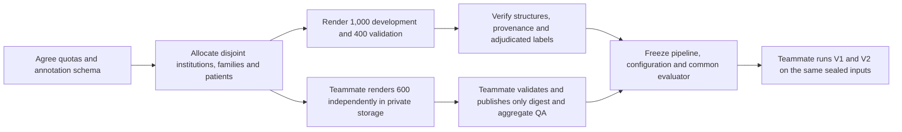

# robustness_v2 dataset design for approval

The dataset target is exactly 2,000 new valid synthetic Patient Records, in addition to the unchanged 2,000-record Secret Wards Blind corpus. Each corpus keeps its own version, provenance and benchmark. An input file can contain zero, one or several Patient Records. Metadata, unit-only cases and malformed-input fixtures sit outside the record quota. The new dataset is a controlled challenge distribution for testing generalization. It cannot estimate real-world clinical prevalence or de-identification performance.

## Allocation

Retain the proposed targets. FHIR grows from 50 to 400 Patient Records and reaches 20% of the new corpus. This leaves 500 free-text notes for messy multilingual writing and ambiguous contexts.

| Format | Development | Validation | Sealed | Total |
| --- | ---: | ---: | ---: | ---: |
| CSV | 200 | 80 | 120 | 400 |
| TSV | 150 | 60 | 90 | 300 |
| JSON | 200 | 80 | 120 | 400 |
| FHIR R4 | 200 | 80 | 120 | 400 |
| Plain text | 250 | 100 | 150 | 500 |
| **Total** | **1,000** | **400** | **600** | **2,000** |

| Primary scenario | Development | Validation | Sealed | Total |
| --- | ---: | ---: | ---: | ---: |
| Diverse hospitals and clinical writing styles | 150 | 60 | 90 | 300 |
| Multilingual and Indian naming variations | 125 | 50 | 75 | 250 |
| Contextual and ambiguous identifiers | 125 | 50 | 75 | 250 |
| Messy Unicode and formatting | 125 | 50 | 75 | 250 |
| Nested structures, FHIR and attachments | 125 | 50 | 75 | 250 |
| Longitudinal patient linkage | 125 | 50 | 75 | 250 |
| Clinical hard negatives and utility | 125 | 50 | 75 | 250 |
| Complex combinations | 100 | 40 | 60 | 200 |
| **Total** | **1,000** | **400** | **600** | **2,000** |

Cross-tab formats and primary scenarios in the manifest. Use independent secondary tags for script, format variants, clinical context and institution. Broader exploratory languages supplement organizer-critical English, Devanagari Hindi and Hinglish. Track Kannada and Tamil separately so a change in their allocation cannot hide an organizer-language regression.

## Generation and annotation

- Generate a synthetic patient and encounter ledger first. Create coherent admissions, care sequences, diagnosis codes, medicines, dosage/frequency, material lab values and follow-ups. Include realistic relationships for evaluating event order, duration, postoperative intervals, distributions and lab medians. Have a clinically informed reviewer spot-check plausibility and paired examples.
- Render across several independently authored hospital information systems, from government and rural facilities to private specialty clinics, emergency departments, telemedicine, labs, radiology, pathology, billing and insurers. Use discharge, admission, progress and nursing notes, prescriptions, referrals, test reports, histories, follow-ups and claims. Keep family identities tied to document structure, surface style, alias vocabulary and institution profile. Adopt separate renderers for content forms such as terse triage entries, dialogue transcripts, report tables, structured claims and long narrative histories. Independent families matter more than name substitutions.
- Generate fictional patients and institutions from offline invented components and use reserved domains such as `.invalid`. Prefer officially published test identifiers where available. For Aadhaar-like, ABHA-like, PAN-like, MRN and mobile shapes without an authoritative reserved range, use offline synthetic test namespaces or valid shape with deliberate deviations. Keep checksum-positive algorithm cases separate and document provenance and any collision uncertainty. A valid shape or checksum does not prove a number is issued or unused. Never route a call, query an identity service or base a record on a real patient. [Reserved DNS names (RFC 2606)](https://www.rfc-editor.org/rfc/rfc2606) · [UIDAI Aadhaar definition](https://uidai.gov.in/en/aadhaar-act) · [ABHA number and address](https://www.pib.gov.in/PressReleasePage.aspx?PRID=1827816&lang=1&reg=48)
- Render context-rich address variants, multilingual honorifics, reordered names, patronymics, initials, transliteration, aliases and typos. Include healthcare-specific identifiers such as ABHA address aliases, insurance membership, patient-local identifiers and organizer-scored PAN. Include clinician/patient homonyms, inherited family contacts, shared phones, similarly named patients, reused hospital IDs, changed contact details, conflict and missingness.
- Separate messiness from validity. Track controlled variants for composition, Indic digits, non-breaking and zero-width characters, OCR-like substitutions, unusual casing/spacing, delimiters and multiline text. Use real serializers for quotes, escaped keys, nested arrays and null values. Include valid XHTML with split text nodes, bounded encoded text attachments and metadata. Include transformations that legitimately alter format or byte size while retaining the meanings and role boundaries.
- For FHIR, start from locally pinned R4 4.0.1 and a pinned published ABDM profile subset. Cover Patient, Practitioner, RelatedPerson, Organization, Encounter, Observation, DiagnosticReport, DocumentReference and Composition, narrative, notes, extensions, attachments and reference graphs. Use one Patient Record per evaluated document Bundle unless the organizer clarifies multi-patient locator semantics. Annotate which references require coordinated pseudonymization and which identifiers are safe. Validate the input and release separately with the R4 validator and also with the applicable ABDM profiles for fixtures that declare conformance. Keep self-contained reference fixtures and offline/local profile packages. [FHIR R4](https://hl7.org/fhir/R4/) · [ABDM guide](https://www.nrces.in/ndhm/fhir/r4/index.html)
- Annotate at serialization time using emitted original offsets and locators. Keep annotation data outside runtime fixtures. For a predeclared, balanced 300-record measurement subset, independently exhaustively review identifier occurrences and protected spans across applicable channels. Proposed counts are 100 development, 60 validation and 140 sealed. Disagreements go to adjudication. Focus negative annotation on shared surfaces for clinician/relative and complaint/relationship roles, blood pressure, doses, labs with units, ICD, SNOMED CT and procedure code systems, vitamin names, eponyms, anatomical terms, duration and alphanumeric clinical values. Define the negative unit universe before computing FPR. Record partly annotated units as such.
- Store opaque IDs, variant ancestry, primary and secondary scenarios, difficulty, format, locale, language, writing style, institution, template family, SHA-256, generator revision, seed reference, split, scope and adjudication state. Truth includes typed original half-open code-point spans or format-specific pointers for numeric/scalar values, the declared representation for decoded attachments, protected facts with exact or semantic equivalence, expected treatment class and validity, patient-cluster and linkability evidence, and processing outcome. Ground-truth patient keys, annotator hints and split-only seed keys stay outside detector inputs.

## Leakage and sealed ownership

Developer B owns the sealed allocation. Reserve whole institution and template families before generation, then allocate synthetic patient and metamorphic groups within each split. No synthetic patient, renderer family, institution, file family or near-duplicate group crosses the boundary. If quotas conflict with a linked group, design or regenerate a whole group inside that split. Do not repair counts by moving individual encounters. Use distinct authorship and private renderer definitions/seed for sealed families. The shared interface, annotation guide and aggregate targets can be public to the team. The 600 sealed inputs, their generator logic and annotations stay in teammate-controlled storage outside the implementation workspace and repo. Publish hashes, support and aggregate QA only.

Positive labels identify same-patient pairs and the subset linkable under organizer evidence. Include different-patient challenge pairs that share name, contacts, birth date or addresses. Validate rejection of contradictory bridges, record ownership and that pseudonym consistency can be scored in artifact and ledger. Keep exact age/date annotations and derived differences in truth only. A frozen runtime SHA, configuration, dependency lock, scorer SHA, split digest and run protocol are supplied to the teammate for one sealed run. If findings inform rule changes, retire that split to development and create a newly sealed cohort.

## QA gates

Verify exact split and format counts, manifest bijection with scoring units, schema and original↔decoded span round-trips, hard-negative roles, valid reference targets, independent clinical spot review and exclusion of truth from inputs. Check exact hash duplicates and near-duplicates using template-normalized text shingles, structural fingerprints and manual inspection of cross-split high similarity. Require each family and institution to occur in one split and report per-slice support. For conservative linkage, measure precision, recall on eligible pairs, F0.5, B-cubed, false merged clusters and abstention counts by format and institution. Estimate uncertainty with patient- or template-grouped bootstrap where sampling and cluster counts support it. Report small-slice counts where intervals would be misleading.

Keep malformed JSON, invalid UTF-8 under a UTF-8 contract, unsupported or undeclared encodings, truncated tables, invalid R4 resources, unsupported attachment MIME types and size/depth overruns in a separately versioned side suite. Pair with a valid cp1252 source export, a BOM-tagged UTF-16 file, supported plain text attachment and a metadata-only file. Declare safe export, quarantine or a policy-validated fallback for every fixture. Budgeted generated properties and metamorphic tests cover valid structure, clinical byte/semantic invariants, UTF-8 rendering, no neighboring damage, consistent references, repeat safety and bounded CPU/RSS.
