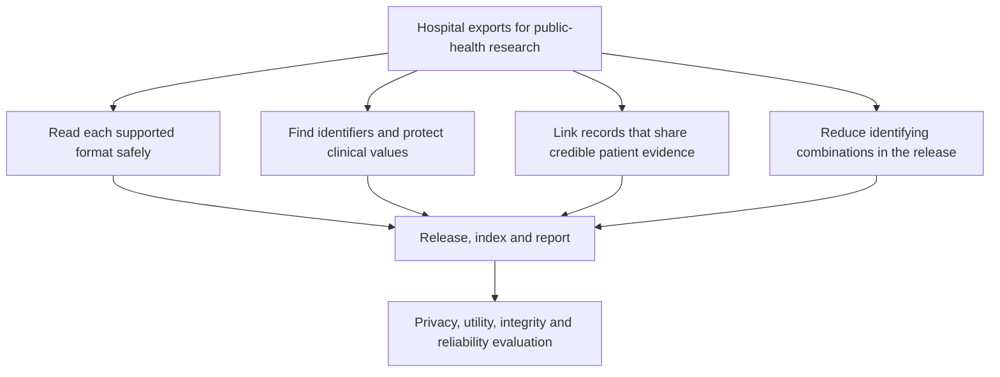
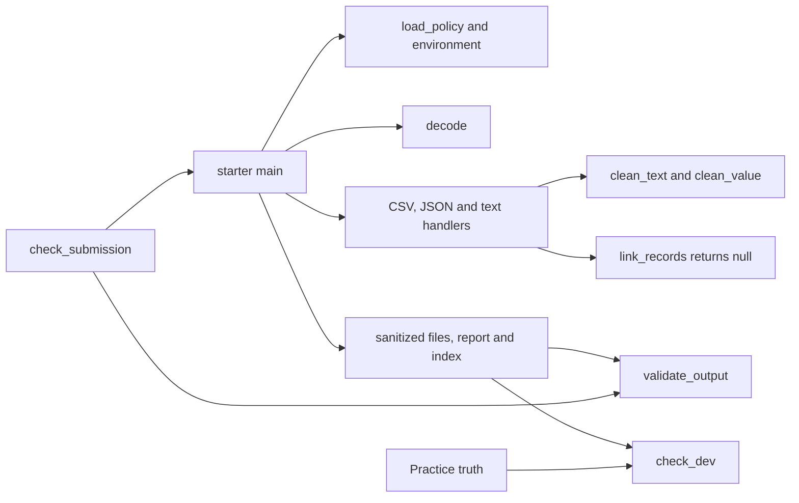
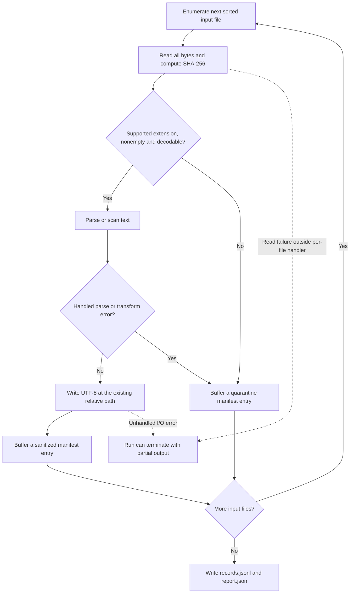
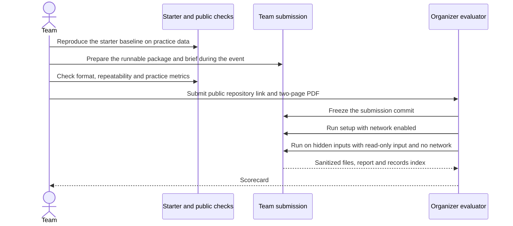
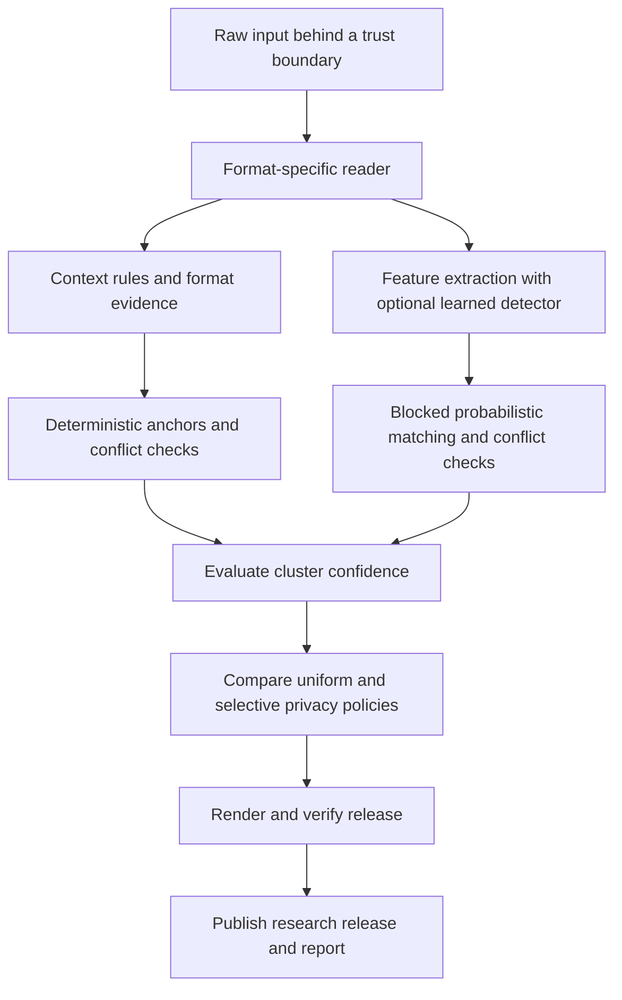
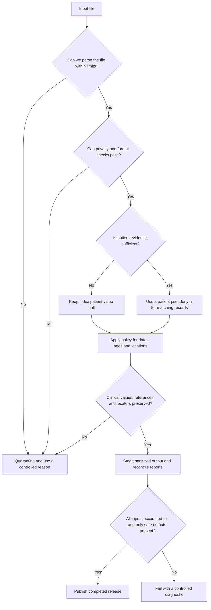
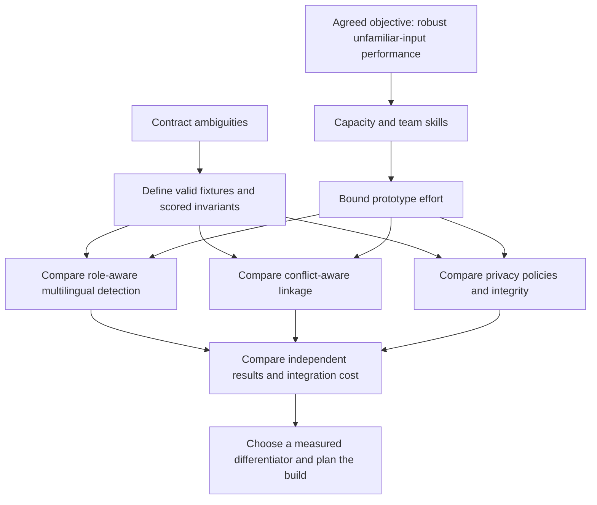

# Secret Wards diagrams

## Confirmed challenge breakdown

A useful release needs readable data, accurate patient histories, and fewer ways to identify a person. The judges measure all three along with processing behavior. [Brief](../PROBLEM_STATEMENT.md) · [Scoring](../SCORING.md)

## Verified starter architecture and module dependencies

The starter handlers clean one file at a time. The checkers sit outside the pipeline, and only the local self-check sees the practice truth. The date and age helpers are currently unused during a run. [Starter](../../starter/main.py#L35) · [Pre-submit runner](../../check_submission.py#L173) · [Local self-check](../../check_dev.py#L84)

## Verified starter data flow and failure handling

Recognized failures become report rows. A failure outside the error types the starter catches can terminate before it writes the final manifest. [File loop and output](../../starter/main.py#L211)

## Documented interaction flow

The hackathon workflow centers on a command-line batch. The evaluator prepares the repository, calls the command, and scores the output. [Submission instructions](../PROBLEM_STATEMENT.md#4-submission-format) · [Execution contract](../SPEC.md#1-repository) · [Fairness](../FAIRNESS.md)

## Hypothetical alternative designs

The alternatives share format and safety work. Their detection and linkage components can also be tested independently in mixed combinations. Uniform versus selective privacy is a separate decision downstream of patient grouping. [Feasibility matrix](feasibility-analysis.md) · [Existing privacy approaches](existing-solutions.md)

## Hypothetical release decision tree

This candidate describes how safe parsing, abstention, and release checks could fit together. The uncertain-date policy and organizer constraints on output fields still need to be resolved. [Edge cases](outliers-and-edge-cases.md) · [Contract questions](open-questions.md)

## Research dependencies for Wayfinder

The first decision sets the objective. Capacity and contract facts determine which tests can meaningfully separate the candidates. The resulting evidence feeds the later Wayfinder discussion. [Decision frontier](open-questions.md) · [Experiments](feasibility-analysis.md#experiments-for-the-prototype-phase)
