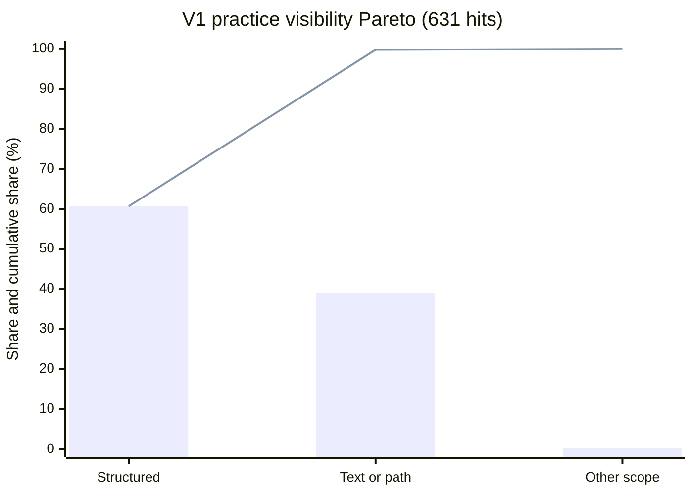

# Version 1 generalization and requirements audit

## Frozen reference

Version 1 is commit `095c854a4a2740e049e1db65a601a90a16e868a8`. Review range `752aad8...095c854` includes the Phase A handoff and integrated detector. The [Phase A selection](candidate-pipelines.md) records the accepted route and sequence. The [development plan](../development-plan.md) marks the interface and task details as draft. The governing submission contract is [SPEC.md](../SPEC.md). The tracker has the existing [Secret Wards hackathon decision map](https://github.com/baymax-afk/scaler_hackthon/issues/1) and a closed organizer-requirements investigation. No standalone approved engineering spec surfaced in the checkout or issue-title search. No ADR directory exists at this revision.

| Development evidence | Observed result |
| --- | --- |
| Organizer practice, all input labels | 2,599/3,230 labels not visible (80.46%). That includes 58 labels attached to quarantined files. |
| Organizer practice, exported files only | 2,541/3,172 labels not visible (80.11%). 631 file-level visibility hits across 138 files. |
| Organizer practice, coverage and utility | 187/200 files exported, including 185/192 required files. 4,701/4,701 probes for exported files visible, 4,701/4,855 over all inputs. 0/4 observed Canaries. |
| Secret Wards Blind, record-level audit | 7,917/7,917 source-present labels no longer visible, 10,000/10,000 exact probes preserved, 700/700 separately checked structured Aadhaar values removed and 0/7 observed Canaries. All 2,000 Patient Records exported. |
| Secret Wards Blind, longitudinal and other checks | 0/1,502 same-patient pairs linked in the corpus, 3,950/3,950 observed dates unchanged, 1,950/1,950 observed ages unchanged. One metadata-only index entry and one accepted fixture designated invalid UTF-8. |

The practice audit uses normalized file substrings, while the record-level audit joins each label to its record and confirms source presence. The previous broad Blind visibility scan includes 49 FHIR email labels absent from the source. It remains in the historical [Phase A report](regex-phase-a-validation.md). Both corpora informed development. The differences are descriptive and cannot estimate an independent generalization gap, prevalence, clinical harm or an official score. Overall precision, false-positive rate and complete anonymity are unestablished. The organizer's private evaluator uses record-level rules, protected occurrences and broader normalization/encoded channels. [Organizer scoring](../SCORING.md#1-detection--contextual-intelligence-20) · [Practice counts](results/v1-practice-trace.json) · [Record-level counts](results/v1-blind-record-audit.json)

| Secret Wards Blind format | Records | Source-present labels no longer visible |
| --- | ---: | ---: |
| CSV | 500 | 1,990/1,990 |
| TSV | 500 | 1,990/1,990 |
| JSON | 450 | 1,796/1,796 |
| FHIR | 50 | 149/149 |
| Plain text | 500 | 1,992/1,992 |

## Practice failure taxonomy

The audit replays each of 187 exported files through filename handling, decoding, the production format adapter, candidate generation, selection, transformation and serialization. It asserts byte-for-byte agreement with the V1 output and agreement with the visibility count. For each hit it scopes trace units by CSV/TSV row, JSON pointer, note/Bundle, or channel. It compares original and edited trace units, looking for a discarded candidate only when that candidate actually covers the label and was absent from selected edits. Repeated literals, textual serialization and normalized substring matching limit attribution. The coarse categories identify the earliest supported failure stage. The script emits aggregate counts without identifier values or PII-bearing paths.

| Earliest supported location | Labels | Share | Cumulative | Interpretation |
| --- | ---: | ---: | ---: | --- |
| Structured field without a covering candidate | 383 | 60.7% | 60.7% | Unrecognized field role plus no applicable covering shape. Includes 152 patient-name, 52 MRN, 33 relative-name and 30 DOB labels. |
| Text or path without a covering candidate | 247 | 39.1% | 99.8% | Source reached detection. Includes 93 patient-name, 38 village, 34 relative-name and 30 MRN labels. Covers free text and hidden channels with the same missing-candidate symptom. |
| Visible outside intended trace scope only | 1 | 0.2% | 100% | One patient-name label matched the file-level scanner. Needs independent role and occurrence adjudication before treating it as a local leak or an incorrect gold label. |



| Slice | Hits |
| --- | --- |
| Format | Plain text 233, generic JSON 171, TSV 154, FHIR 50, CSV 23 |
| Type | Patient name 246, MRN 82, village 76, relative name 67, locality 40, house 31, DOB 30, landmark 25, PIN 24, insurance ID 10 |
| Channel | Content 599, filename 10, decoded base64 9, metadata 9, header 4 |
| Script | Devanagari 114/143 labeled, Hinglish 80/111, Latin 437/2,976 |

The 630 traced hits provide direct evidence of insufficient candidate coverage. Differences among missing patterns, overly strict boundaries, text context and normalization require controlled counterfactuals before assigning each label a finer cause. The trace assigned zero hits to a discarded covering candidate, no literal in detector input or a failed edit after local detection. This says little about counterexamples outside the observed hits, leaks the rough scanner missed or partial-span removal. Example mechanisms to probe include field-role normalization across scripts, MRN formats outside known prefixes, relationships outside the bounded relative patterns and names spanning XHTML nodes. Never copy practice names, labels or file-specific literals into rules.

Quarantine affects a different denominator. Five files did not export because of unresolved detections, and eight had empty/invalid input, depth, a key collision, unsupported attachment or unsupported format. Seven quarantined files were expected to sanitize. Include these in coverage and resource comparisons, with reasons and protected-content losses attributable to quarantine. Nine base64-channel labels reached detection and survived within the released subset. They therefore cannot all be attributed to lack of attachment decoding. Generic text and base64 checking still cannot establish coverage for opaque attachments.

## Requirements traceability

| Requirement and governing source | V1 implementation and test evidence | Classification and remaining gap |
| --- | --- | --- |
| Remove Direct Identifiers in all declared languages and channels, including JSON keys, headers, paths, metadata and supported attachments. [Problem statement §2](../PROBLEM_STATEMENT.md#2-core-challenge-objectives) | [Detector](../../submission/rakshak/detection.py), [adapters](../../submission/rakshak/formats.py), [path rewrite](../../submission/rakshak/release.py), [multilingual and FHIR tests](../../submission/tests/test_pipeline.py). 631 visibility hits, plus six channels requiring continued independent checks. | Mandatory privacy objective with confirmed release gaps. Scope and fix candidate generation first. |
| Preserve clinical values, clinician names in context, and temporal relationships. [Scoring §§1, 4](../SCORING.md) | Probe results above. Synthetic note containing a patient name and a dose on the same line loses the dose through the greedy local-label rule. | Mandatory clinical requirement with a confirmed defect outside the probe set. Exact facts and relational utility need independent tests. |
| One ledger line per exported Patient Record, correct locator and output pseudonym consistency. [Contract §6](../SPEC.md#6-recordsjsonl) | [Adapters](../../submission/rakshak/formats.py#L62) derive some locators from findings. Metadata-only JSON acquired a locator. Unchanged patient-bearing rows/notes can lack one. | Mandatory requirement violation. Identify records independently from detections and reconcile against the release. |
| Link records with sufficient identifiable evidence, prefer abstention to a False Merge, key Patient Pseudonyms and put assigned IDs into the released record. [Dataset](../DATASET.md#when-must-two-records-be-linked) · [Contract §§6–7](../SPEC.md#6-recordsjsonl) | [Release builder](../../submission/rakshak/release.py#L85) unconditionally writes `null`. There is no linkage path. The 1,502 denominator counts all same-patient pairs in Blind, including potentially ambiguous pairs. | Incomplete organizer capability. An individual abstention is permitted. V1 earns zero organizer identity credit because it produces no pseudonyms. Implement evidence-gated matching before redaction. |
| Protect DOB as identifying information and address exact visit-date risk while preserving actual clinical intervals. [Dataset](../DATASET.md#the-answer-key-truthjson) · [Scoring §§1, 3, 4](../SCORING.md) · [Contract §7](../SPEC.md#7-behaviour-that-is-scored) | No event-date policy. Record-level audit found unchanged dates. Generic DOB replacement can turn an R4 date into an invalid string. | Missing date policy and confirmed format defect. Under a different secret both pseudonyms and date shifts should change. Use one nonzero keyed offset per adequately linked patient and test clinical intervals. DOB is separately scored as a Direct Identifier and as a truthful utility field. Use a permitted, valid year-only or shifted representation after checking age consistency and privacy. |
| Handle age as a Quasi-Identifier and keep any released age band truthful. [Problem statement §2](../PROBLEM_STATEMENT.md#2-core-challenge-objectives) · [Scoring §4](../SCORING.md#4-clinical-utility-20) | No age policy. 1,950 audited values unchanged. | Missing risk treatment. An unchanged age is not itself a contract violation. Exact age gets utility credit, while truthful bands trade some utility for privacy. Compare 5-year and selective policies as a first experiment. Protect treatment durations and unrelated numbers. |
| Preserve JSON value types, table structure and valid FHIR R4 Bundles with resolvable references. [Contract §4](../SPEC.md#4-output-layout) | [Format code](../../submission/rakshak/formats.py#L154) and [tests](../../submission/tests/test_pipeline.py#L56) cover examples and a subset of references. Synthetic valid Patient birth date becomes an invalid R4 primitive. Unresolved absolute references can pass the current check. | Confirmed mandatory format gap. Validate staged structure and reference graphs independently. ABDM profiles expand the fixture set, while the organizer judges R4. |
| Accept documented legacy input encodings and quarantine inputs that cannot be processed safely. [Contract §§3–4](../SPEC.md#3-input) · [Dataset encodings](../DATASET.md#four-hospital-systems-four-ways-of-doing-things) | [Decode](../../submission/rakshak/formats.py#L23) retries cp1252 after strict UTF-8 failure. The malformed fixture bytes decode as cp1252, so the synthetic fixture is exported. File size, unsupported attachments and parse errors have existing safeguards. | cp1252 is explicitly permitted. Byte sequences alone cannot always distinguish cp1252 from corrupt UTF-8. Unconditional fallback is an architectural release gap. Known encoding policy, document checks and bounded quarantine need testing. |
| No raw partial export, accurate file accounting, deterministic content and no side-channel leaks. [Contract §§5–7](../SPEC.md#5-reportjson) · [Sandbox](../SANDBOX.md) | [Staging and report](../../submission/rakshak/release.py). Same-secret repeats and input immutability passed local checks. Sibling staging requires a writable parent. No independent staged content gate. | Mandatory boundary. Validate streams and outputs, keep sanitized-only staging within permitted paths, test forced write failures and ensure no success ledger for a partial release. |
| Offline CPU-only, bounded resources and eligible public repo with root manifest, README and brief. [Problem statement §§3, 7](../PROBLEM_STATEMENT.md#7-ground-rules) · [Contract §§1–2](../SPEC.md#1-repository) | [Package](../../submission/README.md) runs locally without model or network. Manifest sits under `submission/`; this team checkout is not the eligible target. | Local preflight evidence only. Final packaging and organizer-equivalent sandbox remain release gates. |
| Independent estimation of span precision, recall, false positives, utility and unseen-format behavior. [Phase A checkpoint](../development-plan.md#evaluation-and-checkpoints) | [Evaluator](../../evaluation/evaluate.py#L41) can count failed negative units as true negatives. Neither public corpus has exhaustive occurrence annotations. | Evaluation limitation and confirmed scorer defect. Use adjudicated spans, explicit incomplete states and separate input/export denominators. Property-based testing and alternate regex engines are optional techniques. |

The organizer's existing research identifies three open contract cases. A sensitive JSON input locator conflicts with locator fidelity, some formats have no obvious legal pseudonym placement and multi-patient FHIR Bundles have no clear `doc` mapping. Favor a validated and candidly accounted quarantine/abstention where the specific case cannot be released safely. Keep supported cases processing without delay. [Organizer rules investigation](https://github.com/baymax-afk/scaler_hackthon/issues/2)

## Replay

Run from the repository root with the Version 1 runtime and evaluator. The audit files live in the review checkout. Keep outputs private and disposable.

```sh
python3 -B docs/research/scripts/audit_v1_practice.py
scratch=$(mktemp -d)
blind=docs/datasets/secret_wards_blind
RAKSHA_SECRET=practice python3 -B submission/main.py --input "$blind/input" --output "$scratch/release"
python3 -B validate_output.py --input "$blind/input" --output "$scratch/release"
python3 -B docs/research/scripts/audit_v1_blind.py "$blind" "$scratch/release"
```

When running from a separate Version 1 checkout, pass the review checkout's full audit-script path while keeping the working directory at the Version 1 root. Both datasets and runtime/evaluation files retain their existing versions. A named Git reference can be added after approval.
