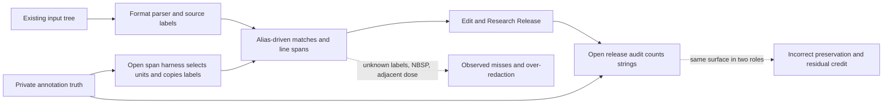
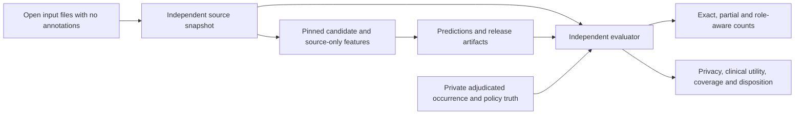
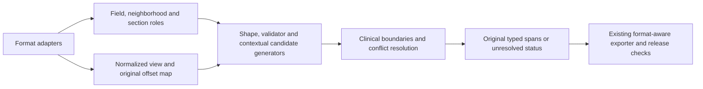
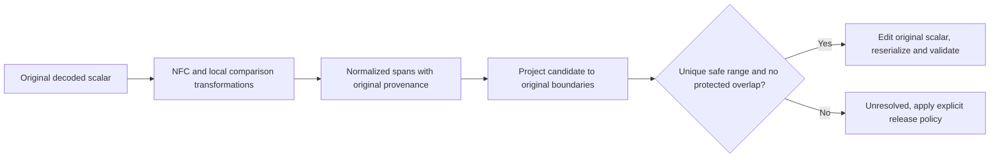
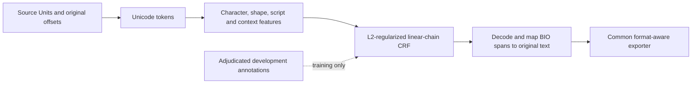
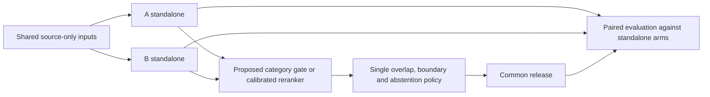
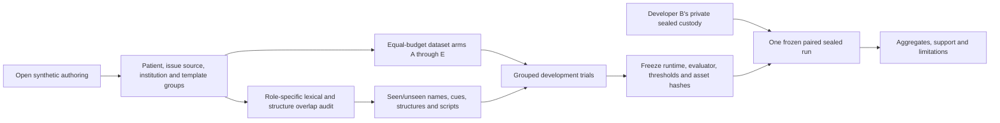
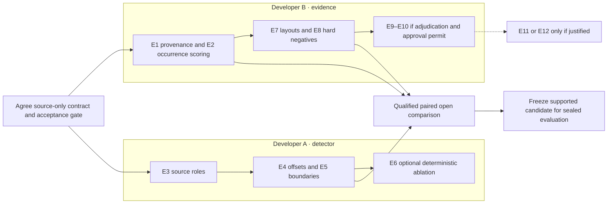

# Secret Wards generalization solution plan

**Proposed for approval.** Use an independent evaluator as the gate for performance claims. In parallel, test a small format-aware deterministic improvement on open synthetic counterexamples. Introduce a learned detector only if corrected evaluation still shows systematic misses where the available context can distinguish sensitive and protected roles.

This revisits the field-role, evaluation, clinical-boundary and holdout decisions in the existing [Wayfinder map](https://github.com/baymax-afk/scaler_hackthon/issues/1). It uses [the organizer submission contract](../SPEC.md), [scoring policy](../SCORING.md) and [original problem statement](../PROBLEM_STATEMENT.md) as requirements, and the approved Phase A route as the historical baseline. The Phase A candidate document records route approval and treats detailed interfaces as proposals. The checkout has no separate team engineering specification or ADR for this change. Preserve Version 1 commit `095c854` and current deterministic reference `d8973ab` as distinct comparators. Keep their reports and historical candidate numbering. The plan uses **A** for the deterministic candidate, **B** for the CRF candidate and **C** for the hybrid in this document. [Earlier candidate selection](candidate-pipelines.md) · [Previous V2 plan](version-2-improvement-plan.md)

## Evidence and root causes

The original corpus had 0 visible literals among 7,917 source-present labels on 2,000 records. On the newer 1,400 records, 2,015/4,391 remained visible. CSV had 559/840 residual labels and TSV 418/630. The audits use different scopes and neither establishes population accuracy. The current pipeline has no trained weights. The sealed 600-record test remains independently owned and was not accessed.

| Priority | Confirmed problem | Root cause and uncertainty |
| --- | --- | --- |
| P0 | Span predictions can receive annotation-provided roles. | Source-unit export reads truth to enumerate units and copy labels. Detector labels affect rule selection. Filtering to annotated units also omits ordinary background fields. The underlying release path does not need this oracle. |
| P0 | Release measurement can hide a leak and over-credit protection. | Surface counts collapse distinct instances of the same text. The newer strict scorer has one-to-one overlap matching, while the older open scorer can credit one broad prediction twice. Strict mode can also classify an unreviewed span in a partially annotated positive unit as a false positive. Whole-unit accuracy can credit a unit with only one of several identifiers found. |
| P1 | Same values behave differently under unfamiliar headers or Unicode spacing. | The parser hands a label and scalar to detection. Exact alias membership and literal cue separators do much of the role inference. Existing label normalization does not cover the corresponding note-cue path. The evidence favors combining independent signals; the size of the benefit is unmeasured. |
| P1 | A name rule deletes an adjacent dose. | The inline labeled-candidate regex can capture the rest of the line up to its limited separators, and the whole match becomes the accepted edit. This case reproduces without a competing candidate, so the primary defect is boundary construction. |
| P1 | The open splits share identity vocabulary. | 412/454 validation name occurrences and 146/160 relative occurrences reuse exact development surfaces. Declared patients, institutions and templates are disjoint. The shared generator and name pools limit claims about identity-vocabulary generalization. Causal impact is unmeasured. |
| P1 | Lower residual counts can accompany reduced export coverage. | The date guard quarantines 19 additional organizer-practice files. Visible labels moved from 631/3,172 exported to 581/2,940, with preserved clinical probes declining from 4,701/4,855 to 4,382/4,855 across all inputs. Current rules still link 0/78 eligible open pairs. Keep quarantine and linkage on the scorecard. |

[Evidence, versions and replay](generalization-and-regularization.md) · [Detector](../../submission/rakshak/detection.py#L25) · [Open evaluator](../../evaluation/robustness_v2.py#L230) · [Strict scorer](../../evaluation/evaluate.py#L82)

## Independent evaluation

### Interfaces

| Boundary | Input | Output and invariant |
| --- | --- | --- |
| Source enumeration | Input bytes, format, configuration and observable structure. The detector sees only organizer-visible inputs. | Source Units with opaque ID, original file/unit locator, channel, parse status, original decoded text or typed scalar, and source-derived context. Enumerate all supported runtime units before opening truth. Physical files with equal hashes retain distinct identities. |
| Detector | Source Units and versioned configuration. | A prediction snapshot with variant and configuration digests, input digest, unit/record locator, complete/incomplete status, and typed half-open original code-point spans. Carry entity role when known and a controlled reason on abstention. Raw text and truth are excluded from the prediction artifact. |
| Private annotation | Original Source Units and review evidence in evaluator custody. | Occurrence IDs, source locations, exact typed span or whole scalar, role, protected facts, transformations and disposition. Mark each unit `exhaustive`, `partial` or `unknown`, with separate adjudication state. Multiple mentions with identical text have distinct IDs and locations. |
| Release audit | Independently parsed input and output, private truth, `report.json`, `records.jsonl` and file hashes. | Reconciled file and record accounting, observed occurrence outcome, protected-fact outcome, and measured coverage. Use RFC 6901 paths and consistent decoded-attachment representations. Check exact indexing separately from longest-locator linkage matching, honor mapped output locations, and reconcile file statuses with actual paths/bytes. |

Pin fixture and scorer versions. Verify that changing an annotation, deleting annotations entirely, or moving the truth directory leaves the detector input bytes and hashes identical. Run detector variants with access only to the deployment input tree and their pinned assets. A detector process may share parsing contracts, while an evaluator checks their results without importing recognizers or rule maps.

### Metrics and denominators

- **Exact typed spans.** A match needs the same Source Unit, original start/end, category, and role when the role is annotated for that comparison. Report category-only and role-aware metrics separately. Use maximum one-to-one matching on eligible occurrences. Unmatched gold spans are misses. Unmatched predictions are false positives only in exhaustively adjudicated scope. Keep completed partial annotations useful for matched positives and explicitly label what their support can justify.
- **Partial spans.** Run a separate maximum-cardinality one-to-one match at the declared overlap criterion, with greater overlap as the deterministic tie-break and a stable ID for remaining ties. Report typed overlap and partial coverage of each gold span alongside exact matches. A partial overlap does not establish that a released identifier is unrecoverable. Track overlong boundaries and any overlap with protected facts. [Biomedical exact and partial span precedent](https://aclanthology.org/S13-2056/) · [Clinical i2b2 scoring](https://pmc.ncbi.nlm.nih.gov/articles/PMC4989908/)
- **Release occurrences.** Compare each input occurrence against its mapped output context. Classify as fully transformed, partly visible, fully visible, unresolved alignment or not exported. For duplicate strings, anchor to source/target structure and neighboring unchanged context. Test a private edit-coordinate trace only if independent alignment is too ambiguous. Verify every trace against output bytes and hold trace data outside the Research Release. An ambiguous alignment remains unresolved. If the trace is used, bind physical input and output identities, artifact digests, typed target coordinates and declared dispositions, then verify unchanged segments and replacement replay. Identical duplicate text can admit more than one valid replay. Scan structured channels and locally decoded attachments independently. [Provenance derivation](https://www.w3.org/TR/prov-dm/#term-Derivation) Count a record as verified private only if exported, structurally valid and all adjudicated required occurrences pass, with adequate annotation coverage.
- **Clinical utility and coverage.** Score protected occurrence retention and exact/semantic fact preservation. Include dose, unit, route and frequency jointly where possible. Publish separate denominators for all input and exported material. Require file, Patient Record and Scoring Unit coverage and quarantine/rejection reasons. Quarantine protects against release of unsafe data but leaves the retention and coverage denominator. Audit missing and reused outputs, unlisted artifacts, duplicate index entries and positional remaps. Include side-channel Canary checks and run-to-run reproducibility.
- **Other required outcomes.** Report eligible linkage precision/recall and False Merges independently of exact index coverage. Check pseudonym consistency inside records and secret changes, date interval fidelity, age-band truthfulness and validity of required formats. Keep organizer metrics and local independent audits distinctly named. [Submission and disclosure requirements](../SPEC.md#6-recordsjsonl) · [Organizer scoring](../SCORING.md)
- **Uncertainty and distribution.** Publish numerator, denominator and support by CSV/TSV/JSON/FHIR/text, entity category and role, script/language, layout, vocabulary familiarity, template familiarity and split. For paired deltas, resample independent patient or template/institution groups at the level the experiment holds out. Avoid treating related occurrences as independent. Report weakly supported slices explicitly and use descriptive counts when too few independent groups support intervals. Include p50/p95 latency, throughput and peak process-tree RSS on the same machine and constraints.

### Synthetic evaluator acceptance examples

| Counterexample | Expected independent result |
| --- | --- |
| A note contains a relative and a clinician with the same fictional name. The release removes only the clinician occurrence. | One sensitive occurrence remains and one protected occurrence was lost. The current audit reproduced the opposite. |
| A wide predicted span overlaps two separately annotated names. | Zero exact matches and at most one typed partial match. Report any covered clinical span. |
| A name spans two tokens and only the surname is edited. | Count partial span coverage and a released residual for the remaining identifying part under the fixture's policy. |
| Nested JSON keys contain escaped slash and tilde, and an attachment has two matching strings. | Join by escaped structural location, representation and occurrence. Corrupt or extra locations fail. |
| A partially annotated unit has one known positive and one unreviewed prediction. | Credit the verified positive. Mark the second prediction unknown unless independently judged. The current strict scorer instead reported precision 0.5 in this probe. |
| An incomplete negative has no accepted spans. | Count incomplete with reason. The unit cannot supply a true negative or evidence of successful scanning. |
| A difficult file is quarantined, or two input digests point to one artifact. | Quarantine lowers coverage and all-input utility. A duplicate artifact fails reconciliation. A metadata-only file with a Patient Record entry fails the index gate. |

## Candidate architectures

These share the existing CLI and exporter contract. Keep one Source Unit interface, one finding representation and one release integration point. Use internal modules to hide parser and mapping complexity. Keep logical Patient Record enumeration separate from detector selection.

### A. Improved deterministic detection

Infer source roles from FHIR resource and element paths, nearby expected fields, label tokens, aggregate shape of a bounded sample of column values and local section cues. A label contributes evidence. A compatible value shape, cross-field evidence or a known structured role can corroborate it. Unknown or conflicting roles carry explicit uncertainty. Use precision-oriented validators for email or structured identifiers where applicable, and country-format rules as evidence rather than proof of assignment. A dictionary can supply evidence without overriding a protected clinical role. Candidate generators propose spans independently, with the combiner recording source evidence and rejecting unresolved ambiguity rather than merging across clinical text. This borrows the idea of combining column values and surrounding table context from general semantic typing research. That literature does not validate our clinical labels. [FHIR actor datatype reuse](https://hl7.org/fhir/R4/datatypes.html#HumanName) · [Sato](https://arxiv.org/abs/1911.06311) · [Sherlock](https://vis.csail.mit.edu/pubs/sherlock/) · [Philter](https://www.nature.com/articles/s41746-020-0258-y)

**Normalization.** Keep original bytes and the decoded source immutable. Normalize a comparison view as a well-defined versioned policy. Start with tested Unicode space handling in label contexts and NFC for canonically equivalent text. Apply NFKC, digit folding, casefold and punctuation normalization in narrowly declared comparison features when justified. Handle expansion, composition and zero-length effects with provenance ranges from the original decoded text. Validate the mapping against the Unicode normalization contract. For full-string normalization, account for composition and reordering across adjacent input scalars. A separately normalized character or segment can differ from the normalized whole. If matching only a portion of an expansion would redact a neighboring symbol or protected fact, report unresolved. Never rewrite measurement symbols or saved JSON from the comparison view. A probe with an emoji and a decomposed accent placed a following name at original code points [8,12), NFC code points [7,11), and original UTF-16 code units [9,13). Use these as distinct coordinate systems. [Unicode normalization](https://www.unicode.org/reports/tr15/) · [Unicode segmentation](https://www.unicode.org/reports/tr29/) · [ICU edit mapping](https://unicode-org.github.io/icu-docs/apidoc/released/icu4j/com/ibm/icu/text/Edits.Iterator.html)

**Clinical boundaries.** Replace remainder-of-line capture with bounded candidate segmentation and scoped stop cues for dose patterns, units, frequencies, negations and clinical headings. Require positive context for patient or relative roles. A hard negative can prevent deleting the wrong mention. It must not veto a distinct identifying occurrence with the same surface. Test names adjacent to protected text before changing overlap policy. Compare candidate coverage, exact boundaries and export utility.

### B. Independent L2-regularized linear-chain CRF

Use source-only tokenization with stable original offsets and an explicit BIO scheme for flat category spans. Preserve ambiguous and overlapping gold separately in evaluation, with a predeclared training policy for labels the flat representation cannot express. Use compact character n-grams, prefixes/suffixes, token shape, script, digits, punctuation, capitalization, token windows, source structural context and carefully sourced clinical terminology. Cap rare lexical features and retain separate shape/context channels. An independently decoded sequence can discover spans outside the deterministic candidate set. Training examples and annotation truth are separate from inference artifacts. Measure category leakage and unsupported cases even if a CRF improves F1.

Use CRFsuite L2 first with matched weak/L2 grid arms. Compare L1 or rare feature pruning after measuring feature reliance. Hold tokenization, architecture, train groups, sampling, config and seeds fixed. For neural options, ordinary dropout reduces co-adaptation, locked dropout reuses masks across sequence positions and R-Drop penalizes disagreement across two stochastic training passes. They raise different training costs and only apply to a justified trainable neural tagger. Use grouped validation for early stopping and thresholds. Form-aware augmentation and train-only feature masking may reduce reliance on names or label features. Only vary context known to preserve labels, and recalculate offsets. Adversarial text perturbations are useful as diagnostic stress tests. Adversarial training follows only if they remain plausible and label-preserving and simple augmentation leaves the exact measured weakness. No primary-source evidence establishes “COPA dropout” as the requested NER regularizer. [CRFsuite](https://www.chokkan.org/software/crfsuite/manual.html#lbfgs) · [Earlier regularization comparison](generalization-and-regularization.md#dropout-and-other-learned-regularizers) · [RockNER](https://aclanthology.org/2021.emnlp-main.302/) · [R-Drop](https://proceedings.neurips.cc/paper/2021/hash/5a66b9200f29ac3fa0ae244cc2a51b39-Abstract.html)

### C. Independently qualified hybrid

Run A and B on the same neutral source and preserve separate outputs. Compare a simple per-category gate first. For example, high-evidence structured detections go through the deterministic arm and lower-confidence unstructured spans may use CRF evidence. Compare that gate with category-aware reranking only where validation support justifies it. A learned score combiner or calibrated fusion requires enough disjoint validation labels, a defined outcome such as correct typed span, and separate calibration checks under shift. A regex Detection Score is a rank, not a probability. Conflicts and disputed boundaries use the same release policy. A hybrid must beat the stronger standalone arm on the predeclared objective with no gate regressions. In one i2b2 study, the ensemble improved strict F1 compared with the rules and CRF arms, yet recall was slightly below its neural component. Inspect model-only wins and clinical losses directly. [i2b2 hybrid study, Tables 4 and 6](https://medinform.jmir.org/2020/4/e17622/) [Calibration under shift](https://proceedings.neurips.cc/paper/2019/hash/8558cb408c1d76621371888657d2eb1d-Abstract.html)

| Criterion | A. Deterministic | B. L2 CRF | C. Hybrid |
| --- | --- | --- | --- |
| Transfer and privacy | Directly addresses measured label dependence. May miss rare or cue-free names. | Character/context features can transfer. A small corpus can reward lexical shortcuts and gaps in negative coverage. | Potential coverage gain if errors complement each other. A union can amplify false positives and ambiguity. |
| Clinical preservation and explainability | Bounded edits and source-specific reasons are readily checked. | Learns boundaries with reviewed roles. Feature inspection and adjudicated negatives support debugging. | Disagreement evidence helps review. More decisions complicate attribution and gating. |
| Training and language | No fit. Test English/Hindi/Hinglish and unseen scripts with explicit support counts. | Needs adjudicated spans, tokenization across scripts and grouped splits. Unseen identity and language slices are essential. | Needs standalone artifacts and extra valid threshold-selection support per class. |
| Effort, compute and latency | Lowest startup cost and best near-term fit. Bound scans, sampling and candidate counts. Measure actual impact. | Moderate offline training and CPU inference effort with a compact model. Pin dependency and measure footprint and p95. | Highest integration and validation cost. Measure both engines and the combined policy. |
| Compatibility and eligibility | Reuses adapters, normalization seam and output contract. Offline rules are allowed. | Independently supplies the same findings. A self-trained classic CRF is explicitly allowed, with declared assets. | Compliant only if each component is eligible and the combined release stays within all limits. |

Recommend **A now**, evaluated by B's independent workstream. It directly addresses the measured failure locations and allows later evidence to justify B. A learned-only selection would depend on adjudicated data whose readiness is still open. A hybrid comparison also depends on two standalone results and evidence of complementary errors.

## Tool and model comparison

The organizer permits rules, gazetteers, CRFs, classical ML and small models contestants train. The judged run has two CPU cores, a 4,096 MB process-tree RSS cap and a 900 s standard-profile hard limit. Full standard-profile efficiency credit uses 60 s and 512 MB. It runs offline. LLMs, generative models and pretrained transformers above 50M parameters are prohibited, and every model needs declaration in the submission README. Pre-stage the chosen dependency wheels, tokenizer, weights and configuration, then verify on a cold network-disabled run. A checkpoint’s file size is separate from its parameter count and process RSS. This review inspected primary sources and did not benchmark the packages. [Ground rules](../PROBLEM_STATEMENT.md#7-ground-rules) · [Runner specification](../SPEC.md#2-execution-environment) · [CPU scoring](../SCORING.md#6-cpu-efficiency--reliability-10)

| Tool or model | Availability, terms, and useful comparison |
| --- | --- |
| Presidio Analyzer (originally Microsoft) | The 2.2.366 MIT release is published from Data Privacy Stack for Python 3.11–3.14. Use local pattern and context recognition, with a pinned local CPU NLP asset if needed. It offers India-specific recognizers for several identifiers and supports per-language engines and context configuration. Compare its typed candidates against the native rules on Devanagari digits, ambiguous clinical numbers and script-switching. A country setting selects relevant recognizers. Hindi tokenization, labels and clinical roles still need their own validation. [Package](https://pypi.org/project/presidio-analyzer/2.2.366/) · [Supported entities](https://presidio.dataprivacystack.org/supported_entities/) · [Country filter](https://presidio.dataprivacystack.org/analyzer/filtering_by_country/) · [Language configuration](https://presidio.dataprivacystack.org/analyzer/languages/) |
| GEMINI pyDeid | GEMINI source declares 1.0.1 and MIT. The rendered docs show 0.0.4 and the separately published PyPI project with the same name shows 0.0.1, so pin GEMINI’s source revision. Compare regex, inclusion and exclusion lists, and record-level name reuse on unstructured fields. The authors report best recall 0.950 and F1 0.904 across configurations in their admission/discharge-note experiments. Use these as evidence for the method and test local transfer across English, Hindi and Hinglish. Feed spans into the existing release path to preserve its format, linkage and pseudonym rules. [Source metadata](https://github.com/GEMINI-Medicine/pyDeid/blob/master/setup.py) · [License](https://github.com/GEMINI-Medicine/pyDeid/blob/master/LICENSE.md) · [Docs](https://gemini-medicine.github.io/pyDeid/) · [PyPI](https://pypi.org/project/pydeid/) · [Study](https://pmc.ncbi.nlm.nih.gov/articles/PMC11752853/) |
| UCSF Philter | The UCSF MIT project published `philter-ucsf` 1.0.3 with an sdist and a Python 2-tagged wheel. Check the source revision, Python compatibility and NLTK assets before any run. Use allow-patterns, custom clinical protections, and deny-patterns as a design reference. The original study reported 99.46% recall on UCSF notes and 99.92% on i2b2, with results specific to those corpora and its scoring method. Test how legacy English lexical rules treat local abbreviations, protected terms and code-switching. The separate Apache-2.0 `philterd/philter` namesake implements its own redaction system. [UCSF package](https://pypi.org/project/philter-ucsf/1.0.3/) · [UCSF source and license](https://github.com/BCHSI/philter-ucsf) · [Study](https://www.nature.com/articles/s41746-020-0258-y) · [UCSF results summary](https://informationcommons.ucsf.edu/media/101) · [Namesake](https://github.com/philterd/philter) |
| sklearn-crfsuite and CRFsuite | `sklearn-crfsuite` 0.5.0 and `python-crfsuite` 0.9.12 are MIT. The bindings bundle the modified-BSD C/C++ CRFsuite implementation, whose standalone release is 0.12. Prefer the wrapper for development and benchmark direct bindings for inference if dependency overhead matters. A locally trained BIO tagger over Unicode-aware shape, nearby role cues, section, token n-grams and gazetteer matches can focus on missed Patient names and address spans. Keep patterns as independent evidence for structured IDs. The 2014 i2b2 organizers found successful systems combined CRFs and handwritten rules. Their results motivate the architecture and leave multilingual clinical transfer to local tests. [Wrapper](https://pypi.org/project/sklearn-crfsuite/0.5.0/) · [Bindings](https://pypi.org/project/python-crfsuite/0.9.12/) · [CRFsuite](https://www.chokkan.org/software/crfsuite/) · [i2b2 overview](https://pmc.ncbi.nlm.nih.gov/articles/PMC4989908/) |
| spaCy | MIT `spacy` 3.8.18 has Linux wheels. The separately released MIT `xx_ent_wiki_sm` 3.8.0 is a 10 MB CPU NER pipeline trained on WikiNER and reports F1 0.83 on its published evaluation. Try blank Hindi or neutral tokenization with matcher patterns first and measure whether the statistical pipeline adds enough name/organization coverage. spaCy lists Hindi language support without a trained Hindi pipeline, and the WikiNER labels lack patient/relative/clinician roles. [spaCy package](https://pypi.org/project/spacy/3.8.18/) · [Language support](https://spacy.io/usage/models/) · [Multilingual pipeline and license](https://spacy.io/models/xx) |
| Flair | MIT Flair 0.15.1 supports local sequence tagging. Its `ner-multi-fast` is a non-transformer Flair-embedding LSTM-CRF with CoNLL English, German, Dutch and Spanish and a 1.51 GB artifact. The model card does not declare a checkpoint-specific license. The published model has limited language fit and an uncertain whole-process RSS profile. Keep it as a comparison of architectures or train a compact character model on synthetic data if a CRF leaves repeatable errors. [Flair package and license](https://pypi.org/project/flair/0.15.1/) · [Model card](https://huggingface.co/flair/ner-multi-fast) · [Checkpoint files](https://huggingface.co/flair/ner-multi-fast/tree/main) |
| GLiNER | The 0.2.30 code is Apache-2.0. The separately licensed Apache-2.0 v2.1 model cards list 166M even for `gliner_small-v2.1` and 209M for `gliner_multi-v2.1`. The multilingual PII variant fine-tunes the same multilingual model and uses mDeBERTa-v3-base. The checked checkpoints exceed the cap. Quantization can lower storage and CPU cost while retaining the same parameter count. The PII model card includes medications, conditions and blood type among possible labels, illustrating the need for an explicit Clinical Utility policy before accepting generic NER outputs. [Package](https://pypi.org/project/gliner/0.2.30/) · [Small and multilingual checkpoint table](https://huggingface.co/urchade/gliner_small-v2.1) · [PII checkpoint](https://huggingface.co/urchade/gliner_multi_pii-v1) · [PII configuration](https://huggingface.co/urchade/gliner_multi_pii-v1/blob/4a795149cf3574d0b4b6639aa8112dbd758e7121/gliner_config.json) |
| AI4Bharat models and Hinglish evidence | The MIT `ai4bharat/indic-bert` v1 is a 33M ALBERT encoder per the authors and its PyTorch artifact is 135 MB. It covers Hindi and English among 12 languages. An encoder-only token-classification head fits the numerical cap as a design candidate. Test the 128-token pretraining context, window-edge spans, multilingual offsets and cold CPU budget. The separate gated MIT `ai4bharat/IndicNER` checkpoint uses a later IndicBERT lineage and lists a 667 MB float checkpoint, indicating it is above cap. Naamapadam supports generic person, location and organization labels, while LinCE adds Hindi–English code-mixed social-text NER evidence. Both inform held-out cases and require local role and clinical validation. [V1 model and license](https://huggingface.co/ai4bharat/indic-bert) · [V1 and V2 parameter counts](https://aclanthology.org/2023.acl-long.693.pdf) · [V1 files](https://huggingface.co/ai4bharat/indic-bert/tree/main) · [IndicNER card](https://huggingface.co/ai4bharat/IndicNER) · [Gated checkpoint files](https://huggingface.co/ai4bharat/IndicNER/tree/main) · [Naamapadam paper](https://aclanthology.org/2023.acl-long.582/) · [LinCE paper](https://aclanthology.org/2020.lrec-1.223/) |
| Hypothesis and CheckList | Hypothesis 6.170.17 is MPL-2.0. CheckList 0.0.11 is MIT. Use Hypothesis to generate and shrink original-offset, overlap, format round-trip, Clinical Utility and determinism failures. Apply CheckList minimum functionality, invariance and directional expectation to paired Latin, Devanagari and Hinglish fixtures. Run reproducible saved cases in the existing offline harness and keep these dependencies in development. [Hypothesis package](https://pypi.org/project/hypothesis/6.170.17/) · [Hypothesis license](https://github.com/HypothesisWorks/hypothesis/blob/master/LICENSE.txt) · [CheckList package](https://pypi.org/project/checklist/0.0.11/) · [CheckList paper](https://aclanthology.org/2020.acl-main.442/) |

## Diversity versus quantity

Treat exact repeat of a name as an audit dimension. Shared medications, clinical terminology and common units can be legitimate shared context. Keep identity values, clinician/patient homonyms, institution aliases and field labels separately summarized.

| Dimension | Developer B's audit or controlled probe |
| --- | --- |
| Patient and clinician names, addresses and institution names | Report exact and normalized unique values and occurrence overlap by role. Separate whole names, surnames, initials and naming conventions. Use same-context swaps with fresh synthetic identities and paired same-surface role flips. |
| Identifier formats and Unicode | Fingerprint issuer, pattern/shape, separators, script and lengths independently from exact IDs. Hold out combinations, such as Indic digits plus a shifted delimiter or a new namespaced identifier in an unfamiliar field. |
| Fields, layouts and sentence structure | Hash schema shape and ordering; compare normalized text shingles plus label and template-family distributions. Review suspicious adjacent split groups manually. Compare familiar values in new layouts and new values in the same layout to isolate causes. |
| Language and clinical vocabulary | Report section, label and text script separately because names can be multilingual in English notes. Track legitimate clinical overlap separately from identity values. Hold out plausible combinations of layout, script, role and cues. |
| Generation methods | Record authoring process, source template families and perturbation ancestry. Group all related variants before splitting. Read only aggregate sealed metadata supplied by its owner. |

At equal annotated record counts compare **A** more familiar layouts and vocabulary, **B** independently authored layouts, **C** those layouts with new identity vocabulary, **D** independent layouts plus adjudicated clinical hard negatives and **E** combinations of multilingual, structural and contextual variation. Here A–E label dataset arms only. Hold annotation policy, review effort, identifier mix, document/format balance, model config, seeds and development evaluation fixed. For held-out combinations keep marginal cue frequencies similar where possible while withholding specific alias, script and section tuples. Form extraction studies support reporting unseen-layout slices separately. These are design analogies rather than clinical performance estimates. [VRDU](https://arxiv.org/abs/2211.15421) · [DocILE](https://arxiv.org/abs/2302.05658) · [Compositional split design](https://arxiv.org/abs/1912.09713) Compare nested learning-curve budgets such as 100/250/500 reviewed records if support permits. Use out-of-fold development errors to sample hard negatives, near misses and ordinary controls. For deterministic prototypes, compare equal fixture/review budgets and time spent changing rules, since a rule engine does not train on the dataset. Select only after testing against separate untouched open development families. Keep the 600-record test reserved for one frozen comparison. [Clinical active learning study](https://pmc.ncbi.nlm.nih.gov/articles/PMC6568071/) · [WILDS](https://proceedings.mlr.press/v139/koh21a.html) · [Indian transfer study](https://aclanthology.org/2024.bionlp-1.26/) · [Cross-institution results](https://link.springer.com/article/10.1186/s12911-019-0935-4) · [Synthetic-to-real drift study](https://pmc.ncbi.nlm.nih.gov/articles/PMC13130710/)

## Controlled experiment roadmap

All experiments specify private truth separate from inference inputs, paired baseline revisions and fixed policy, annotator effort, metric support and resource conditions unless the row explicitly varies them. Use the open five-record integration slice to exercise seams, historical practice and original fixtures as regressions, and independently authored open development groups for variation. Build held-out group comparisons without consulting the sealed 600. Small prototypes estimate feasibility. No result below is established until executed.

| Experiment and owner | Hypothesis, variable and controls | Data and methodology | Metrics, gate and decision | Effort and dependency |
| --- | --- | --- | --- | --- |
| E1 · B · P0 | Truth leaks through source enumeration and labels. Compare legacy export and source-only enumeration with identical raw input and detector. | Five-record slice plus unknown/nested field and background controls. Mutate and remove annotation copies, compare snapshot digests and unit inventory. | Identical source-only inputs across truth changes, complete intended channel inventory, forbidden attributes absent. Decides neutral Source Unit contract. The small slice cannot prove full adapter coverage. | 1–2 h initial prototype. Existing [neutral input issue](https://github.com/baymax-afk/scaler_hackthon/issues/21). |
| E2 · B · P0 | Occurrence, locator and disposition reconciliation exposes false passes. Compare legacy counts with the independent evaluator on frozen outputs. | Use the six counterexamples above with manually authored truth and negative controls. Independently parse outputs and project per-occurrence context. | Every counterexample scores as expected, ambiguity remains visible, no count credit for missing outputs. Decides auditor alignment contract and whether a private verified trace is needed. | 2–4 h initial prototype. Can start on fixtures alongside E1. Existing [role scoring](https://github.com/baymax-afk/scaler_hackthon/issues/22) and [artifact reconciliation](https://github.com/baymax-afk/scaler_hackthon/issues/23). |
| E3 · A · P1 | Structure and corroborating field evidence recover misses on renamed CSV/TSV/JSON headers. Compare alias-only with source-derived roles. | Paired open cases with unknown labels, equivalent values, clinician fields and incomplete rows. Hide a family during design and include misleading field labels. | Improve exact role/type recall on paired positives, no added protected loss, unchanged supported coverage. Decides which source context to derive. | 1–2 h. Agreed source contract; can build fixtures in parallel with E1/E2. |
| E4 · A · P1 | Safe comparison normalization protects equivalent inputs. Compare current and original-mapped normalization. | Use Unicode official cases plus metamorphic NBSP, combining marks, expansions, full-width digits, escaped text and protected adjacent symbols. Generate property-based malformed and collision examples. | Equivalent cases return the expected original roles/ranges, every offset round-trips, no leaked or damaged neighbor on fixtures. Decides allowed normalization policy. | 1–2 h initial. Requires Source Unit representation; pairs with E5. |
| E5 · A · P1 | Clinical boundaries improve edits containing a name and a dose. Compare greedy candidate with bounded segmentation. | Pair synthetic adjacent name/dose/frequency/negation cases, and same-surface clinician and relative controls. Fix normalization while comparing. | Exact spans and protected facts both pass critical cases. Favor narrower or unresolved candidates if evidence conflicts. Decides where segmentation sits relative to candidate aggregation. | 1–2 h. Fixtures in parallel, E2 required for benchmark claims. |
| E6 · A · P1 | Independent shape, validator and contextual evidence generalizes past predefined aliases. Ablate each proposed evidence source on A after E3–E5. | Held-out open layouts, new identifier formats, decoy codes, family/role collisions and sparse fields. Record matched reasons and downstream dispositions. | Improve worst supported targeted feature slices and maintain gates. Decides whether multi-signal deterministic recognition suffices for the next deliverable. Small coverage can leave the result inconclusive. | 2–4 h. E1–E5. |
| E7 · B · P1 | Independent style and identity vocabulary outperform familiar-template sampling at fixed effort. | Compare dataset arms A/B/C at equal reviewed volume, then E where capacity allows. Score unseen layouts and identity surfaces on open held-family examples. | Report paired gains with group support and stable annotation quality. Decide whether to spend new data budget on unfamiliar syntax or more volume. | 3–6 h for an initial adjudicated set plus review. E1/E2 for quantitative claims; authoring can start earlier. |
| E8 · B · P1 | Clinical hard negatives improve preservation with manageable recall cost. | Compare B/D/E of dataset arms at equal counts and review budget. Mine out-of-fold development errors only. Include paired positive counterparts and ordinary controls. | Fewer damaged protected spans at fixed recall/coverage band, with inspected error types. Decides hard-negative sampling mix. | 2–4 h initial plus review. E2; parallel with E7 authoring. |
| E9 · B with A interface review · conditional | A lightweight CRF recovers systematic ambiguous spans outside deterministic output. Compare deterministic reference with standalone CRF at one approved policy. | Only after adjudicated examples and approved training, fit compact source-only features on development. Validate on grouped held-family layouts and measure paired direct release effects. | Credible targeted typed-span gain or complementary residual reduction with coverage, utility and resource gates. Decides whether to retain an independent learned arm. | 4–8 h plus labeling. E1/E2 and readiness review, approved shared findings contract. |
| E10 · B · conditional | L2 and feature control reduce name/template shortcuts. | Hold train case set, feature families and tokenization fixed; compare L2 grid, L1/pruning and leave-one-feature-family-out. Include unseen identity and misleading-label strata. | Compare development-to-validation gap, worst supported script/role, protected errors, model size and CPU. Decides the minimum useful feature/model configuration. | 2–4 h after E9. |
| E11 · shared, lead B · optional | A small sequence tagger gains on remaining boundary/context cases at acceptable CPU cost. | Compare matched capacity and seeds with and without embedding/activation dropout and grouped early stopping. Add locked dropout only if justified. Fix training set. | Material gain over the selected CRF within release/resource gates. Report training cost and uncertainty. Decides whether neural complexity earns a place. | 6–12 h after E9/E10 and only with measured need. |
| E12 · A integration, B evaluation · optional | Independent candidates complement each other. Compare standalone A/B against a simple category gate, then calibrated fusion if data is sufficient. | Use the same release policy and frozen inputs. Fit gates or calibration on grouped validation only. Use paired disagreements and measure acceptance/review. | Hybrid clears all gates and beats the strongest standalone arm by an agreed margin. Otherwise choose the best eligible standalone arm. | 3–6 h after both independent baselines. |

## Ownership, gates and shortest path

- **Developer A** owns `submission/rakshak/` and runtime regression tests. Review the Source Unit and finding schema with B once, then use source-only prototypes and fixed clinic controls while the evaluator matures. Start with one table-role case and one note-boundary case. Later combine verified behavior into the existing output adapter. Linkage and date transformations already have separate decision paths.
- **Developer B** owns `evaluation/`, `docs/datasets/`, corpus lineage and sealed custody. Deliver E1/E2 in small artifacts and verify each in a clean evaluation process. Prepare diverse open families, label support and neutral snapshots independently. If the CRF branch earns priority, B can train it with the frozen Source Unit/finding contract while A continues deterministic work. A consumes generated public fixtures and aggregate sealed evidence.
- **Joint checkpoints.** Agree one neutral fixture and result contract, replay counterexamples and both historical benchmarks, then run the first qualified deterministic comparison. Before final evaluation B verifies split separation and freezes inputs while both pin runtime and scorer. Open threshold changes stay in development/validation. Once sealed evidence informs tuning it loses sealed status under the existing custody agreement.

**Minimum viable iteration.** E1 and E2, then the smallest paired E3/E5 comparison. Include E4 for normalization-dependent paths. Use the previous single 90-person-minute follow-up as a planning cap unless the team revises it. Typical engineering planning estimate is 7–12 person-hours for this narrow cycle including a replay and preflight, with annotation budget and calendar time still to confirm. It is a measurable improvement cycle. Full linkage, keyed temporal protection and broader output qualification remain required for the complete solution. [Prior development budget](../development-plan.md#version-2-planning-and-handoff)

**Proposed gates.** Require source-input invariance to any truth change and exact expected behavior on every evaluator counterexample. Require no new failed protected-fact or format checks on paired controls, no new False Merges, no Canary escapes, no silent skips and no loss of supported export coverage on the same targeted fixture set. Require improvement on targeted independently authored open cases before freeze. A provisional decision margin is at least 10 percentage points of exact typed recall on the predeclared target, with the uncertainty and subgroup support reported. Compare alternatives when smaller differences could matter, and treat inconclusive samples as inconclusive. On judge-equivalent Linux enforce 2 CPUs, 4,096 MB process-tree RSS and 900 s, and report the 60 s and 512 MB standard-profile scoring targets where applicable. [Runtime contract](../SPEC.md#2-execution-environment) · [Scoring](../SCORING.md#6-cpu-efficiency--reliability-10)

## Remaining decision frontier

Reopen the holdout and evidence gate first, then confirm the source-derived field role and protected-boundary comparison. Keep the earlier format-preserving, offline and sealed-custody decisions. Defer the choice of a learned or hybrid route until the corrected scorer shows what contextual failures remain. Significant interface or release-policy choices can become ADRs after approval.

The first decision is whether both developers should use an evaluator-first gate for all acceptance and tuning claims while A prototypes on public fixtures. A could instead patch visible misses and use the old literal audit as a temporary selection measure. That is faster to start, but the same-surface counterexample shows it can reward the wrong edit. The proposed gate permits parallel detector experiments and withholds adoption claims until B qualifies the neutral inputs and role-aware audit. It determines when thresholds can be selected and when model work becomes actionable. [Existing decision frontier](../wayfinder.md#version-2-decision-frontier)
