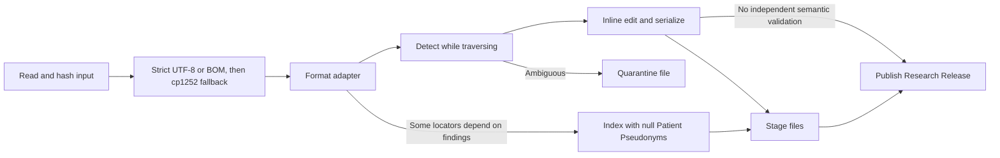
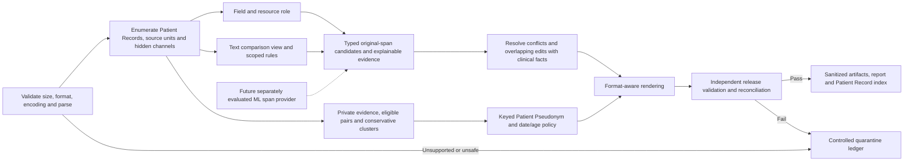
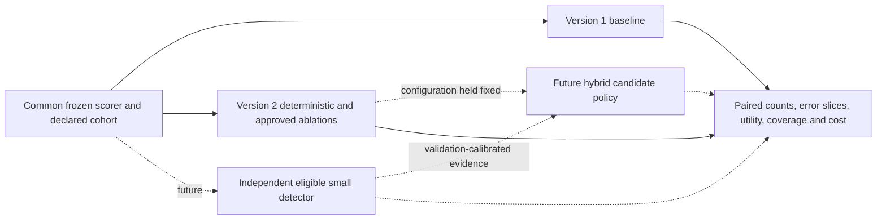

# Version 2 decision proposal

Version 1 remains the historical reference. The [generalization and requirements audit](generalization-analysis.md) contains the replay, failure taxonomy and traceability matrix. The [external research](robustness-techniques.md) and [robustness_v2 design](dataset-v2-design.md) specify the evidence, proposed experiments and dataset protocol. Implementation depends on team approval.

## Verified Version 1 flow

The adapter supplies some field roles, resolves references on a subset of Bundles, and writes a reconciled file ledger. The parse/detect/edit interleaving leaves no place to reuse private identity evidence across Patient Records. The observed missed links come directly from unconditional abstention. There is no evidence that removing identifiers early caused an attempted linker to fail.

## Proposed Version 2 flow

Keep the CLI, output contract, format-specific rendering, original offsets and whole-file disposition. Evolve the existing modules with a small internal handoff for parsing and evidence. Keep cross-file identity state compact and private. Re-read bounded inputs in a second pass if that reduces peak RSS and raw evidence retention. Benchmark against a single-pass variant before committing to the execution shape.

| Proposed seam | Responsibility and contract |
| --- | --- |
| Format adapters and source units, A | Parse each supported input under an explicit disposition and size/decode policy. Return stable Patient Record locators independently of identifiers. Supply immutable source text or typed structured values plus original path, channel, field role hints, unit and FHIR context as applicable. Preserve the existing half-open code-point contract for text. R4 primitives and JSON numbers retain type-specific rendering constraints. |
| Detection and candidate resolution, A | Propose typed spans with stable evidence codes. Resolve full or partial overlaps and mark a candidate accepted, conflicts/review or an incomplete scan. Detection Scores order comparable candidates under a versioned policy; they are heuristic evidence, with no probability semantics. Protect clinical cues contextually and preserve protected facts even adjacent to a valid identifying span. An empty complete scan and an incomplete scan have distinct results. |
| Linkage and privacy policy, A after the release slice | Read the private record/issuer evidence before redaction. Block on qualified strong anchors or corroborating cues, scope local identifiers by issuer, and veto conflicting anchors and unsupported transitive merges. Emit an opaque assignment or abstention per input record plus approved typed edits and outcomes. Key Patient Pseudonyms and date offsets with separate derivation labels and the release secret. Use bounded temporary storage only if necessary and keep raw evidence, keys and mappings out of all release channels. |
| Render, validate and publish, A | Apply original-coordinate edits once. For FHIR, coordinate locator/ID and reference updates within the graph. Use an independent staged-output parser, reference checks and semantic invariants, along with a bounded secondary residual check that uses different evidence from the detector. Verify paths, report, index, record counts and in-record assignments. Fail closed on the affected file if a required inspection is incomplete. A controlled release-level failure handles incomplete commit/publication. Keep fixture truth and runtime independent. |
| Dataset and evaluator, B | Validate known truth, generate neutral source-unit snapshots, score common artifacts and manage grouped splits independently of the runtime. Use opaque IDs to join, digests to freeze and explicit records for incompleteness. Teammate alone runs the sealed suite. |

An independently verified legacy encoding can be accepted. Probe BOM, explicit declaration or locally known source contract, structural gates and negative fixtures before relying on cp1252 heuristics. Accept valid incomplete fields under defined schema rules. Reject malformed input, sizes beyond limits and unsupported attachments when no safe complete read exists. Export safe metadata with zero Patient Record locators. Distinguish a review signal from a final release disposition. Use the existing output status and stable reason vocabulary for accounting.

## Focused experiments

The [research matrix](robustness-techniques.md#feasible-experiments-in-order) supplies materials and variant details. These are proposed tests with no V2 results.

| Priority and experiment | Hypothesis and decision | Resources, measures and provisional gate |
| --- | --- | --- |
| P0, export safety | Independent stage checks catch invalid dates/references, missing or excess index lines and ambiguous encodings. Decide disposition and staging boundary. | A, 1–2 h for isolated fixture probe. Use V1 and one proposed check at a time. Compare counts, policy dispositions, FHIR reparse, deterministic bytes and protected inputs. Success is catching every known defect with zero rejected positive controls on that fixture set. |
| P1, candidate coverage | Field role plus limited mapped normalization recovers more missed roles than regex-only expansion, at equal clinical retention. Decide the first detection slice. | A with B-adjudicated open fixtures, 90 person-minutes for first paired comparison, 30–50 synthetic minimal pairs as available. Compare baseline, role-only and role + comparison view. Require higher exact-span recall on the targeted subset, no newly damaged protected spans, no Canary escape and no validity regression. Review thinner slices and reject a change that only improves public practice. |
| P1, linkage and policy | Issuer-scoped exact anchors with conflict-aware corroboration can link admissible pairs and support consistent date shifts. Decide the minimum policy and which ambiguous records abstain. | A authors policy, B scores independently, 2–3 h prototype. Run homonym, shared contact, transfer, duplicate hash, conflicting bridge and leap-day fixtures. Require zero False Merges on the conflict set and nonzero eligible-pair recovery with exact intervals, valid output and truthful age handling. Measure utility and synthetic disclosure proxy for fixed versus selective policy. |
| P2, optional follow-up | An added context, dictionary, overlap, secondary validator or performance change provides measurable marginal gain. Select one by new adjudicated failures. | At most the previously agreed 90 person-minutes for the selected follow-up unless explicitly revised. Ablate one component on the same input. Measure detection, protected spans, coverage, wall time and RSS. If evidence is inconclusive, retain the simpler supported configuration. |

The local fixture sets cannot establish statistical superiority or full profile conformance. Before TDD, confirm the CLI/input-to-Research-Release seam for file, ledger and privacy policy behavior, and the detector source-unit-to-result seam for exact spans. Exercise benchmark scorer correctness through the snapshot-to-report interface. Add paired regression cases for FHIR birth date and unresolved absolute references, clinical text adjacent to names, valid cp1252 versus malformed UTF-8, inaccurate index coverage, incomplete negative scoring and an output directory with a nonwritable parent. Keep seeds and shrunk property examples. Fix defects at the highest observable seam that still gives precise feedback.

## Comparisons and adoption

Compare V1, V2 and ablations with identical inputs, truth, scoring code, CPU limits and declared runtime configuration. Evaluate exact and partial typed spans, record and channel residuals, false positives where exhaustive truth exists, all-input coverage, quarantine accuracy, exact and semantic clinical facts, linkage and in-record consistency, temporal transformations, FHIR criteria and cold/warm CPU, latency, throughput and process-tree RSS. Slice by format, entity, language, scenario, institution, document type, difficulty and template with support. Separate scenario quotas from measured outcomes. Track results from organizer practice, original regression, new development, validation and sealed test separately. Publish paired deltas and grouped confidence intervals where justified. Future ML brings a separately scored candidate provider and can be compared or calibrated on the validation set after requirements, parameter caps and label readiness are confirmed.

