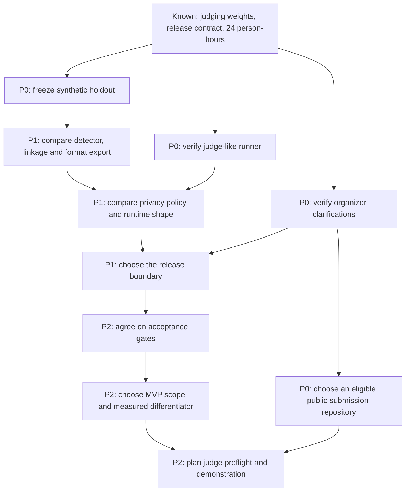
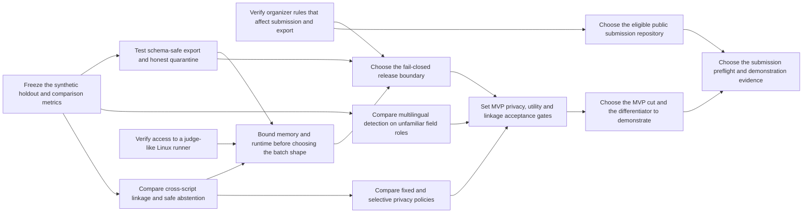
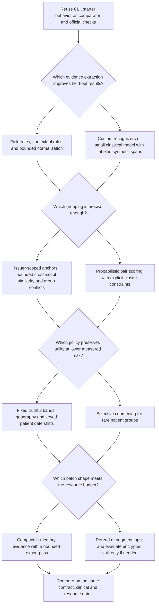
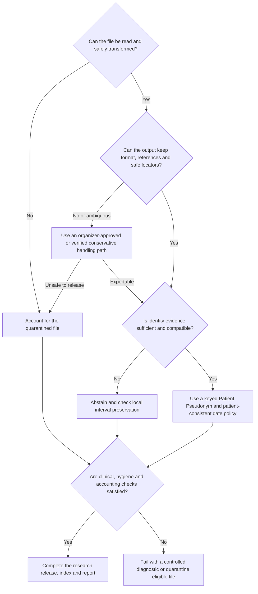
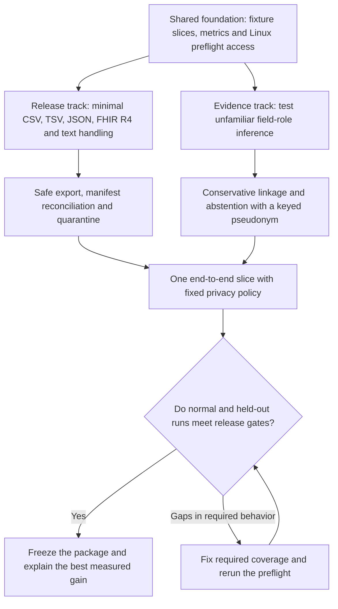

# Secret Wards Wayfinder diagrams

The [Secret Wards hackathon decision map](https://github.com/baymax-afk/scaler_hackthon/issues/1) is the canonical tracker. Its tickets carry the questions, ownership and current dependencies.

## Destination and first frontier

Plan a format-preserving **Research Release** that protects patient identities and keeps clinical facts useful on unfamiliar synthetic exports. The team has 24 total person-hours. One person owns ingestion, FHIR export and Linux packaging. The other owns multilingual detection and linkage evaluation. The team chose unfamiliar field-role inference as the first comparison. The showcase feature is still a decision. [Problem statement](PROBLEM_STATEMENT.md) · [Existing feasibility estimates](research/feasibility-analysis.md)

Privacy (25%), detection (20%), and clinical utility (20%) account for 65 points before penalties. Patient identity consistency (15%), integrity (10%), and reliability (10%) account for the rest. The kit reported `CONTRACT OK` on the starter while the practice checker observed 84.1% of annotated PII mentions still visible, all four Canary identities, and zero patient links. The organizers' reference scored 84.84 on standard normal data and 50.33 on standard unfamiliar-format data. These are two different baselines. [Scoring](SCORING.md) · [Starter measurements](research/codebase-overview.md#baseline-measured-in-this-checkout)

DevForge publishes an absolute code freeze at **09:00 IST on Friday, November 27, 2026**. The general rubric includes innovation, technical complexity, feasibility, impact and presentation, with shortlisted teams presenting live. Track 3 also requires a public event-created submission repository and a two-page brief. The configured planning repository is currently private and GitHub records its creation at 09:00:18 IST on Day 0. The eligibility of the starter import is open. Reserve time before the freeze for preflight on the commit the judges will receive. [DevForge rules](https://yugaantar.org/events/devforge) · [Track 3 requirements](PROBLEM_STATEMENT.md) · [Verify organizer rules that affect submission and export](https://github.com/baymax-afk/scaler_hackthon/issues/2)

| Status at charting | Decision or evidence |
| --- | --- |
| Already set | Synthetic-only data, offline CPU submission, format-preserving output, safe quarantine, repeatable keyed pseudonyms and safe abstention. The team prioritizes unfamiliar inputs and shared holdout evidence. |
| Ready now | Establish the holdout, verify access to a judge-like Linux runner, and select an eligible public submission repository. [Choose the eligible public submission repository](https://github.com/baymax-afk/scaler_hackthon/issues/14) |
| Blocked | Prototype conclusions depend on common fixtures. The release boundary depends on export and runtime evidence. The differentiator and submission plan depend on acceptance gates and comparative results. |
| Requires investigation | Exact organizer behavior for PII-bearing locators, permissible pseudonym placement and multi-patient Bundles; submission repository eligibility and any Track 3-specific live judging instructions; tool setup and measured benefit; performance on realistic skew and unfamiliar formats. |

The contract requires an input JSON locator in the index and also scans that index for identifying information. It requires a Patient Pseudonym in the record while limiting schema changes. Test both conflicts on synthetic fixtures. The problem statement and fairness guide use a per-dataset ranking margin, while the scoring guide describes a paired-significance rule. Use the documented 900 s cap for planning even though the scoring configuration lists 1,800 s for the large profile. [Submission contract](SPEC.md) · [Open organizer questions](research/open-questions.md)

| Decision type | Resolution skill or workflow |
| --- | --- |
| Research | Use Research to seek new first-party guidance. |
| Grilling | Use Grilling with Domain Modeling to settle team trade-offs and record durable terms or decisions. |
| Prototype | Use Prototype for a throwaway comparison with a measured result and a team verdict. |
| Task | Use the Wayfinder task workflow for shared fixtures and runner access. Use Wizard only if runner access requires manual provisioning the agent cannot perform. |

## Overall decision map

## Native blocking dependencies

Arrows point from prerequisites to the decisions they unlock. The export test can probe documented cases and expose ambiguous ones while organizer research is underway.

## Alternative solution pathways

Mix and compare components on the same unseen synthetic patients, schemas and note templates. Candidate library versions and setup costs are documented in the research. [Technology survey](research/tools-and-technologies.md) · [Feasibility comparison](research/feasibility-analysis.md)

The first comparison starts with contextual field-role rules and asks whether additional evidence improves recall without erasing protected clinical spans. The team can use deterministic transliteration and fuzzy matching helpers for bounded linkage comparisons. Any learned model needs synthetic labels, a patient- and template-disjoint holdout, declared provenance and offline packaging. OCR, additional libraries and adaptive policies have to earn their time through measured benefit. [Technical candidates](research/tools-and-technologies.md) · [Evaluation plan](research/feasibility-analysis.md#experiments-for-the-prototype-phase)

## Critical decision points

Test the conflicts that change these choices: ambiguous dates, reused hospital IDs, homonyms and shared contacts, duplicate hashes, colliding keys, FHIR reference rewrites, and unsupported payloads. Pair a zero-observed-Canary-escape gate with held-out clinical retention, precision and risk measures. Confirm the conservative handling of disputed cases after the organizer review. [Edge-case matrix](research/outliers-and-edge-cases.md) · [Execution and output contract](SPEC.md)

## Shortest candidate path to a working MVP

Use the previous budget estimate as a planning ceiling. A provisional allocation is 3 person-hours for shared fixtures and runner access, 5 for release and format handling, 5 for detection and linkage comparisons, 5 for policy and remaining compatibility, and 6 for integration, verification and the brief. Test a small end-to-end slice early, then widen to all required formats. The estimate needs evidence from the first slice. The official limits are 2 CPUs, 4 GB process-tree RSS and a 900 s run. Use the standard full-credit markers of 60 s and 512 MB as comparison points. [Budget basis](research/feasibility-analysis.md#packaging-and-budget) · [Scoring targets](SCORING.md#6-cpu-efficiency--reliability-10)

For the brief, pair a reproducible practice run with the unfamiliar-input comparison. Report privacy proxies, exact clinical preservation, false merges, quarantine coverage and resource usage with their denominators. Prepare a short live command-line run on a synthetic fixture if shortlisted. The local checkers cover only some of the official behavior. Add independent R4/reference, per-file accounting, channel, changed-secret and read-only input checks during the later preflight. [Project Brief requirements](PROJECT_BRIEF.md) · [Toolkit limitations](research/codebase-overview.md#baseline-measured-in-this-checkout)
