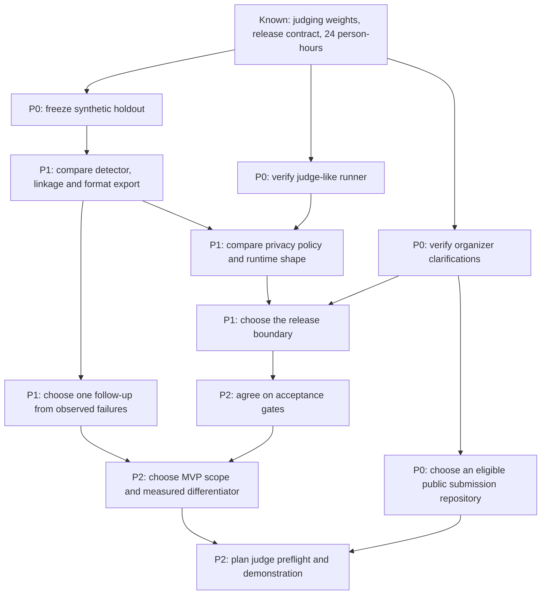
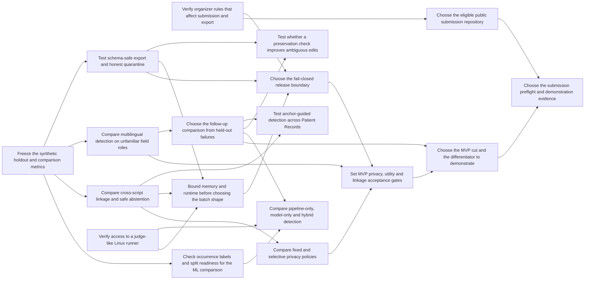
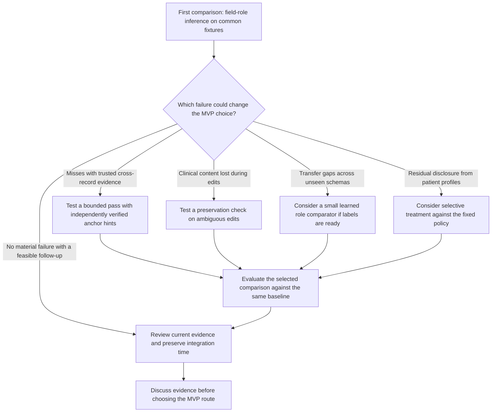
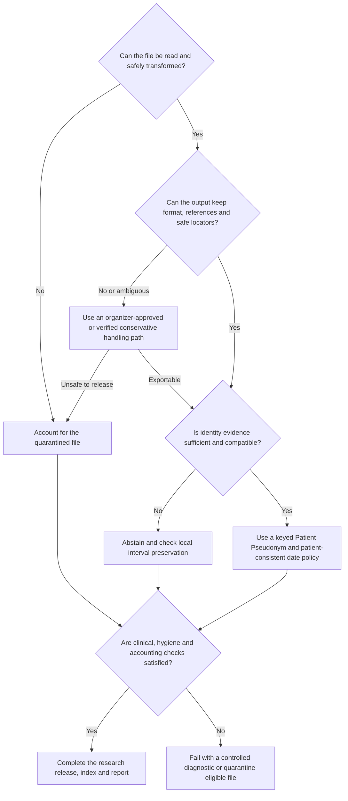
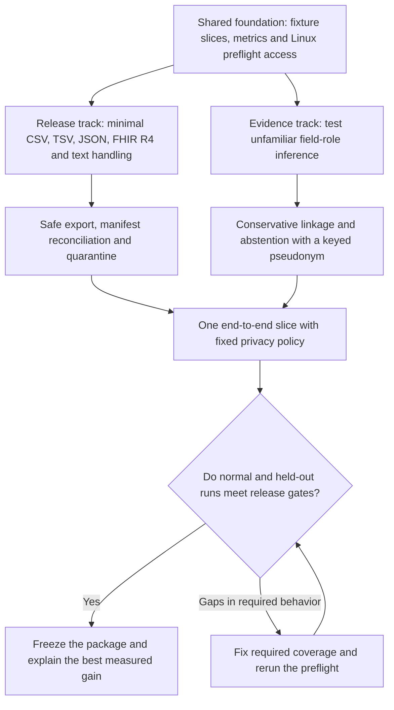

# Secret Wards Wayfinder diagrams

The [Secret Wards hackathon decision map](https://github.com/baymax-afk/scaler_hackthon/issues/1) is the canonical tracker. Its tickets carry the questions, ownership and current dependencies.

## Phase A handoff

The team selected Candidate A for the first implementation path. Phase A uses existing synthetic inputs while Developer B improves the dataset. The improved corpus gates independent model training in Phase B. Score integration and the paired comparison follow in Phases C and D. The regex work can qualify on its own. [Refined candidate](research/candidate-pipelines.md#proposed-phase-a-detection-flow)

The next decisions are developer capacity and ownership, the original-source finding interface, and approval of the preliminary experiments. The first comparison remains [unfamiliar field-role inference](https://github.com/baymax-afk/scaler_hackthon/issues/6). Shared fixtures and runner access still affect the strength of its evidence. The previous single 90-person-minute follow-up limit remains a planning constraint until the team confirms when the later phases fit. The integrated Phase A package passed the format check on both public development corpora. Practice leaks, held-out quality and release readiness remain open. [Validation evidence](research/regex-phase-a-validation.md) [Development plan](development-plan.md) · [Developer B handoff](developer-b-handoff.md)

## Destination and first frontier

Plan a format-preserving **Research Release** that protects patient identities and keeps clinical facts useful on unfamiliar synthetic exports. The team has 24 total person-hours. One person owns ingestion, FHIR export and Linux packaging. The other owns multilingual detection and linkage evaluation. The team chose unfamiliar field-role inference as the first comparison. The showcase feature is still a decision. [Problem statement](PROBLEM_STATEMENT.md) · [Existing feasibility estimates](research/feasibility-analysis.md)

Privacy (25%), detection (20%), and clinical utility (20%) account for 65 points before penalties. Patient identity consistency (15%), integrity (10%), and reliability (10%) account for the rest. The kit reported `CONTRACT OK` on the starter while the practice checker observed 84.1% of annotated PII mentions still visible, all four Canary identities, and zero patient links. The organizers' reference scored 84.84 on standard normal data and 50.33 on standard unfamiliar-format data. These are two different baselines. [Scoring](SCORING.md) · [Starter measurements](research/codebase-overview.md#baseline-measured-in-this-checkout)

DevForge publishes an absolute code freeze at **09:00 IST on Friday, November 27, 2026**. The general rubric includes innovation, technical complexity, feasibility, impact and presentation, with shortlisted teams presenting live. Track 3 also requires a public event-created submission repository and a two-page brief. The configured planning repository is currently private and GitHub records its creation at 09:00:18 IST on Day 0. The eligibility of the starter import is open. Reserve time before the freeze for preflight on the commit the judges will receive. [DevForge rules](https://yugaantar.org/events/devforge) · [Track 3 requirements](PROBLEM_STATEMENT.md) · [Verify organizer rules that affect submission and export](https://github.com/baymax-afk/scaler_hackthon/issues/2)

| Status at charting | Decision or evidence |
| --- | --- |
| Already set | Synthetic-only data, offline CPU submission, format-preserving output, safe quarantine, repeatable keyed pseudonyms and safe abstention. The team prioritizes unfamiliar inputs and shared holdout evidence. |
| Ready now | Establish the holdout, verify access to a judge-like Linux runner, and select an eligible public submission repository. [Choose the eligible public submission repository](https://github.com/baymax-afk/scaler_hackthon/issues/14) |
| Blocked | Prototype conclusions depend on common fixtures. The release boundary depends on export and runtime evidence. The differentiator and submission plan depend on acceptance gates and comparative results. |
| Requires investigation | Exact organizer behavior for PII-bearing locators, permissible pseudonym placement and multi-patient Bundles; submission repository eligibility and any Track 3-specific live judging instructions; tool setup and measured benefit; performance on realistic skew and unfamiliar formats. |

The contract requires an input JSON locator in the index and also scans that index for identifying information. It requires a Patient Pseudonym in the record while limiting schema changes. Test both conflicts on synthetic fixtures. The problem statement and fairness guide use a per-dataset ranking margin, while the scoring guide describes a paired-significance rule. Use the documented 900 s cap for planning even though the scoring configuration lists 1,800 s for the large profile. [Submission contract](SPEC.md) · [Open organizer questions](research/open-questions.md)

| Decision type | Resolution skill or workflow |
| --- | --- |
| Research | Use Research to seek new first-party guidance. |
| Grilling | Use Grilling with Domain Modeling to settle team trade-offs and record durable terms or decisions. |
| Prototype | Use Prototype for a throwaway comparison with a measured result and a team verdict. |
| Task | Use the Wayfinder task workflow for shared fixtures and runner access. Use Wizard only if runner access requires manual provisioning the agent cannot perform. |

## Overall decision map

## Native blocking dependencies

Arrows point from prerequisites to the decisions they unlock. The export test can probe documented cases and expose ambiguous ones while organizer research is underway.

## Alternative solution pathways

Each route puts a different source of evidence first. All viable routes still have to produce a complete Research Release in the original formats. Effort and performance are planning estimates. The prototype ranges cover narrow comparisons after fixtures exist, and the follow-up budget covers a smaller experiment. All viable routes use local CPU, so the relevant costs are annotation, dependencies, extra passes, memory, and time taken from integration. [Output contract](SPEC.md#4-output-layout) · [Feasibility estimates](research/feasibility-analysis.md) · [Toolkit overview](research/codebase-overview.md)

| Approach | Innovation and fit with the toolkit | Effort, performance and scaling | Uncertainty that could change the choice |
| --- | --- | --- | --- |
| Context-first editing | Infer field roles from labels, values and neighboring context, then run linkage and export. Strong fit with the starter’s per-format handlers and source-preserving edits. Innovation comes from generalizing to unseen labels and names. | Lowest initial effort. The prior estimate is 2–4 person-hours for a focused comparison. Bounded local scans have modest expected memory use. Rules and exceptions add coverage and maintenance cost as formats diversify. | Do unfamiliar labels and mixed-script values still leak, and do value-shape cues mistake treatments for identifiers? |
| Patient-first identity evidence | Start from trusted links across exports and use cross-record consistency to suggest missing identity evidence. This can recover unlabeled aliases and fragmented records. The starter’s linkage stub leaves this architecture with more integration work. | Medium to high integration effort. The prior estimate for the linkage comparison alone is 3–5 hours. Compact indexes can bound typical candidate work, while common names and shared contacts can create large blocks. Raw evidence increases memory and handling costs. | Does the extra evidence recover more legitimate detections than it creates incorrect edits or False Merges? Can it help people with only one record? |
| Model-first role recognition | Learn roles or spans from synthetic examples using a sparse classifier or CRF. Better transfer across varied text or labels would differentiate it. Reuse format handlers and evaluation tooling through a span interface. | High upfront effort. The prior narrow-CRF estimate is 6–10 person-hours after labels exist. Expected inference cost is lower than the annotation, packaging and calibration cost. A limited follow-up depends on reusable labels and features. | Does transfer hold on both patient- and template-disjoint samples? A model that generalizes to new names can still memorize note layouts. |
| Clinical-preservation-first | Identify the observations and fields that must survive and use that evidence to review uncertain edits. A positive check can give integrity evidence beyond a leak score. The starter offers parsers and practice probes, but no reusable clinical span validator. | Medium effort for a narrow check, high for rebuild-by-allowlist across all formats. Applying it only to ambiguous edits limits runtime; reconstructing notes or FHIR carries greater schema, coverage and validation costs. | Can a check protect exact doses and diagnoses while still removing identifiers embedded in plausible clinical fields? What happens to coverage when the two checks disagree? |
| Release-risk-first | Compare fixed and selective policy against patient-level disclosure and clinical retention across the full release. This addresses rare combinations left by identifier removal. Existing date and age helpers offer examples for a fixed baseline. | Medium to high effort. The prior estimate is 2–4 hours for fixed transformations and 4–7 hours for a selective comparison. Counting patient groups on a few approved fields can scale; repeated policy evaluation adds passes and grouping memory. | Does selective treatment reduce measured risk at comparable coverage and exact temporal utility, given uncertainty in patient grouping? |

Two hybrids merit a bounded comparison. A **contextual detector plus anchor hints** can look for recurring misses where independent patient evidence already exists. A **contextual detector plus a preservation check** can focus extra work on ambiguous edits. The same clinical token can appear in a sensitive context. Test a clinician and patient sharing a name, and a clinical field containing an identifier. Compare the same input and base detector with the proposed addition off and on. [Edge cases](research/outliers-and-edge-cases.md)

Evidence is sufficient to drop hosted inference, aggregate-only releases, query enclaves, and an output rewrite into a single canonical format. The runner and release contract exclude those options. The published all-redaction baseline scored roughly 22/100 across the reported profiles, which rules out blanket redaction as the submission strategy. Selective clinical protection, internal normalization, and patient-level risk measures remain candidates. [Runner and output contract](SPEC.md) · [Published calibration](SCORING.md#calibration)

Reuse the [Secret Wards Blind fixtures](datasets/README.md) alongside organizer practice data. Keep truth out of runtime and reserve whole patients and templates for comparison. Evaluate identifier and Canary observations, exact clinical spans and input-based retention, False Merges, and incremental CPU/RSS. Use a common comparator even when a candidate changes which files are quarantined. [Evaluation plan](research/feasibility-analysis.md#experiments-for-the-prototype-phase)

The team selected one follow-up capped at **90 person-minutes**, chosen by the first comparison’s failure pattern. The Grilling decision controls which route to test. The chosen comparison becomes a prerequisite for the MVP cut. The ML branch needs independent occurrence labels and a fair comparison of pipeline-only, model-only and hybrid detection. The adaptive policy remains available through its existing ticket. [Choose the follow-up comparison from held-out failures](https://github.com/baymax-afk/scaler_hackthon/issues/16) · [Compare multilingual detection on unfamiliar field roles](https://github.com/baymax-afk/scaler_hackthon/issues/6) · [Compare fixed and selective privacy policies](https://github.com/baymax-afk/scaler_hackthon/issues/8) · [Dedicated ML detector and score fusion](research/candidate-pipelines.md#dedicated-ml-detector-and-score-fusion)

The two new Prototype tickets specify comparisons with the proposed addition off and on. [Test anchor-guided detection across Patient Records](https://github.com/baymax-afk/scaler_hackthon/issues/17) · [Test whether a preservation check improves ambiguous edits](https://github.com/baymax-afk/scaler_hackthon/issues/18)

## Critical decision points

Test the conflicts that change these choices: ambiguous dates, reused hospital IDs, homonyms and shared contacts, duplicate hashes, colliding keys, FHIR reference rewrites, and unsupported payloads. Pair a zero-observed-Canary-escape gate with held-out clinical retention, precision and risk measures. Confirm the conservative handling of disputed cases after the organizer review. [Edge-case matrix](research/outliers-and-edge-cases.md) · [Execution and output contract](SPEC.md)

## Shortest candidate path to a working MVP

Use the previous budget estimate as a planning ceiling. A provisional allocation is 3 person-hours for shared fixtures and runner access, 5 for release and format handling, 5 for detection and linkage comparisons, 5 for policy and remaining compatibility, and 6 for integration, verification and the brief. Test a small end-to-end slice early, then widen to all required formats. The estimate needs evidence from the first slice. The official limits are 2 CPUs, 4 GB process-tree RSS and a 900 s run. Use the standard full-credit markers of 60 s and 512 MB as comparison points. [Budget basis](research/feasibility-analysis.md#packaging-and-budget) · [Scoring targets](SCORING.md#6-cpu-efficiency--reliability-10)

For the brief, pair a reproducible practice run with the unfamiliar-input comparison. Report privacy proxies, exact clinical preservation, false merges, quarantine coverage and resource usage with their denominators. Prepare a short live command-line run on a synthetic fixture if shortlisted. The local checkers cover only some of the official behavior. Add independent R4/reference, per-file accounting, channel, changed-secret and read-only input checks during the later preflight. [Project Brief requirements](PROJECT_BRIEF.md) · [Toolkit limitations](research/codebase-overview.md#baseline-measured-in-this-checkout)

## Version 2 decision frontier

Keep the format-preserving, offline CPU baseline and the field-role-first investigation. The existing public fixtures are regressions because their templates influenced Phase A. The evidence reopens holdout independence, the release boundary and acceptance gates. Linkage and temporal policy remain unresolved capabilities. [V1 evidence](research/generalization-analysis.md)

| Existing decision | Evidence and next step |
| --- | --- |
| [Choose the fail-closed release boundary](https://github.com/baymax-afk/scaler_hackthon/issues/10) | Keep in the release-policy frontier. Confirmed encoding, FHIR and index gaps affect whether outputs can be released safely. Agree what qualifies as a safe, counted file before changing runtime. |
| [Test schema-safe export and honest quarantine](https://github.com/baymax-afk/scaler_hackthon/issues/5) | Use the confirmed defects to narrow the existing safety prototype and establish the CLI test seam. |
| [Freeze the synthetic holdout and comparison metrics](https://github.com/baymax-afk/scaler_hackthon/issues/3) | Run in parallel. Agree independent sealed ownership, patient/family/institution groups and adjudication before threshold tuning. |
| [Compare multilingual detection on unfamiliar field roles](https://github.com/baymax-afk/scaler_hackthon/issues/6) | Retain this as the primary detection experiment. Practice trace supports the candidate-coverage focus and changes which slices deserve support. |
| [Compare cross-script linkage and safe abstention](https://github.com/baymax-afk/scaler_hackthon/issues/7) and [Compare fixed and selective privacy policies](https://github.com/baymax-afk/scaler_hackthon/issues/8) | Obtain independent linkability fixtures before testing anchor, bridge and temporal decisions. Patient Pseudonym placement and eligible submission target remain open. |
| [Choose the follow-up comparison from held-out failures](https://github.com/baymax-afk/scaler_hackthon/issues/16) and [Set MVP privacy, utility and linkage acceptance gates](https://github.com/baymax-afk/scaler_hackthon/issues/11) | Select one follow-up from newly discriminating evidence. Compare supported coverage, clinical preservation, safe abstention and cost before the MVP decision. |

The tracker remains canonical. This evidence update records proposals against its existing open decisions. [Version 2 decision proposal](research/version-2-improvement-plan.md)

## Generalization evidence checkpoint

The same-surface clinical counterexample and annotation leakage reopen [Freeze the synthetic holdout and comparison metrics](https://github.com/baymax-afk/scaler_hackthon/issues/3) and [Set MVP privacy, utility and linkage acceptance gates](https://github.com/baymax-afk/scaler_hackthon/issues/11). The first proposal for discussion is an independent evaluator gate on candidate acceptance and threshold tuning. A can prepare open-fixture [unfamiliar field-role comparisons](https://github.com/baymax-afk/scaler_hackthon/issues/6) in parallel. Include Unicode offsets and route clinical-boundary conflicts through the existing [preservation comparison](https://github.com/baymax-afk/scaler_hackthon/issues/18). Use the existing Developer B evidence issues for [neutral inputs](https://github.com/baymax-afk/scaler_hackthon/issues/21), [role-aware outcomes](https://github.com/baymax-afk/scaler_hackthon/issues/22) and [release reconciliation](https://github.com/baymax-afk/scaler_hackthon/issues/23). Keep learned and hybrid experiments conditional on the earlier [occurrence-label readiness](https://github.com/baymax-afk/scaler_hackthon/issues/19) and [follow-up selection](https://github.com/baymax-afk/scaler_hackthon/issues/16) decisions. The format-preserving, offline and sealed-custody decisions still stand. [Proposed solution and experiments](research/generalization-solution-plan.md)
